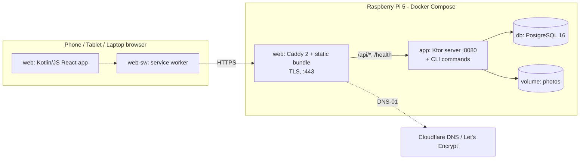

# 001 – Recipe app MVP: design

- Requirements: docs/requirements/001-recipe-app-mvp.md
- Status: Designed – ready for implementation
- Date: 2026-09-19
- Architecture: docs/architecture/overview.md

## Summary
A private recipe app for one household. It runs as three Docker containers on Viktor's Raspberry Pi 5 (4 GB, arm64): Caddy serves the web app and terminates HTTPS, a Ktor (Kotlin/JVM) server provides a JSON API, and PostgreSQL stores the data. The client is a single installable web app (PWA) written in Kotlin/JS with React. It serves phones, tablets and laptops. A Kotlin/JS service worker caches every recipe a device has opened, so the recipe view, scaling and cooking mode work offline. Scaling, amount parsing and validation live in a shared Kotlin module used by both server and client. Access is username/password with long-lived sessions, and new members join through one-time invitation links from Viktor. The 8 existing Markdown recipes are imported once by a CLI command of the server.

## Drivers and constraints
| Driver | Source | In numbers | How the design meets it | Verified by |
|---|---|---|---|---|
| Everything dockerised on a Raspberry Pi 5, 4 GB RAM | SC2 | linux/arm64. Memory limits: web 128 MB + app 896 MB + db 512 MB = 1536 MB, which leaves 2560 MB for OS (~400 MB), Docker, page cache and the backup job | 3 containers, fixed `mem_limit`, JVM flags (ADR 0004), tuned PostgreSQL (ADR 0003), images built off-device | T-ARCH-1, T-MEM-1 |
| ≥ 10 concurrent users, not noticeably slower | SC2, QE8 | 1 active user ≈ 1 list + 1 recipe + 1 photo per 10 s = 0.3 req/s → 10 users = 3 req/s. Design target 10× = 30 req/s. p95 < 300 ms for GET, < 1000 ms for save | Stateless API, 5 DB connections, recipe list is one query, photos streamed from disk, static files from Caddy | T-LOAD-1 |
| Written in Kotlin | SC1 | 100 % of hand-written product code in Kotlin (server, web, service worker, shared, E2E tests) | ADR 0001 | Build: no `.js`/`.ts` sources under `server/`, `shared/`, `web/src`, `web-sw/src` (T-LANG-1, a Gradle check task) |
| Recipes opened before work offline incl. photo, scaling, cooking mode | S10, QE4, R9 | API fallback to cache after 4 s. Photos cache-first. Cache size ≤ (recipes × ~400 KB) ≈ 80 MB at 200 recipes | Service worker (ADR 0002), scaling in client code | E2E-OFFLINE |
| Screen stays on in cooking mode | S6, QE3 | Screen stays on for ≥ 5 min without touch | Screen Wake Lock API plus a silent looping video as fallback. Needs HTTPS (ADR 0005) | E2E-COOK (API call), M-1 (real devices) |
| Private to household | R1, QE5 | 0 recipe bytes without a valid session | Every `/api` route except auth/invitation requires a session. LAN-only (ADR 0005, 0006) | A-ACCESS |
| Poor kitchen Wi-Fi | QE4, R9 | Mutations time out after 15 s. Reads fall back to cache after 4 s | Timeouts, draft persistence, offline messages | E2E-OFFLINE, E2E-EDITOR |
| Existing data: 8 inconsistent Markdown files | S11 | Exactly 8 recipes, 68 ingredients, 19 with amounts (table in R10) | Line-based parser, golden tests with copies of the real files (ADR 0007) | I-GOLDEN |

## Decisions
- Stack: Kotlin 2.x, Ktor 3.x (Netty) server, Kotlin/JS + React (kotlin-wrappers), shared Kotlin Multiplatform module (ADR 0001). Versions: the latest stable release in these major lines at implementation start, pinned in `gradle/libs.versions.toml`.
- Offline: PWA service worker, network-first with a 4 s timeout for recipe GETs, cache-first for photos (ADR 0002).
- Database: PostgreSQL 16 (ADR 0003). Access via Exposed (DSL, not DAO) with HikariCP (pool size 5). Migrations via Flyway.
- Deployment: 3 containers with fixed memory limits, arm64 images built off-device (ADR 0004).
- HTTPS on the LAN: Caddy with a Let's Encrypt certificate via DNS-01 at Cloudflare, no internet exposure (ADR 0005).
- Auth: username/password (bcrypt, cost 11), 180-day server-side sessions, invitation links (ADR 0006).
- Import: CLI subcommand, line-based parser, one transaction, runs once (ADR 0007).
- Recipe aggregate: ingredients and sections are stored as JSONB columns on `recipes`. A recipe is always read and written as a whole, so child tables would only add diffing code.
- Categories: no table. A category is the `category` string of the recipes that use it, so "exists only while used" (R4) holds by construction.
- Photos: resized in the browser to JPEG with at most 1600 px on the long edge and quality 0.85 (this also strips EXIF/GPS). Stored as files on a Docker volume and served only through the authenticated API. Reason: browsers decode every format the phone produces (incl. HEIC on iOS), and the Pi does no image processing.
- Search: client-side substring filter over the loaded list. It is instant and works offline, and the list is small (≤ a few hundred titles).
- Live updates: none. Clients fetch the list when it is shown and when the app returns to the foreground (`visibilitychange`). No requirement asks for push.
- One household per installation. There is no household entity.

## Components



| Component | Responsibility | Code |
|---|---|---|
| `shared` | DTOs (kotlinx.serialization), `Amount` (parse/format), `Scaling` (R5/R6), `RecipeValidation`, `CategoryName.normalize` | `shared/src/commonMain/kotlin/rezepte/shared/` |
| `server` | Ktor API (auth, invitations, members, recipes, photos), Flyway migrations, background jobs, CLI commands (`create-founder`, `reset-password`, `import`) | `server/src/main/kotlin/rezepte/server/` |
| `web` | React single-page app: all screens, API client, draft storage, wake lock, photo resizing, service worker registration | `web/src/jsMain/kotlin/rezepte/web/`, static files in `web/src/jsMain/resources/` |
| `web-sw` | Service worker `sw.js`: shell precache, API/photo caching | `web-sw/src/jsMain/kotlin/rezepte/sw/` |
| `web` container | Caddy: TLS, serves static bundle with SPA fallback, reverse proxy `/api/*` and `/health` to `app:8080`, security headers | `deploy/Caddyfile`, `deploy/Dockerfile.web` |
| `e2e` | Playwright (Java API, Kotlin + JUnit 5) end-to-end tests | `e2e/src/test/kotlin/` |

Server packages: `auth` (login, sessions, throttling, Origin check), `members` (invitations, resets, member list), `recipes` (routes, repository, service with owner checks and category resolution), `photos` (storage, validation, streaming), `importer` (parser, command), `jobs` (cleanup), `cli` (dispatch in `Main.kt`: no args → server, otherwise the subcommand).

## Data model

Flyway migration `V1__init.sql`. All timestamps are `timestamptz`, stored in UTC. IDs are UUIDs generated by the server (`UUID.randomUUID()`).

**users**: one row per household member.
| Field | Type | Null | Constraints |
|---|---|---|---|
| id | uuid | no | PK |
| username | varchar(32) | no | unique. Stored lowercase. Pattern `^[a-z0-9._-]{3,32}$` |
| display_name | varchar(50) | no | trimmed, 1–50 chars |
| password_hash | varchar(100) | no | bcrypt, cost 11 |
| is_founder | boolean | no | default false. Partial unique index `ON users(is_founder) WHERE is_founder` → at most one founder |
| created_at | timestamptz | no | default now() |

**sessions**
| Field | Type | Null | Constraints |
|---|---|---|---|
| token_hash | char(64) | no | PK, hex SHA-256 of the cookie token |
| user_id | uuid | no | FK users ON DELETE CASCADE, index |
| created_at, last_seen_at | timestamptz | no | |
| expires_at | timestamptz | no | index. = last_seen_at + 180 days. Updated when a request arrives and `last_seen_at` is older than 24 h |

**invitations**: invitation, founder and password-reset links.
| Field | Type | Null | Constraints |
|---|---|---|---|
| id | uuid | no | PK |
| token_hash | char(64) | no | unique |
| kind | varchar(16) | no | CHECK in (`FOUNDER`, `INVITE`, `PASSWORD_RESET`) |
| created_by | uuid | yes | FK users. NULL when created by CLI |
| target_user_id | uuid | yes | FK users ON DELETE CASCADE. Required for `PASSWORD_RESET`, else NULL (CHECK) |
| created_at | timestamptz | no | |
| expires_at | timestamptz | no | INVITE/PASSWORD_RESET: +7 days. FOUNDER: +24 h |
| used_at | timestamptz | yes | set on use. A used link is invalid |

**recipes**
| Field | Type | Null | Constraints |
|---|---|---|---|
| id | uuid | no | PK |
| owner_id | uuid | no | FK users ON DELETE RESTRICT, index |
| title | varchar(200) | no | trimmed, 1–200 |
| category | varchar(60) | no | normalized (R4), 1–60. Index on `lower(category)` |
| servings | smallint | yes | CHECK 1–99 |
| ingredients | jsonb | no | array of `{"amount": string\|null, "unit": string\|null, "name": string}` |
| sections | jsonb | no | array of `{"name": string\|null, "steps": [string]}` |
| photo_id | uuid | yes | unique. File `/data/photos/<photo_id>.jpg` |
| version | integer | no | default 0, +1 on every update (optimistic locking) |
| created_at, updated_at | timestamptz | no | |

JSON content rules (enforced by `RecipeValidation` in `shared` on client and server):
- `amount`: canonical decimal string with a dot, e.g. `"250"`, `"1.5"`. It is > 0, ≤ 99999 and has at most 3 decimals. A `unit` requires an `amount`.
- `unit`: trimmed, 1–20 chars, free text (e.g. `g`, `EL`, `L`).
- `name`: trimmed, 1–200 chars.
- ingredients: 1–100 entries, order = display order.
- sections: 1–30. Only the first may have `name: null` (steps before any heading). Named: trimmed 1–100 chars. Each section has 1–100 steps. Step text is trimmed, 1–4000 chars, and may contain `\n`. At most 200 steps in total.

**app_meta**: `key varchar(64) PK, value text not null, updated_at timestamptz`. Used for `import.completedAt`.

Visibility and ownership: every row in `recipes` is visible to every user (R1). Only `owner_id` may update or delete (R2). There is no member deletion in the MVP, so `ON DELETE RESTRICT` never fires in practice.

## Interfaces

### API conventions
- Base path `/api`, JSON (UTF-8). Dates are ISO-8601 UTC.
- Auth: cookie `rezepte_session`. Routes marked "member" return `401 UNAUTHENTICATED` without a valid session, with no data in the body.
- Mutating methods (POST/PUT/DELETE) need `Origin: https://$PUBLIC_HOST`, otherwise `403 FORBIDDEN_ORIGIN`.
- Error format (every non-2xx): `{"error": {"code": "NOT_OWNER", "message": "<German text>", "fields": [{"path": "ingredients[2].amount", "code": "AMOUNT_INVALID"}]}}`. `fields` appears only for `VALIDATION`. The UI shows the text mapped from `code` (table in "User interface").
- Unknown errors: `500 INTERNAL` and a log entry with the call ID.

### Endpoints
| Method, path | Who | Request | Response | Errors |
|---|---|---|---|---|
| POST /api/auth/login | public | `{username, password}` | 204 + Set-Cookie | 401 INVALID_CREDENTIALS, 429 TOO_MANY_ATTEMPTS, 422 VALIDATION |
| POST /api/auth/logout | member | – | 204, cookie cleared, session row deleted | 401 |
| GET /api/me | member | – | `{id, username, displayName, isFounder}` | 401 |
| GET /api/invitations/{token} | public | – | `{kind: "FOUNDER"\|"INVITE"\|"PASSWORD_RESET", username: string\|null, expiresAt}` (username only for reset) | 404 INVITATION_INVALID (unknown, used or expired: same answer) |
| POST /api/invitations/{token}/accept | public | FOUNDER/INVITE: `{displayName, username, password}`. RESET: `{password}` | 204 + Set-Cookie (logged in). RESET also deletes all other sessions of that user | 404 INVITATION_INVALID, 409 USERNAME_TAKEN, 422 VALIDATION (password 8–128 chars, username pattern, displayName 1–50) |
| POST /api/invitations | founder | – | 201 `{url: "https://$PUBLIC_HOST/einladung/<token>", expiresAt}` | 401, 403 NOT_FOUNDER |
| GET /api/members | founder | – | `[{id, displayName, username, isFounder}]` sorted by displayName | 401, 403 NOT_FOUNDER |
| POST /api/members/{userId}/password-reset | founder | – | 201 `{url, expiresAt}` | 401, 403 NOT_FOUNDER, 404 NOT_FOUND |
| GET /api/recipes | member | – | `{recipes: [{id, title, category}]}`, unsorted (the client sorts) | 401 |
| GET /api/recipes/{id} | member | – | Recipe (below) | 401, 404 NOT_FOUND |
| POST /api/recipes | member | `multipart/form-data`: part `recipe` (JSON RecipeWrite), optional part `photo` (image/jpeg) | 201 Recipe | 401, 413 PHOTO_TOO_LARGE, 415 PHOTO_INVALID, 422 VALIDATION |
| PUT /api/recipes/{id} | owner | multipart: `recipe` (RecipeWrite + `version` + `photoAction`), optional `photo` | 200 Recipe | 401, 403 NOT_OWNER, 404, 409 VERSION_CONFLICT, 413, 415, 422 |
| DELETE /api/recipes/{id} | owner | – | 204 | 401, 403 NOT_OWNER, 404 |
| GET /api/photos/{photoId} | member | – | `image/jpeg`, `Cache-Control: private, max-age=31536000, immutable` | 401, 404 |
| GET /health | public | – | `{"status":"ok"}` after a `SELECT 1` | 503 if DB unreachable |

Recipe (response):
```json
{"id":"…","title":"Pute","category":"Hauptgerichte","servings":null,
 "ingredients":[{"amount":"250","unit":"g","name":"Hackfleisch"},{"amount":null,"unit":null,"name":"Salz"}],
 "sections":[{"name":"Füllung","steps":["Mett mit Hackfleisch mischen","…"]}],
 "photoUrl":"/api/photos/…"|null,"owner":{"id":"…","displayName":"Viktor"},
 "canEdit":true,"version":3,"updatedAt":"2026-09-19T10:00:00Z"}
```
`canEdit` = requesting user is the owner. The UI uses it only to show or hide controls. The server enforces R2 independently.

RecipeWrite: `{title, category, servings: int|null, ingredients, sections}`. The PUT additionally has `version: int` and `photoAction: "KEEP"|"REMOVE"|"REPLACE"`. `REPLACE` requires the `photo` part. On POST, the presence of `photo` means the recipe has a photo.

Photo handling on the server: `photo` part ≤ 3 MB (else 413). The first bytes must be `FF D8 FF` and ImageIO must read the dimensions as ≤ 2048 px per side (else 415). The server writes the upload to `/data/photos/.tmp/<uuid>`, then commits the DB transaction, then renames the file to `/data/photos/<uuid>.jpg`. If the DB write fails, the temp file is deleted. A replaced or removed photo's file is deleted after commit. Failures there are cleaned up by the job below. Caddy limits request bodies on `/api/recipes*` to 6 MB.

Update algorithm (PUT): validate → load recipe (404) → owner check (403) → resolve category (R4) → `UPDATE recipes SET … , version = version + 1 WHERE id = ? AND version = ?`. 0 rows → 409 VERSION_CONFLICT.

### Jobs (in-process coroutines in `app`, started at boot)
| Job | Trigger | What | Idempotency / missed runs |
|---|---|---|---|
| cleanup | 60 s after start, then every 24 h | delete sessions with `expires_at < now()`; delete invitations with `expires_at < now() - 30 days`; delete files in `/data/photos` (incl. `.tmp`) older than 1 h that no `recipes.photo_id` references | Pure deletes of expired or unreferenced things. Running twice is harmless. A missed run is covered by the next start |

### CLI commands (same image: `docker compose run --rm app <command>`)
| Command | Effect | Refuses when |
|---|---|---|
| `create-founder --username <u> --display-name <n>` | creates a FOUNDER invitation and prints its URL. Accepting it creates the user with `is_founder = true` | any user exists |
| `reset-password --username <u>` | creates a PASSWORD_RESET link for that user and prints it (for the founder himself) | user unknown |
| `import --source <dir> --owner <username> [--dry-run]` | R10 | owner unknown, `import.completedAt` set, parse error |

### External services
- Let's Encrypt + Cloudflare DNS API (via Caddy) for the TLS certificate only (ADR 0005). Renewal is automatic about 30 days before expiry. If it fails, Caddy retries with backoff while the existing cert stays valid, and the error appears in the `web` logs. Nothing in the app depends on internet access.

## Business rules

### R1 Visibility / S1
Every `/api/recipes*` and `/api/photos/*` route requires a session (Ktor `authenticate("session")` block around the whole route tree). Any valid session sees all recipes. The static web bundle contains no recipe data. Examples: no cookie → 401 with body `{"error":{"code":"UNAUTHENTICATED",…}}`. Expired session → 401. Member B's session → all recipes, including the ones imported for Viktor.

### R2 Ownership
Server: PUT and DELETE compare `recipes.owner_id` with the session user → `403 NOT_OWNER`. Client: "Bearbeiten" and "Löschen" are rendered only when `canEdit`. Owner on create = session user. Owner on import = the `--owner` user.

### R3 Recipe content
See data model and `RecipeValidation`. Required: title, category, ≥ 1 ingredient, ≥ 1 step. Optional: servings, amounts/units, section names, photo. There is no source field.

### R4 Categories
`CategoryName.normalize(input)`: Unicode NFC → trim → collapse runs of whitespace to one space. Empty → VALIDATION `CATEGORY_REQUIRED`.
Resolution on save (server): if another recipe (id ≠ current) has a category equal to the normalized input ignoring case (`lower(category) = lower(:c)`), use that recipe's spelling. Otherwise store the input as normalized.
Category list = distinct `category` over all recipes, derived by the client from `GET /api/recipes`. So an unused category disappears without any extra code.
Sorting: categories and titles use `localeCompare(other, "de", {sensitivity: "base"})`.
Examples: existing "Hauptgerichte", input " hauptgerichte " → "Hauptgerichte". No existing match, input "Desserts" → new category "Desserts". Last recipe in "Soßen" deleted → "Soßen" no longer in the list. The owner renames the only "Beilage" recipe's category to "Beilagen", which already exists → it joins "Beilagen".

### R5 Scaling and R6 Rounding (`shared/Scaling.kt`, pure function, used only by the client)
Amounts are held as `Amount(milli: Long)` (value × 1000) to avoid floating point.
- Offered only if `recipe.servings != null`. Chosen servings: integer 1–99, stepper "−"/"+", initial value = `recipe.servings`, kept only in the component state of the open recipe view. It resets when the recipe is opened again and is never sent to the server.
- If chosen == recipe.servings: show the stored amounts unchanged (`Amount.formatGerman`, up to 3 decimals, no trailing zeros).
- Else, per ingredient with an amount: `tenths = roundHalfUp(milli × chosen × 10 / (servings × 1000))`, integer arithmetic: `num = milli × chosen`, `den = servings × 100`, `tenths = (2·num + den) / (2·den)`. Display: `tenths / 10` with a comma, and ",0" dropped (`15` → "1,5", `20` → "2"). If `tenths == 0` → display "< 0,1".
- Ingredients without an amount, units, names and step texts are never changed.
- German number format: comma decimal separator, no thousands grouping ("1125 g").

| Stored | Servings | Chosen | Shown |
|---|---|---|---|
| 250 g Hackfleisch | 4 | 6 | 375 g Hackfleisch |
| 2 eier | 4 | 3 | 1,5 eier |
| 1,5 L Rinderbrühe | 4 | 6 | 2,3 L (2,25 → half-up) |
| 30 ml Pflanzenöl | 4 | 1 | 7,5 ml |
| 1 EL Senf | 3 | 2 | 0,7 EL (0,666…) |
| 900 g Kartoffeln | 4 | 5 | 1125 g |
| 1 Ei | 4 | 3 | 0,8 (0,75 → half-up) |
| 0,1 TL | 4 | 1 | < 0,1 TL (0,025) |
| 0,125 l | 4 | 4 | 0,125 l (unchanged) |
| Salz (no amount) | 4 | 6 | Salz |
| step "0,5 l Wasser" | 4 | 6 | "0,5 l Wasser" |
| servings null | – | – | no stepper shown |

### Amount input (`Amount.parse`, shared)
Accepts `^\s*\d{1,5}([.,]\d{1,3})?\s*$`. Comma and dot are both decimal separators. The value must be > 0. Otherwise VALIDATION `AMOUNT_INVALID` with the UI text "Menge bitte als Zahl angeben, z. B. 1,5". Examples: "1,5" → 1.5, "0.125" → 0.125, "250" → 250, "1/2" → invalid, "0" → invalid, "1.000,5" → invalid.

### R7 Sections
The API stores sections in order. Recipe view: an unnamed first section is rendered without a heading. Named sections get a heading, and their steps are numbered starting at 1 within each section (as in the source files). Cooking mode shows the section name of the current step above it.

### R9 Connection
- Reads: see ADR 0002 and "Offline behaviour" below.
- Writes (create, edit, delete, login, invitation): the client uses `fetch` with a 15 s timeout (AbortController). It treats as "no connection": a `TypeError` from fetch, a timeout, the synthetic SW response `503 OFFLINE`, or `navigator.onLine == false` before sending (in that case it doesn't send at all).
- On "no connection" while saving, the editor stays open with all input and shows the message. The draft (form state + resized photo as data URL) is also written to `localStorage` key `draft:<recipeId|new>`. When the editor opens and a draft exists, the draft is loaded with the notice "Nicht gespeicherte Eingaben wiederhergestellt." plus the button "Verwerfen". The draft is deleted after a successful save or on "Verwerfen". If `localStorage` throws (quota), the draft is saved without the photo and the photo stays in memory.

### R10 Import (`server/importer`, ADR 0007)
Input: all `*.md` files under `--source`, recursively, except `README.md` (case-insensitive) and any path segment starting with `.` (`.git`, `.idea`, `.claude`). Files are read from disk as they are at import time. Note: in the source repo, `Shortribs.md` is staged but its content isn't committed yet. The importer reads the working-tree file, so it gets the full content. File and folder names are normalized to NFC. UTF-8 is required, and a decoding error aborts the import.

Category: the first path segment below `--source` if the file is in a folder, with the first character uppercased ("hauptgerichte" → "Hauptgerichte", "beilagen" → "Beilagen", "soßen" → "Soßen"). A file directly in `--source` → "Hauptgerichte".

Per file, lines are processed in order after stripping trailing whitespace. A heading is `^#+\s*(.*)$`, and its text is `.trim()`.
1. Title = text of the first heading. No heading → error.
2. A heading whose text (case-insensitive) is `Zutaten`, `Zubereitung` or `Quelle` switches the mode to INGREDIENTS, STEPS or DROP.
3. INGREDIENTS mode: a bullet line `^\s*[*+-]\s+(.+)$` or any other heading → one ingredient with that text. Any other non-blank line → one ingredient.
4. STEPS mode:
   - heading `^(\d+)\.\s+(.+)$` (after the `#`s) → starts a *heading step* whose first line is the text after the number;
   - any other heading → starts a new section with that name;
   - numbered line `^\s*\d+\.\s*(.+)$` → new step with the text after "N." (numbers are ignored, and order = file order);
   - bullet line → new step;
   - `^\s*(-{3,}|\*{3,})\s*$` (horizontal rule) → ignored;
   - other non-blank line → if the current step is a heading step, append it to that step with `\n`; otherwise it becomes a new step.
5. DROP mode: all lines are ignored (Gulasch's YouTube link).
6. Non-blank content before the first mode heading (other than the title) → error.
7. Inline cleanup, applied to title, ingredients, section names and steps: `**x**` → `x`, and a trailing `\` (Markdown hard break) is removed. Nothing else is changed. Typos, casing, dashes and spacing inside the text stay as written.
8. Steps before the first section heading form an unnamed first section. A recipe with no step or no ingredient → error.
9. Amount recognition per ingredient text `t` (`U` = `g|kg|mg|ml|cl|dl|l|L|EL|TL`):
   - leading: `^(\d+(?:[.,]\d+)?)(?:\s*(U))?(?=\s)\s*(.+)$`, provided the number isn't followed by `-`/`–` (a range) → amount, unit (optional), name = rest;
   - otherwise trailing parenthesis: `^(.+?)\s*\((\d+(?:[.,]\d+)?)\s*(U)?\)$` → name = group 1, amount, unit;
   - otherwise no amount, name = `t`.
10. Result per recipe: owner = `--owner`, servings = null, photo = null. All 8 are written in one transaction together with `app_meta('import.completedAt')`. A dry run prints the parsed recipes and writes nothing.

Expected result (golden test I-GOLDEN, using copies of the real files in `server/src/test/resources/import/rezepte/` with the same folder structure):

| File | Title | Category | Ingredients (with amount) | Sections → steps |
|---|---|---|---|---|
| Shortribs.md | Geschmorte Short Ribs in Rotwein mit Selleriepüree | Hauptgerichte | 14 (4 Short Ribs…; 2 Flaschen Rotwein; 30 ml Pflanzenöl; 4 Schalotten…; 2 Knoblauchzehen…; 2 EL Tomatenmark; 1.5 L hochwertige Rinderbrühe (hausgemacht oder gekauft); 2 Lorbeerblätter; 1 Zweig Thymian; 1 EL grobkörniger Senf; 1 EL Rotweinessig oder Sherryessig) | unnamed → 6 heading steps. Step 1 = "Rotwein reduzieren\nDen Rotwein in einen großen Topf geben und sanft aufkochen lassen.\nAuf die Hälfte einkochen, …Beiseitestellen." Step 2 contains "Backofen auf 140°C (Umluft: ca. 120°C) vorheizen." (bold removed). Step 4 has 7 lines incl. "Im Ofen 3,5–4 Stunden schmoren, …" |
| beilagen/Kartoffelklöße.md | Kartoffelklöße | Beilagen | 9 (900 g "Kartoffeln mehlig") | unnamed → 12. Step 4 = "0.5 l wasser mit einer packung fanni und ein eigelb mischen" (unchanged) |
| beilagen/Serviettenknlöße.md | Serviettenlklöße | Beilagen | 8 (2 "Eier") | unnamed → 13 (duplicate "2." kept as its own step). Step 11 = "10 in alufolie einpacken" |
| hauptgerichte/Entenbrust.md | Entenbrust | Hauptgerichte | 1 ("entenbrust", heading-style) | unnamed → 3 (plain lines) |
| hauptgerichte/Pute.md | Pute | Hauptgerichte | 17 (250 g Hackfleisch; 450 g Mett; 2 eier) | Füllung → 7, Pute würzen → 3, Pute braten → 4 |
| hauptgerichte/Schweinebauch.md | schweinebauch | Hauptgerichte | 3 (none) | unnamed → 4. Step 2 = "Unten mit paprika,pfeffer salz wurzen" (trailing `\` removed) |
| hauptgerichte/Tortellini_Panna.md | Tortellini alla panna | Hauptgerichte | 9 (2 eier; 250 ml sahne) | unnamed → 8 |
| soßen/Brauhausgulasch.md | Brauhaus gulasch | Soßen | 7 (2 Zwiebeln) | unnamed → 7. Quelle/link dropped |

Totals: 8 recipes, 68 ingredients, 19 with amounts, 67 steps. "4 Short Ribs (Rinderrippen), mit Knochen (ca. 1,5–2 kg gesamt)" → amount 4, no unit, name "Short Ribs (Rinderrippen), mit Knochen (ca. 1,5–2 kg gesamt)" (the leading amount wins). "Weizenmehl zum Wenden (mit Salz und Pfeffer gewürzt)" → no amount. "2 Lorbeerblätter" → amount 2, no unit, because `L` must be followed by whitespace. The golden test asserts every recipe field by field, not just the counts.

Display of imported ingredients follows the general display rule `[amount][ unit] name`, so "Kartoffeln mehlig (900g)" is shown as "900 g Kartoffeln mehlig" (assumption A5).

## User interface
Language German. Mobile-first single column, max content width 720 px, centred on laptops. Base font 18 px, tap targets ≥ 44 × 44 px, system font stack. The PWA manifest has `name: "Rezepte"`, `display: "standalone"`, `lang: "de"`, 192/512 px icons. Routes are client-side. Caddy serves `index.html` for every non-file, non-`/api` path.

Global states:
- **Offline hint**: when the last API response came from cache (`X-Served-From: cache`) or `navigator.onLine` is false, a slim bar shows "Offline – du siehst die zuletzt geladene Version." It disappears after the next network response.
- **Not logged in**: any 401 → `/anmelden`, then back to the original route after login.
- **iOS install hint** (iOS Safari, not standalone, shown once, closable): "Tipp: Über „Teilen → Zum Home-Bildschirm“ installieren, damit Rezepte auch offline verfügbar bleiben."
- Error code → text: INVALID_CREDENTIALS "Benutzername oder Passwort falsch." · TOO_MANY_ATTEMPTS "Zu viele Versuche. Bitte in 15 Minuten erneut versuchen." · INVITATION_INVALID "Dieser Link ist ungültig oder abgelaufen." · USERNAME_TAKEN "Dieser Benutzername ist schon vergeben." · NOT_OWNER "Nur wer das Rezept angelegt hat, kann es ändern." · NOT_FOUND "Dieses Rezept gibt es nicht mehr." · VERSION_CONFLICT "Das Rezept wurde inzwischen auf einem anderen Gerät geändert. Bitte neu laden." · PHOTO_TOO_LARGE / PHOTO_INVALID "Dieses Foto kann nicht verwendet werden. Bitte ein anderes wählen." · VALIDATION: field messages below · INTERNAL "Etwas ist schiefgelaufen. Bitte erneut versuchen." · no connection (write) "Keine Verbindung – Speichern ist gerade nicht möglich. Deine Eingaben bleiben erhalten, versuch es gleich noch einmal."

| Screen / route | Content and actions | States | Stories |
|---|---|---|---|
| Anmelden `/anmelden` | Fields "Benutzername", "Passwort", button "Anmelden" | error texts, offline: "Keine Verbindung. Anmelden ist gerade nicht möglich." | S1 |
| Einladung `/einladung/:token` | Loads the invitation kind. INVITE/FOUNDER: "Dein Name", "Benutzername", "Passwort" (min. 8 Zeichen), button "Konto erstellen". RESET: shows the username, "Neues Passwort", button "Passwort speichern". After success → Rezeptliste | loading, invalid link, validation, offline | S1 |
| Rezeptliste `/` | Search field "Rezept suchen". Recipes grouped by category (heading per category, alphabetical), titles alphabetical. Tap → recipe. Floating button "Neues Rezept". Menu: "Mitglieder" (founder only), "Abmelden" | loading "Rezepte werden geladen…"; empty household "Noch keine Rezepte. Leg das erste an!"; search without hit "Keine Rezepte gefunden."; offline hint; error "Rezepte konnten nicht geladen werden." + "Erneut versuchen" | S1, S2, S3 |
| Rezept `/rezepte/:id` | Title, category, photo (only if present: full width, `object-fit: cover`, max 50 vh; no placeholder and no reserved space when absent), servings stepper "Portionen − N +" (only if servings set), "Zutaten" list (`[amount][ unit] name`), "Zubereitung" with section headings and numbered steps (`white-space: pre-line`), button "Kochmodus starten". Owner only: "Bearbeiten", "Löschen" | loading; offline and not cached: "Dieses Rezept ist offline nicht verfügbar. Öffne es einmal mit Verbindung, dann klappt es auch offline."; 404 (the cached copy is removed); offline hint | S4, S5, S8, S9, S10 |
| Kochmodus `/rezepte/:id/kochen` | Full screen, dark-on-light high contrast. Top: section name (if any), "Schritt i von n" (n = all steps across sections). Centre: step text, font size `clamp(28px, 5vw, 48px)`. Tapping the right half or the button "Weiter" → next; tapping the left half or "Zurück" → previous (hidden on the first step). On the last step "Weiter" becomes "Fertig" → back to the recipe. "✕ Schließen" top right at any time → back to the recipe | wake lock unavailable: small hint "Bildschirm bleibt eventuell nicht an." Works offline from the cached recipe | S6, S10 |
| Rezept anlegen `/rezepte/neu`, bearbeiten `/rezepte/:id/bearbeiten` | "Titel"; "Kategorie" (text input with `<datalist>` of existing categories); "Portionen" (optional, number 1–99); "Zutaten" rows with "Menge", "Einheit", "Zutat", remove ✕, move ↑↓, "+ Zutat"; "Zubereitung": ordered list of items, each either a step (textarea) or a section heading (text input), with ↑↓ ✕, "+ Schritt", "+ Abschnitt"; "Foto": "Foto hinzufügen"/"Foto ersetzen"/"Foto entfernen" (`<input type="file" accept="image/*">`, which offers camera and gallery on phones), preview; "Speichern", "Abbrechen". Only the owner reaches the edit route; for others the route shows NOT_OWNER | saving (button disabled, "Wird gespeichert…"); validation messages under fields: "Bitte einen Titel eingeben.", "Bitte eine Kategorie wählen oder eingeben.", "Mindestens eine Zutat angeben.", "Mindestens einen Schritt angeben.", "Abschnitt „X“ hat keine Schritte.", "Portionen: bitte eine Zahl von 1 bis 99."; offline at open: bar "Keine Verbindung – Speichern geht erst wieder mit Verbindung."; save failure without connection (R9); photo decode failure "Dieses Bildformat wird nicht unterstützt. Bitte ein JPEG- oder PNG-Foto wählen."; conflict (409) with "Neu laden" (discards input after confirming) | S7, S8, S10 |
| Löschen (dialog) | "„{Titel}“ wirklich löschen? Das Rezept wird für alle im Haushalt entfernt." Buttons "Löschen", "Abbrechen". After success → list, and the cached entry is removed | offline: "Löschen braucht eine Verbindung." without sending | S9, S10 |
| Mitglieder `/mitglieder` (founder) | Member list. "Mitglied einladen" → shows link, validity date ("gültig bis 26.09.2026") and buttons "Link teilen" (Web Share API, hidden if unsupported) and "Kopieren". Per non-founder member: "Link zum Passwort-Zurücksetzen erstellen" (same presentation) | non-founder: route hidden in menu, API 403 → list redirect; offline | S1 |

Editor mapping to the API: items before the first heading form the unnamed first section. Each heading starts a new named section. Empty rows (blank name and amount and unit, or blank step) are dropped before validation. The amount field is validated with `Amount.parse` on blur and on save.

Photo pipeline (client): `createImageBitmap(file)` → scale so the long edge is ≤ 1600 px (never upscale) → canvas → `toBlob("image/jpeg", 0.85)`. If the result is > 3 MB, retry with quality 0.7. The preview uses an object URL.

Wake lock (`web/cooking/WakeLock.kt`): on entering cooking mode (a user gesture), call `navigator.wakeLock.request("screen")`. On `visibilitychange` to visible, request again. On leaving, release. If the API is missing or rejects, play the bundled 1-second silent `nosleep.mp4` in a hidden `<video muted playsinline loop>` element, started in the same user gesture, and stop it on leave. The hint text is shown only if both fail.

## Cross-cutting concerns
- **Authorization**: enforced in Ktor route blocks: `authenticate("session")` for members, then `requireFounder()` and `requireOwner(recipe)` helpers. The UI only hides controls.
- **Offline behaviour** (`web-sw`): cache names `shell-<buildId>`, `api-v1`, `photos-v1`.
  - install: precache `/`, `/index.html`, `/app.js`, `/styles.css`, `/manifest.webmanifest`, icons, `/nosleep.mp4`; then `skipWaiting()`.
  - activate: delete `shell-*` caches not matching the current build, then `clients.claim()`.
  - navigation requests: network-first with a 4 s timeout, fallback to cached `/index.html`.
  - `GET /api/me`, `GET /api/recipes`, `GET /api/recipes/{id}`: network-first with a 4 s timeout. A 200 is stored in `api-v1`. A 404 deletes the entry and passes through. A 401 passes through without using the cache. On network error or timeout: cached copy with added header `X-Served-From: cache`, or a synthetic `503 {"error":{"code":"OFFLINE",…}}`.
  - `GET /api/photos/{id}`: cache-first, then network with the response stored in `photos-v1`.
  - everything else: network only.
  - The client removes `api-v1` entries after a successful DELETE and refreshes the entry after a successful PUT (by re-fetching). On logout it deletes `api-v1` and `photos-v1`. After login it calls `navigator.storage.persist()`.
- **Concurrency**: optimistic locking via `version` (409). Two members never edit the same recipe, because only the owner can.
- **Time and locale**: containers `TZ=Europe/Berlin`. Stored in UTC, shown as German dates (`dd.MM.yyyy`) in Europe/Berlin. Numbers use a German comma.
- **Files**: see Photo handling. Photos are deleted with their recipe (after commit, plus the cleanup job).
- **Security**: bcrypt, hashed session/invitation tokens (random 32 bytes via `SecureRandom`), Origin check, cookie flags, login throttling. Caddy headers: `Strict-Transport-Security: max-age=31536000`, `Content-Security-Policy: default-src 'self'; img-src 'self' blob: data:; media-src 'self'; style-src 'self'; script-src 'self'; connect-src 'self'; frame-ancestors 'none'`, `X-Content-Type-Options: nosniff`, `Referrer-Policy: no-referrer` (keeps invitation tokens out of referrers). Passwords, tokens and cookies are never logged.
- **Observability**: logback to stdout, INFO level, one line per request (method, path without token segments, status, duration, call ID). Docker `json-file` log driver with `max-size: 10m`, `max-file: 3` per container to limit SD card writes.

## Deployment and runtime
Files: `deploy/docker-compose.yml`, `deploy/Caddyfile`, `deploy/Dockerfile.app` (stage 1 `gradle:jdk21` builds `:server:installDist`, stage 2 `eclipse-temurin:21-jre`), `deploy/Dockerfile.web` (stage 1 Gradle builds `:web:jsBrowserDistribution` and `:web-sw`; stage 2 `caddy:2-builder` runs xcaddy with the cloudflare module; stage 3 `caddy:2` with the binary and static files in `/srv`), `deploy/postgres.conf`, `deploy/.env.example`.

Services (compose project `rezepte`, all `restart: unless-stopped`):
| Service | Image | Ports | Volumes | Health check |
|---|---|---|---|---|
| web | rezepte-web (arm64) | 80, 443 on the host | `caddy_data:/data`, `caddy_config:/config` | – (Caddy) |
| app | rezepte-app (arm64) | none (internal 8080) | `photos:/data/photos` | `curl -f http://localhost:8080/health` every 30 s |
| db | postgres:16-alpine | none | `pgdata:/var/lib/postgresql/data`, `postgres.conf` | `pg_isready` every 10 s |
`app` depends on `db` (condition healthy). Flyway migrates at app start. If the migration fails, the app exits.

Configuration (`/opt/rezepte/.env` on the Pi, mode 600, never committed): `PUBLIC_HOST`, `CLOUDFLARE_API_TOKEN`, `ACME_EMAIL`, `POSTGRES_PASSWORD`, `TZ=Europe/Berlin`. The app reads `DB_URL=jdbc:postgresql://db:5432/rezepte`, `DB_USER=rezepte`, `DB_PASSWORD`, `PUBLIC_HOST`, `PHOTO_DIR=/data/photos`.

Resource budget (Pi 5, 4096 MB, arm64):
| Component | Limit | Expected use | Notes |
|---|---|---|---|
| web (Caddy) | 128 MB | ~30 MB | static files + proxy |
| app (JVM) | 896 MB | ~350 MB RSS | heap 384 MB + metaspace 128 + code cache 64 + direct 64 + threads/native ~110 = ~750 MB worst case |
| db (PostgreSQL) | 512 MB | ~150 MB | shared_buffers 128 MB, max_connections 20 × work_mem 4 MB |
| OS + Docker | – | ~400 MB | Raspberry Pi OS Lite 64-bit |
| Headroom | – | ≥ 2.1 GB | page cache, `pg_dump` during backup |

Prerequisites (one-time, documented in `docs/operations.md` by the implementer): Raspberry Pi OS 64-bit with Docker Engine + Compose plugin; a domain with DNS at Cloudflare; A record `PUBLIC_HOST` → Pi LAN IP (fixed via DHCP reservation), DNS-only; router rebind exception for `PUBLIC_HOST`; `BACKUP_DIR` on a USB drive.

Deployment: `scripts/deploy.sh <pi-ssh-host>`: `docker buildx build --platform linux/arm64` for `app` and `web` → check `docker image inspect -f '{{.Architecture}}'` = `arm64` (T-ARCH-1) → `docker save | ssh <host> docker load` → copy `deploy/` to `/opt/rezepte` → on the Pi run `scripts/backup.sh`, then `docker compose up -d` → poll `https://$PUBLIC_HOST/health` for 60 s.

First start: `docker compose run --rm app create-founder --username viktor --display-name Viktor` → Viktor opens the printed link and sets his password → copy the recipe repo to the Pi (`scp -r ~/IdeaProjects/rezepte pi:/tmp/rezepte`) → `docker compose run --rm -v /tmp/rezepte:/import:ro app import --source /import --owner viktor --dry-run`, check the output, then run again without `--dry-run` → Viktor invites his wife from "Mitglieder".

Backups: `scripts/backup.sh` runs from a systemd timer (`deploy/rezepte-backup.timer`, daily 03:30 Europe/Berlin, `Persistent=true` so a missed run happens at next boot) and before every deploy. It writes `pg_dump -Fc` (via `docker compose exec -T db`) and a tar of the `photos` volume to `$BACKUP_DIR/<yyyy-MM-dd_HHmm>/` and keeps the newest 14. `scripts/restore.sh <dir>` stops `app`, restores DB and photos, and starts `app`.

Local development: `docker compose -f deploy/docker-compose.dev.yml up db` + `./gradlew :server:run` + `./gradlew :web:jsBrowserDevelopmentRun` (webpack dev server proxies `/api` to 8080). `localhost` counts as a secure context, so the service worker and wake lock work.

## Test strategy
| Level | Tool | Location | Covers |
|---|---|---|---|
| Unit (shared) | kotlin.test, run on JVM and JS | `shared/src/commonTest` | U-SCALE (every row of the R5/R6 table), U-AMOUNT (parse/format examples), U-VALID (RecipeValidation limits, section rules), U-CATEGORY (normalize) |
| Importer | JUnit 5 | `server/src/test/.../importer` | I-GOLDEN (the 8 real files, every field as in the R10 table), I-CMD (owner missing, second run refused, dry run writes nothing, parse error → nothing written) |
| API | JUnit 5 + Ktor `testApplication` + Testcontainers `postgres:16-alpine` | `server/src/test` | A-AUTH, A-INVITE, A-ACCESS, A-RECIPES, A-OWNER, A-CATEGORY, A-PHOTO, A-CONFLICT |
| End-to-end | Playwright for Java in Kotlin, JUnit 5; Chromium and WebKit; viewports phone 390×844, tablet 810×1080, laptop 1440×900 | `e2e/src/test/kotlin` | E2E-INVITE, E2E-LIST, E2E-SEARCH, E2E-VIEW, E2E-SCALE, E2E-COOK, E2E-EDITOR, E2E-DELETE, E2E-OFFLINE |
| Target platform | scripts on the real Pi | `scripts/verify-pi.sh`, `loadtest/recipes.js` | T-ARCH-1, T-LOAD-1, T-MEM-1, T-BACKUP-1 |
| Manual on real devices | checklist `docs/acceptance-checklist.md` (written by the implementer) | – | M-1, M-2 |
| Build check | Gradle task `checkKotlinOnly` in `check` | root build | T-LANG-1 |

E2E runs against the compose stack with Caddy `tls internal` (the test browser ignores HTTPS errors). The test data seed is created through the API: two members (founder "viktor", member "anna"), recipes with and without photo, servings and sections.

Test details:
- **E2E-OFFLINE**: open recipe A (with photo) online → `context.setOffline(true)` → reload recipe A: title, photo (`naturalWidth > 0`), ingredients and steps visible, offline hint shown; stepper 4→6 recalculates; cooking mode navigates. Recipe B (never opened) → "offline nicht verfügbar" text. Editor: change the title, save → no-connection message, input still there; reload editor → draft restored. Delete → "Löschen braucht eine Verbindung."; back online → save succeeds and the draft is removed.
- **E2E-COOK**: init script replaces `navigator.wakeLock.request` with a recorder. Asserts it was called with "screen" on start and after a simulated visibility change, one step visible, section name shown for Pute-style data, forward/back, "Fertig" returns to the recipe. Computed font size of the step text ≥ 28 px on the phone viewport.
- **T-LOAD-1** (k6, run from a laptop in the LAN against the production stack on the Pi): 10 VUs × 5 min, each iteration logs in once per VU, then GET list → GET random recipe → GET its photo → sleep 1 s; plus 1 VU doing PUT on its own recipe every 10 s. Pass: `http_req_failed < 1%`, `p(95) < 300 ms` for GETs, `p(95) < 1000 ms` for PUT.
- **T-MEM-1**: `verify-pi.sh` samples `docker stats --no-stream` every 5 s during T-LOAD-1. Pass: each container's peak < 80 % of its limit, `OOMKilled=false` for all, and host `MemAvailable` > 1 GB throughout.
- **T-ARCH-1**: deploy script architecture check (above), plus `/health` = 200 on the Pi.
- **T-BACKUP-1**: `verify-pi.sh` runs backup, creates a marker recipe, restores into a scratch compose project (`-p rezepte-restoretest`, no ports) and checks that the recipe count equals the count before the marker and that all photo files exist.
- **M-1**: on Viktor's phone, the wife's phone and the kitchen tablet: cooking mode open for 5 min without touching → screen stays on; step text readable from 1 m on the counter.
- **M-2**: the wife, unassisted, joins via invitation link, finds a recipe by search, scales it, cooks in cooking mode, and creates a recipe with a photo on her phone.

## Build order
1. **Skeleton**: Gradle modules, `/health`, compose stack with Caddy/TLS, deploy script, memory limits, backup timer. Runs on the Pi (T-ARCH-1, T-BACKUP-1).
2. **Access**: users/sessions/invitations, CLI `create-founder`/`reset-password`, login, invitation, members page (A-AUTH, A-INVITE, E2E-INVITE).
3. **Read recipes**: schema, list/search/view, photo streaming, shared validation (A-ACCESS, E2E-LIST, E2E-SEARCH, E2E-VIEW).
4. **Write recipes**: create/edit/delete, categories, photo pipeline, drafts, conflicts (A-RECIPES, A-OWNER, A-CATEGORY, A-PHOTO, A-CONFLICT, E2E-EDITOR, E2E-DELETE).
5. **Scaling and cooking mode**: shared Scaling, stepper, cooking mode, wake lock (U-SCALE, E2E-SCALE, E2E-COOK).
6. **Offline**: service worker, offline states (E2E-OFFLINE).
7. **Import**: parser + command, run on the Pi (I-GOLDEN, I-CMD).
8. **Verification**: T-LOAD-1, T-MEM-1 on the Pi, M-1, M-2.

## Assumptions
- **A1** Only the founder (Viktor) can create invitation and password-reset links. Other members can't. This is the most restrictive reading of "Viktor invites his wife". There is no member limit. Removing members isn't built (not required).
- **A2** Login stays valid for 180 days per device (sliding), so kitchen devices rarely ask for a password. Logout is available in the menu.
- **A3** The app is reachable only on the home network, not from outside (not required, and more private). It needs a domain at Cloudflare for the HTTPS certificate (ADR 0005).
- **A4** A recipe needs a title, a category, at least one ingredient and at least one step. Servings, amounts, section names and photo are optional. Limits as in the data model.
- **A5** Ingredients are displayed as "[Menge] [Einheit] Name". For imported lines like "Kartoffeln mehlig (900g)", the amount therefore moves to the front ("900 g Kartoffeln mehlig"). Words, spelling and casing stay as written.
- **A6** On import, Markdown markup is removed (`**bold**` markers, trailing `\`, `---` rules, list numbers), because it isn't content. The heading of a numbered heading step (Short Ribs) becomes the step's first line.
- **A7** Step numbers restart in each section, as in the source files. Cooking mode counts across all steps ("Schritt 5 von 14").
- **A8** Chosen servings: whole numbers 1–99, not remembered after leaving the recipe. A scaled amount below 0,05 is shown as "< 0,1".
- **A9** A typed category that matches an existing one apart from upper/lower case uses the existing spelling.
- **A10** Search is a case-insensitive substring match on the title. Results stay grouped by category. There is no umlaut or "ß/ss" folding.
- **A11** Offline, the list shows the last loaded list. Opening a recipe never opened on that device shows a message. Only opened recipes are cached (no prefetch).
- **A12** The editor can be opened without a connection, but saving fails with the R9 message. Unsaved input is also kept on the device (`localStorage`) until saved or discarded.
- **A13** If the owner edits the same recipe on two devices, the second save is rejected with a conflict message instead of overwriting.
- **A14** Photos are reduced to at most 1600 px and stored as JPEG without metadata (no location data).
- **A15** Categories and recipes are sorted alphabetically (German collation).
- **A16** The import reads the files as they are on disk at import time. That includes the not-yet-committed content of `Shortribs.md`. It runs only once. A second run is refused.

## Requirement conflicts
None. The Kotlin constraint (SC1) and the Pi/Docker constraint (SC2) are both met: all product code is Kotlin, and Caddy and PostgreSQL are off-the-shelf containers on the Pi. External DNS/Let's Encrypt is used only to issue the certificate (ADR 0005), and no product function runs outside the Pi.

## Traceability
| Requirement | Design element | Verified by |
|---|---|---|
| S1.1 invite wife, own access, sees all | ADR 0006; `POST /api/invitations`, `/einladung/:token`, Mitglieder screen; R1 | A-INVITE, E2E-INVITE, M-2 |
| S1.2 non-member sees nothing | R1 session guard on `/api/*`, LAN-only | A-ACCESS |
| S1.3 new recipe visible to others | central DB; list fetched network-first on show/foreground | A-RECIPES, E2E-LIST |
| S2.1 grouped by category | Rezeptliste; R4 sorting | E2E-LIST |
| S2.2 empty category hidden | R4 derived categories | A-CATEGORY, E2E-DELETE |
| S3.1 name search | client substring filter (A10) | E2E-SEARCH |
| S3.2 nothing found | "Keine Rezepte gefunden." | E2E-SEARCH |
| S3.3 no ingredient search | filter on title only | E2E-SEARCH (ingredient term → no hit) |
| S4.1 view all fields incl. sections | Rezept screen; R7 | E2E-VIEW |
| S4.2 no photo not broken | photo block omitted when `photoUrl` null | E2E-VIEW |
| S4.3 others' recipe read-only | `canEdit`, R2 server check | A-OWNER, E2E-VIEW |
| S5.1 4→6 recalculated | R5/R6 Scaling, stepper | U-SCALE, E2E-SCALE |
| S5.2 no-amount unchanged | R5 | U-SCALE, E2E-SCALE |
| S5.3 step text unchanged | R5 | U-SCALE, E2E-SCALE |
| S5.4 stored recipe unchanged | client-only state, never sent | E2E-SCALE (second member sees original) |
| S5.5 no servings → no scaling | stepper hidden | E2E-SCALE |
| S6.1 one step, large | Kochmodus, font clamp 28–48 px | E2E-COOK, M-1 |
| S6.2 tap forward/back | tap zones + buttons | E2E-COOK |
| S6.3 section name shown | R7 | E2E-COOK |
| S6.4 screen stays on | Wake Lock + video fallback | E2E-COOK, M-1 |
| S6.5 leave at last step | "Fertig", "✕ Schließen" | E2E-COOK |
| S7.1 enter all fields + photo | editor, `POST /api/recipes` multipart, photo pipeline | A-RECIPES, A-PHOTO, E2E-EDITOR |
| S7.2 pick or create category | datalist + R4 | A-CATEGORY, E2E-EDITOR |
| S7.3 creator = owner, visible to all | owner_id = session user; R1 | A-RECIPES |
| S7.4 offline save kept | R9 write handling, drafts | E2E-OFFLINE |
| S8.1 edit every field | editor, PUT with photoAction | A-RECIPES, E2E-EDITOR |
| S8.2 add servings → scaling | servings editable; stepper appears | E2E-SCALE |
| S8.3 no edit for others | `canEdit`, 403 NOT_OWNER | A-OWNER, E2E-VIEW |
| S8.4 offline edit kept | R9, drafts | E2E-OFFLINE |
| S9.1 confirm, then removed for all | delete dialog, `DELETE /api/recipes/{id}` | A-RECIPES, E2E-DELETE |
| S9.2 no delete for others | 403 NOT_OWNER, hidden button | A-OWNER, E2E-VIEW |
| S9.3 last in category → category gone | R4 | A-CATEGORY, E2E-DELETE |
| S10.1 opened recipes offline incl. photo, cooking, scaling | ADR 0002, service worker | E2E-OFFLINE |
| S10.2 offline create/edit/delete → message | R9, editor/delete offline states | E2E-OFFLINE |
| S11.1 8 recipes, owner Viktor | import command `--owner viktor` | I-GOLDEN, I-CMD |
| S11.2 content as written | R10 steps 3–7 (only markup removed, A6) | I-GOLDEN |
| S11.3 amounts recognised | R10 step 9 | I-GOLDEN |
| S11.4 sections, numbered headings as steps | R10 step 4 | I-GOLDEN |
| S11.5 folder → category, Short Ribs → Hauptgerichte | R10 category rule | I-GOLDEN |
| S11.6 no servings or photo | R10 step 10 | I-GOLDEN |
| S11.7 source link dropped | DROP mode for `Quelle` | I-GOLDEN |
| S11.8 once, no sync | `app_meta` marker, no sync component | I-CMD |
| R1 Visibility | session guard, one household | A-ACCESS |
| R2 Ownership | server owner check + `canEdit` | A-OWNER |
| R3 Recipe content | data model, RecipeValidation, no source field | U-VALID, A-RECIPES |
| R4 Categories | derived categories, normalize + resolve | U-CATEGORY, A-CATEGORY |
| R5 Scaling | Scaling.kt | U-SCALE |
| R6 Rounding | half-up to tenths, German format | U-SCALE |
| R7 Sections | sections JSON, view + cooking mode | E2E-VIEW, E2E-COOK |
| R8 Photo (≤ 1, optional, phone or laptop) | `photo_id` single column, file input with camera | A-PHOTO, E2E-EDITOR |
| R9 Connection | SW reads, write timeouts, messages, drafts | E2E-OFFLINE |
| R10 Import | importer, ADR 0007 | I-GOLDEN, I-CMD |
| QE1 phone, tablet, laptop | one responsive PWA (ADR 0001) | E2E on 3 viewports × 2 engines |
| QE2 readable at a glance | 18 px base, 28–48 px cooking text | E2E-COOK, M-1 |
| QE3 screen stays on | Wake lock | E2E-COOK, M-1 |
| QE4 offline for opened recipes | ADR 0002 | E2E-OFFLINE |
| QE5 privacy | session guard, LAN-only, no sharing, EXIF stripped | A-ACCESS |
| QE6 German UI | all texts German, `lang="de"` | E2E (German assertions) |
| QE7 easy for the wife | invitation link, long sessions, simple screens, install hint | M-2 |
| QE8 ≥ 10 concurrent users | drivers table, budgets | T-LOAD-1, T-MEM-1 |
| SC1 Kotlin | ADR 0001 | T-LANG-1 |
| SC2 Docker on Pi 5 4 GB, ≥ 10 users | ADR 0003, 0004, resource budget | T-ARCH-1, T-LOAD-1, T-MEM-1 |
| LA1 Access and invitation | ADR 0006 | A-AUTH, A-INVITE |
| LA2 Offline reading | ADR 0002 | E2E-OFFLINE |
| LA3 Platforms | PWA for all devices (ADR 0001) | E2E viewports |
| LA4 Screen on | Wake Lock + fallback | E2E-COOK, M-1 |
| LA5 Import mechanics | ADR 0007, R10 | I-GOLDEN |
| LA6 Photo handling | client resize, file volume, auth streaming | A-PHOTO, E2E-EDITOR |
| LA7 Data sharing | central server + DB, fetch on show/foreground | A-RECIPES, E2E-LIST |
| Out of scope: nutrition, ratings, comments | Not built | – |
| Out of scope: advertising | Not built | – |
| Out of scope: public sharing | Not built; LAN-only, auth everywhere | – |
| Out of scope: source field | Not built; import drops it | – |
| Out of scope: ingredient search | Not built | – |
| Out of scope: offline create/edit | Not built; no mutation queue | – |
| Out of scope: further cooking tools | Not built | – |
| Out of scope: Git sync | Not built; import once | – |
| Later: Wochenplan, Einkaufsliste, children as members | Not built | – |
