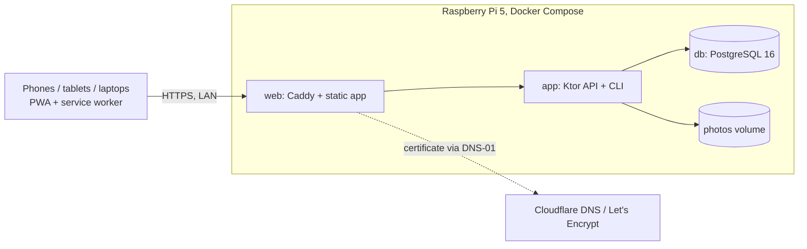

# Household Recipe App – architecture

## System context
One household (Viktor, his wife, later possibly children) uses the app from phones, tablets and laptops on the home network. The whole product runs on Viktor's Raspberry Pi 5 (4 GB RAM, arm64) as three Docker containers. It is reachable only on the LAN, via HTTPS at `https://$PUBLIC_HOST`. The only external dependencies are Cloudflare DNS and Let's Encrypt, which are used to issue the TLS certificate. Devices cache recipes they have opened and keep working offline for reading.

## Hard constraints
| Constraint | Source | Budget / number | Verified by |
|---|---|---|---|
| Product code in Kotlin | 001 Stakeholder constraint 1 | no hand-written JS/TS in product modules | Gradle task `checkKotlinOnly` (T-LANG-1) |
| Frontend, backend and database dockerised on a Raspberry Pi 5, 4 GB RAM | 001 Stakeholder constraint 2 | linux/arm64 images. Memory limits web 128 MB + app 896 MB + db 512 MB = 1536 MB. Host keeps > 1 GB available under load | `scripts/deploy.sh` arch check (T-ARCH-1), `scripts/verify-pi.sh` (T-MEM-1) |
| ≥ 10 concurrent users without noticeable slowdown | 001 Stakeholder constraint 2, QE8 | 10 VUs, 5 min: p95 GET < 300 ms, p95 PUT < 1000 ms, errors < 1 % | k6 `loadtest/recipes.js` on the Pi (T-LOAD-1) |
| Recipes visible only to household members | 001 R1, QE5 | every `/api` route except auth/invitation/health requires a session. LAN-only | API tests A-ACCESS |
| Recipes opened before work offline | 001 S10, QE4 | read fallback to cache after 4 s | E2E-OFFLINE |
| German UI | 001 QE6 | all user-visible texts German | E2E assertions |

## Stack
| Layer | Technology and version | Why (ADR) |
|---|---|---|
| Language | Kotlin 2.x (JVM 21 and Kotlin/JS IR) | ADR 0001 |
| Server | Ktor 3.x (Netty), kotlinx.serialization, Exposed DSL, HikariCP, Flyway, bcrypt (`at.favre.lib:bcrypt`), logback | ADR 0001 |
| Web client | Kotlin/JS + React via kotlin-wrappers, plain CSS, PWA manifest | ADR 0001, 0002 |
| Service worker | Kotlin/JS module `web-sw` | ADR 0002 |
| Shared code | Kotlin Multiplatform module `shared` (jvm + js) | ADR 0001 |
| Database | PostgreSQL 16 (`postgres:16-alpine`) | ADR 0003 |
| Web server / TLS | Caddy 2 with `caddy-dns/cloudflare` | ADR 0005 |
| Runtime | Docker Compose on Raspberry Pi OS 64-bit, `eclipse-temurin:21-jre` | ADR 0004 |
| Tests | kotlin.test, JUnit 5, Ktor testApplication, Testcontainers, Playwright for Java (Kotlin), k6 | design 001 |

Versions: the latest stable release within the named major lines at implementation start, pinned in `gradle/libs.versions.toml` and Dockerfiles. They are upgraded deliberately, never floating.

## Components
- **shared** (`shared/`): DTOs, `Amount`, `Scaling`, `RecipeValidation`, `CategoryName`. It has no I/O. Both server and web depend on it.
- **server** (`server/`): Ktor app and CLI in one artifact. Packages `auth`, `members`, `recipes`, `photos`, `importer`, `jobs`, `cli`, `db`. It depends on PostgreSQL and the photo directory.
- **web** (`web/`): React SPA with screens, API client, draft storage, wake lock and photo resizing. Built into a static bundle served by Caddy.
- **web-sw** (`web-sw/`): the service worker `sw.js` for app shell precache and API/photo caching.
- **e2e** (`e2e/`): Playwright end-to-end tests.
- **deploy** (`deploy/`), **scripts** (`scripts/`), **loadtest** (`loadtest/`): runtime config, deploy/backup/restore/verify scripts, load test.

## Data model
- **users** (id, username, display_name, password_hash, is_founder): household members. Exactly one founder.
- **sessions** (token_hash, user_id, expires_at): login sessions.
- **invitations** (token_hash, kind FOUNDER/INVITE/PASSWORD_RESET, target_user_id, expires_at, used_at): one-time links.
- **recipes** (id, owner_id → users, title, category, servings?, ingredients jsonb, sections jsonb, photo_id?, version): the recipe aggregate. Categories are derived from `recipes.category`.
- **app_meta** (key, value): operational markers (`import.completedAt`).

Field-level detail: design 001, "Data model".

## Deployment and runtime
- Topology: containers `web` (ports 80/443), `app` (internal 8080), `db` (internal 5432). Volumes `pgdata`, `photos`, `caddy_data`, `caddy_config`. `restart: unless-stopped`. Health checks on app and db.
- Resource budget: see Hard constraints and ADR 0004.
- Configuration and secrets: `/opt/rezepte/.env` on the Pi (mode 600): `PUBLIC_HOST`, `CLOUDFLARE_API_TOKEN`, `ACME_EMAIL`, `POSTGRES_PASSWORD`, `TZ=Europe/Berlin`. `deploy/.env.example` in the repo lists the keys without values.
- Reaching it: home Wi-Fi only, `https://$PUBLIC_HOST` (DNS A record → Pi LAN IP, router rebind exception). Users install it to the home screen.
- Build and deploy: `scripts/deploy.sh <pi-host>` builds arm64 images with buildx on the developer machine, verifies the architecture, transfers them via `docker save | ssh docker load`, backs up, then runs `docker compose up -d`. Flyway migrates on app start.
- Admin: `docker compose run --rm app create-founder|reset-password|import …`.
- Backups: systemd timer daily 03:30 plus before each deploy. `pg_dump -Fc` + photo tar to `$BACKUP_DIR` (USB drive), 14 kept. Restore with `scripts/restore.sh`.
- Logs: stdout, Docker `json-file` 10 MB × 3 per container.
- Local: `docker compose -f deploy/docker-compose.dev.yml up db`, `./gradlew :server:run`, `./gradlew :web:jsBrowserDevelopmentRun`.

## Conventions
- Code: package root `rezepte.<module>`. Server code by feature package (routes + service + repository per feature). No business rule is duplicated between server and web: it lives in `shared`.
- API: REST-style JSON under `/api`, cookie session auth, `Origin` check on mutations. Errors always `{"error":{"code","message","fields?"}}` with stable upper-snake-case codes. The client maps codes to German texts.
- Naming: DB snake_case, JSON camelCase, UI texts German, code and docs English.
- Migrations: Flyway `V<n>__<description>.sql` in `server/src/main/resources/db/migration`. Never edit an applied migration. Every migration must keep existing data.
- Amounts: canonical decimal strings in JSON/DB, `Amount(milli: Long)` in code. Never floating point.
- Time: store UTC `timestamptz`. Display Europe/Berlin, German formats.
- Tests: `shared/src/commonTest` (unit), `server/src/test` (importer + API with Testcontainers), `e2e/src/test/kotlin` (Playwright, 3 viewports × Chromium/WebKit). Every acceptance criterion maps to a named test (see the design's traceability table). `./gradlew check` runs everything except the Pi scripts.

## Design index
| # | Title | Status |
|---|---|---|
| 001 | Recipe app MVP | Designed |
