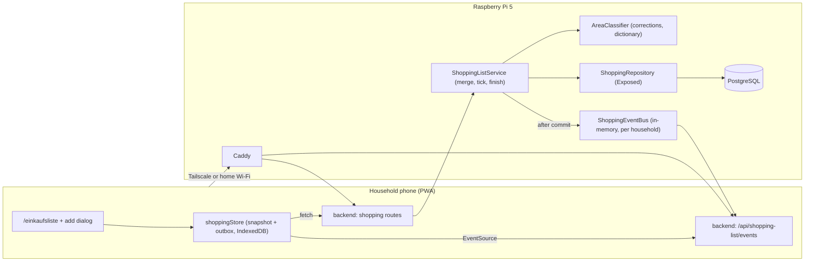

# 002 – Shopping list: design

- Requirements: docs/requirements/002-shopping-list.md
- Status: Designed – ready for implementation
- Date: 2026-09-19
- Architecture: docs/architecture/overview.md

## Summary
The shopping list is a new `shopping` module in the existing Ktor backend with two new PostgreSQL tables (`shopping_line`, `area_correction`) and a new PWA route `/einkaufsliste`. All list logic (merging R1–R3, area assignment R4/R5, scaling) runs on the server inside one transaction per household. Live updates use Server-Sent Events from the same backend: every change emits a `changed` event and clients refetch the (small) list. Offline viewing and ticking use an IndexedDB snapshot plus an outbox of absolute tick states; a revision check on each line guarantees that an offline tick never swallows quantities another member added meanwhile. The stakeholder's Firebase preference is not adopted because it would move the list's data off the Raspberry Pi (see "Requirement conflicts"); to make the shared list reachable from the supermarket, the Pi joins a Tailscale network and household phones keep the Tailscale app on, so the app stays unexposed to the internet and keeps its URL `https://rezepte.home`.

## Drivers and constraints
| Driver | Source | In numbers | How the design meets it | Verified by |
|---|---|---|---|---|
| Everything runs in Docker on a Raspberry Pi 5, 4 GB RAM, arm64 | 001 SC2 (inherited) | Container limits stay at 1.34 GB (unchanged); new host process `tailscaled` ≤ 100 MB; OS + page cache ≥ 2 GB left | No new container; SSE and logic inside existing backend; Tailscale is a host package | `docker compose config` limits unchanged; T-MEM-1 |
| ≥ 10 concurrent users without slowdown | 001 QE1 (inherited) | 10 VUs; shopper: 1 tick / 2 s = 0.5 req/s each; list GET after every event ≈ 10 req/s peak across 10 clients; 10 open SSE connections; p95 < 500 ms, errors < 1 % | Small list (typ. ≤ 150 lines, ≤ 20 KB JSON), one indexed query per GET, SSE holds no DB connection | T-LOAD-2 (`loadtest/shopping.js`) |
| Live updates without noticeable delay, no manual refresh | S1.2, S1.3, QE2 | Change visible on other open client ≤ 1 s p95 (commit → event → refetch → render) | SSE `changed` event after commit, client refetch | T-SSE-1 (`loadtest/sse-latency.mjs`), E2E-S1-2 |
| View and tick/untick without reception; nothing ticked offline is lost | S4.6, QE3, LA2 | Snapshot survives app restart; outbox survives app restart and session expiry; replay ≤ 5 s after connectivity returns | IndexedDB snapshot + outbox; absolute tick state; revision split (R-TICK) | E2E-S4-6a/b/c, unit tests R-TICK |
| Reachable from the store (mobile network) while wife adds at home | S1.2 | 2–4 household phones, off home network | Tailscale subnet route to the Pi + split DNS for `home` (ADR 0007) | T-REMOTE-1 |
| Only household members see the list | S1.5, QE4, 001 S1 | 0 cross-household reads | Session auth; every query scoped by `household_id`; SSE channel per household; app not internet-exposed | Integration tests AUTH-1..3 |
| Kotlin backend | 001 SC1 (inherited) | – | All server code in Kotlin/Ktor | – |
| German UI | 001 QE2 (inherited) | – | Texts in `frontend/src/i18n/de.ts` | Review + E2E text assertions |
| Used one-handed on a phone while walking | QE1 | Tap targets ≥ 48 × 48 CSS px; base font ≥ 18 px on list | Line = full-width tap target | Playwright mobile viewport (Pixel 7) E2E |

## Decisions
- Sync through the existing backend with Server-Sent Events, not Firebase – need met on the Pi, hard constraint beats tool preference. [ADR 0005](adr/0005-live-sync-sse-not-firebase.md)
- Offline: IndexedDB snapshot + outbox of absolute tick states, revision-based split on stale ticks; adding, deleting, moving and finishing stay online-only (LA3: offline adding is not supported). [ADR 0006](adr/0006-offline-ticking-outbox.md)
- Remote access via Tailscale (subnet route + split DNS), replacing "home network only". [ADR 0007](adr/0007-remote-access-tailscale.md)
- Area assignment: household corrections → built-in German keyword dictionary → word-suffix match → Sonstiges. [ADR 0008](adr/0008-area-assignment-dictionary.md)
- Lines are snapshots (name, unit, quantity copied), no foreign key to recipe/ingredient – S2.6 and "recipe origin not shown" (out of scope); nothing to keep in sync.
- No `shopping_list` table: the list is "all `shopping_line` rows of a household" – exactly one list per household by construction (S1.1, S6.4).
- Writes serialize per household with `SELECT … FROM household WHERE id = ? FOR UPDATE` – prevents duplicate lines when two members add at the same time (R1); contention is negligible at 2–4 users.
- Mutations return the full list – the acting client renders the result without waiting for its own SSE event.
- Frontend IndexedDB access via `idb` 8 – small, typed, well known.

## Components

Backend (`backend/src/main/kotlin/.../shopping/`):
- `ShoppingRoutes`: HTTP endpoints below; requires an authenticated session; resolves `householdId` from the session.
- `ShoppingListService`: all business rules; one DB transaction per call; locks the household row first; publishes to `ShoppingEventBus` after commit.
- `AreaClassifier`: algorithm R-AREA; loads the dictionary once at startup from `backend/src/main/resources/shopping/areas-de.tsv`.
- `NameKey`: `nameKey()` / `unitKey()` normalisation (R-KEY), shared by merge and area logic.
- `QuantityScaler`: R-SCALE.
- `ShoppingEventBus`: `ConcurrentHashMap<UUID, MutableSharedFlow<Unit>>` (replay 0, extraBufferCapacity 16, DROP_OLDEST); single backend instance, so in-memory is sufficient.
- `ShoppingRepository`: Exposed table objects and queries, all filtered by `household_id`.
- Inject `java.time.Clock` into the service (tests use a fixed/steppable clock for `created_at`, `ticked_at`).

Frontend (`frontend/src/shopping/`):
- `ShoppingListPage` (route `/einkaufsliste`), `AddRecipeDialog` (opened from `/recipes/:id`), `AreaPickerSheet`, `FinishShoppingDialog`.
- `shoppingStore`: single source of truth for the page. Holds the server snapshot and the outbox (both in IndexedDB database `rezepte-shopping`, stores `snapshot` and `outbox`), computes the displayed list = snapshot with outbox states applied, manages the EventSource and replay.
- `api/shopping.ts`: typed fetch wrappers.
- Navigation: add an "Einkaufsliste" entry to the app's main navigation next to the recipe list.

Service worker (existing, Workbox): add `/einkaufsliste` to navigation fallback (already covered if the SPA navigation fallback serves `index.html` for all routes). Do **not** add a runtime cache for `/api/shopping-list*`; list data lives in IndexedDB only (the outbox must be layered over it by the app).

## Data model
Migration `backend/src/main/resources/db/migration/V<next>__shopping_list.sql` (next free Flyway version). Existing data is untouched; every existing household starts with an empty list.

### `shopping_line`
| Field | Type | Null | Default | Notes |
|---|---|---|---|---|
| id | uuid | no | `gen_random_uuid()` | PK |
| household_id | uuid | no | | FK `household(id)` ON DELETE CASCADE |
| kind | text | no | | CHECK in (`RECIPE`, `FREE`) |
| name | text | no | | RECIPE: ingredient name as stored in the recipe; FREE: the entered text, trimmed (1–200 chars) |
| name_key | text | no | | `nameKey(name)` (R-KEY) |
| quantity | numeric(10,3) | yes | | RECIPE only; null for FREE and for ingredients without quantity. CHECK `quantity > 0` |
| unit | text | yes | | RECIPE only, as stored in the recipe |
| unit_key | text | yes | | `unitKey(unit)`; null when unit null |
| area | text | no | | CHECK in (`OBST_GEMUESE`, `KUEHLREGAL`, `BACKWAREN`, `TIEFKUEHL`, `GETRAENKE`, `SONSTIGES`) |
| ticked | boolean | no | false | |
| ticked_at | timestamptz | yes | | set on tick, cleared on untick |
| seq | bigint | no | `nextval('shopping_line_seq')` | global sequence; "order added" (S4.2) |
| revision | int | no | 0 | +1 on every merge into this line (R1, R2b); used by R-TICK |
| added_by | uuid | yes | | FK `app_user(id)` ON DELETE SET NULL; informational only, never shown |
| created_at | timestamptz | no | `now()` | |

Constraints: CHECK (`kind = 'FREE'` → `quantity IS NULL AND unit IS NULL`); CHECK (`ticked = (ticked_at IS NOT NULL)`).
Indexes: `(household_id, seq)`; `(household_id, name_key) WHERE ticked = false` (merge lookup).

### `area_correction`
| Field | Type | Null | Notes |
|---|---|---|---|
| household_id | uuid | no | FK `household(id)` ON DELETE CASCADE |
| name_key | text | no | `nameKey` of the moved line's name |
| area | text | no | same CHECK as `shopping_line.area` |
| updated_by | uuid | yes | FK `app_user(id)` ON DELETE SET NULL |
| updated_at | timestamptz | no | |
PK `(household_id, name_key)`.

Ownership/visibility: both tables belong to the household; every member may read and write every row (R6); nobody outside the household can read any row (S1.5).

Recipe deletion/edit has no effect on `shopping_line` (no FK) – S2.6.

## Interfaces

All endpoints: session cookie required (401 `UNAUTHENTICATED` otherwise), JSON, camelCase, error format `{ "error": { "code", "message" } }` per conventions. `householdId` always comes from the session, never from the request. A line id of another household behaves exactly like a missing id (404).

`Line` JSON: `{ "id": uuid, "kind": "RECIPE"|"FREE", "name": string, "quantity": number|null, "unit": string|null, "area": AreaCode, "ticked": boolean, "tickedAt": ISO-8601|null, "seq": number, "revision": number }`. Quantity is a JSON number with at most 3 decimals.
`ListResponse`: `{ "lines": Line[] }` – all lines of the household, order irrelevant (client sorts, R-ORDER).

| Method, path | Request | Success | Errors |
|---|---|---|---|
| `GET /api/shopping-list` | – | 200 `ListResponse` | 401 |
| `POST /api/shopping-list/recipe-additions` | `{ "recipeId": uuid, "servings": int, "ingredientIds": uuid[] }` | 200 `ListResponse` | 400 `INVALID_SERVINGS` (not 1–99), 400 `NO_INGREDIENTS` (empty array), 404 `RECIPE_NOT_FOUND` (missing or other household), 409 `RECIPE_CHANGED` (an id is not an ingredient of this recipe any more), 400 `QUANTITY_TOO_LARGE` (a sum exceeds 9 999 999.999) |
| `POST /api/shopping-list/free-items` | `{ "text": string }` | 200 `ListResponse` | 400 `INVALID_TEXT` (empty after trim or > 200 chars) |
| `PUT /api/shopping-list/lines/{id}/ticked` | `{ "ticked": boolean, "seenRevision": int, "seenQuantity": number|null }` | 200 `ListResponse` | 404 `LINE_NOT_FOUND` |
| `PUT /api/shopping-list/lines/{id}/area` | `{ "area": AreaCode }` | 200 `ListResponse` | 400 `INVALID_AREA`, 404 `LINE_NOT_FOUND` |
| `DELETE /api/shopping-list/lines/{id}` | – | 200 `ListResponse` | 404 `LINE_NOT_FOUND` |
| `POST /api/shopping-list/finish` | – | 200 `ListResponse` | – |
| `GET /api/shopping-list/events` | – | 200 `text/event-stream` | 401 |

Semantics:
- `recipe-additions`: loads recipe + ingredients scoped by household; for each selected ingredient in recipe order (`ingredient.position`): scale (R-SCALE), classify area (R-AREA), apply R-MERGE. Base servings for scaling is `recipe.servings`; if it is null, factor is 1 and `servings` is ignored (see Assumptions A3).
- `free-items`: inserts one FREE line with the trimmed text, area by R-AREA; never merges (R3).
- `ticked`: R-TICK. Idempotent: setting the state a line already has is a no-op returning 200.
- `area`: sets `area` on the line, and upserts `area_correction(household_id, line.name_key) = area` (R5). Other existing lines are not changed. Does not change `revision`.
- `DELETE`: deletes the line. Client treats 404 as success.
- `finish`: `DELETE FROM shopping_line WHERE household_id = ? AND ticked = true` (evaluated at execution time). Open lines untouched (S6.2).
- Every successful mutation publishes `changed` for the household after the transaction commits (also no-ops, harmless).

SSE `GET /api/shopping-list/events` (Ktor 3 `ktor-server-sse`):
- On connect: send `retry: 3000`, then one `event: changed` so the client refetches (covers changes missed while disconnected).
- On each household change: `event: changed` / `data: {}`.
- Every 25 s: comment line `: ping` (keeps mobile NAT and proxies from dropping the idle connection).
- On client disconnect: unsubscribe. No DB connection is held.
- Must not be compressed: exclude `text/event-stream` from Ktor `Compression` (when the plugin is installed in the existing code) and from Caddy `encode`. Caddy's `reverse_proxy` flushes `text/event-stream` immediately; no `flush_interval` change needed.

No background jobs. No external services in the application (Tailscale is network infrastructure on the host, ADR 0007).

## Business rules

### R-KEY – name and unit keys (R2)
`nameKey(s)` = Unicode NFC normalisation → trim → collapse internal whitespace runs to one space → `lowercase(Locale.ROOT)`. `unitKey(u)` = same function, null stays null.
Examples: "Zwiebeln" / "zwiebeln" / " Zwiebeln " → `zwiebeln` (same). "Zwiebel" ≠ "Zwiebeln" (R2: no plural matching). "EL" = "el"; null unit = null unit.

### R-SCALE – servings scaling (S2.1, S2.2)
`scaled = quantity × chosenServings ÷ baseServings`, BigDecimal, rounded to 3 decimals HALF_UP; null quantity stays null. This is the formula of 001 S3. Display formatting uses the existing frontend quantity formatter of the recipe view (German decimal comma). Both sides are tested against a shared vector file `shared/test-vectors/scaling.json`, run by a backend unit test and a Vitest test.
Vectors: (3, base 4, chosen 2) → 1.5; (200, 4, 6) → 300; (1, 3, 2) → 0.667; (2, 2, 2) → 2; (null, 4, 8) → null; (0.5, 4, 1) → 0.125.
If the 001 recipe-view code uses a different formula, the 001 code is the truth: change this backend formula and the vectors to match it, so S2.2 ("the same way as in 001 S3") holds.

### R-AREA – automatic area (S5, R4, R5)
Input: the line's `name`. Algorithm (first hit wins):
1. `k = nameKey(name)`. If `area_correction(household, k)` exists → its area.
2. If the dictionary has entry `k` exactly → its area.
3. Split `k` into words on every character that is not a letter (`\p{L}`). For each word `w` and each dictionary entry `e` with `length(e) ≥ 4` and no space: candidate if `w == e` or `w.endsWith(e)`. Pick the candidate with the longest `e`; tie → the one in the rightmost word; tie → earliest area in R4 order.
4. Otherwise `SONSTIGES`.

Dictionary `areas-de.tsv`: UTF-8, lines `<nameKey>\t<AREA_CODE>`, keys already normalised, unique. At least 250 entries covering common German groceries, including singular and plural forms where both are common. It must contain at least these (test fixtures): `zwiebel`, `zwiebeln`, `kartoffeln`, `tomaten`, `äpfel`, `bananen`, `knoblauch`, `petersilie` → OBST_GEMUESE; `milch`, `butter`, `sahne`, `joghurt`, `quark`, `eier`, `käse` → KUEHLREGAL; `brot`, `brötchen`, `toast` → BACKWAREN; `tiefkühlerbsen`, `tiefkühlpizza`, `speiseeis`, `fischstäbchen` → TIEFKUEHL; `wasser`, `saft`, `bier`, `wein`, `limonade` → GETRAENKE; `mehl`, `zucker`, `salz`, `kaffee`, `klopapier`, `nudeln`, `reis`, `kokosmilch`, `trockenhefe` → SONSTIGES. It must **not** contain `hefe` (kept as the S5 correction fixture).
Examples (tests): "Zwiebeln" → Obst & Gemüse (exact). "rote Zwiebeln" → Obst & Gemüse (word). "Vollmilch" → Kühlregal (suffix `milch`). "Kokosmilch" → Sonstiges (exact beats suffix). "2x Milch" → Kühlregal. "Mineralwasser" → Getränke. "Salz nach Geschmack" → Sonstiges. "Klopapier" → Sonstiges. "Hefe" → Sonstiges (fallback, S5.2); after a member moves a "Hefe" line to Kühlregal, a later "hefe" free item and a later recipe ingredient "Hefe" → Kühlregal (S5.4, R5); a different household still gets Sonstiges. "Xyz" → Sonstiges.

### R-MERGE – adding a recipe ingredient (R1, R2, R2a, R2b, S2.5)
Given scaled ingredient (name, unit, quantity q), `nk = nameKey(name)`, `uk = unitKey(unit)`, household locked:
- If `q` is not null: find an open line with `kind = RECIPE`, `name_key = nk`, `unit_key IS NOT DISTINCT FROM uk`, `quantity IS NOT NULL`, lowest `seq`. If found → `quantity += q`, `revision += 1` (area unchanged). Else insert a new open RECIPE line (area by R-AREA).
- If `q` is null (R2b): find any open line with `kind = RECIPE`, `name_key = nk` (any unit, any quantity), lowest `seq`. If found → `revision += 1`, nothing else changes. Else insert a new open RECIPE line with quantity null.
- Ticked lines and FREE lines are never merge targets (R2a, R3).
- Two selected ingredients of the same recipe with the same name and unit merge with each other the same way (processed in recipe order).
Examples (tests): open "2 Zwiebeln" (unit null) + ingredient "1 Zwiebeln" (unit null) → one line "3 Zwiebeln" (the R1 example; the recipe stores the name "Zwiebeln" in both cases). "200 g Mehl" + "2 EL Mehl" → two lines. "200 g Mehl" + "100 G mehl" → 300 g Mehl (case-insensitive name and unit). "Zwiebel" + "Zwiebeln" → two lines (R2). 2 Zwiebeln ticked, add 1 Zwiebeln → new open line 1 Zwiebeln (R2a). Open "Salz" (no quantity) + "Salz" → still one line. Open "1 TL Salz" + "Salz" (no quantity) → still one line "1 TL Salz" (R2b "an open line for that ingredient"). Open "Salz" (no quantity) + "1 TL Salz" → two lines (quantity line needs a quantity line to merge into). Free item "Milch" + recipe "1 l Milch" → two lines (R3). Same recipe added twice for 4 servings with 3 Zwiebeln → 6 Zwiebeln (S2.5).

### R-TICK – tick and untick, including offline replay (S1.3, S4.3, S4.6)
Request `{ticked, seenRevision, seenQuantity}` for line L (household locked):
- L missing → 404 (client drops the operation; the line was deleted or finished by someone).
- `ticked == L.ticked` → no-op.
- Untick (`ticked = false`, L ticked): `ticked = false`, `ticked_at = null`.
- Tick (`ticked = true`, L open):
  - If `L.revision == seenRevision`: `ticked = true`, `ticked_at = now`.
  - Else (someone merged into L after the ticking client last saw it): the tick applies to what the client saw, the additions stay open – the same result as if the tick had reached the server first (R2a):
    - `delta = L.quantity − seenQuantity` when both are not null, else 0.
    - L becomes `quantity = seenQuantity` (when delta > 0), `ticked = true`, `ticked_at = now`.
    - Insert a new open RECIPE line with the same name, name_key, area, and: if delta > 0 → `quantity = delta`, same unit; else → quantity null, unit null. New `seq`, revision 0.
- Concurrent writes from different members are applied in server arrival order (last write wins on the `ticked` flag).
Examples (tests): open 2 Zwiebeln rev 0; phone A ticks offline (seen rev 0, qty 2); wife adds 1 Zwiebeln → 3 Zwiebeln rev 1; A replays → ticked "2 Zwiebeln" + open "1 Zwiebeln". Open "Salz" rev 0 ticked offline; wife's recipe adds "Salz" → rev 1; replay → ticked "Salz" + open "Salz". Replay of the same tick twice → second is a no-op. Tick then untick offline → outbox coalesced to nothing, no request.

### R-ORDER – display order (S4.1, S4.2, R4)
Areas in fixed order OBST_GEMUESE, KUEHLREGAL, BACKWAREN, TIEFKUEHL, GETRAENKE, SONSTIGES; areas without lines are not shown. Within an area: open lines by `seq` ascending, then ticked lines by `ticked_at` ascending, tie `seq`. Unticking returns a line to its original `seq` position among the open lines. Lines created by the R-TICK split get a new `seq` (end of the open lines). Offline, a locally ticked line uses the local tick time for ordering until the server confirms.

### R-FINISH (S6)
Confirmation in the client; server removes all lines ticked at execution time; open lines and `area_correction` stay; no list is created (S6.4).

## User interface
UI language German. Texts below are binding; they live in `frontend/src/i18n/de.ts` under `shopping.*`. Area labels: "Obst & Gemüse", "Kühlregal", "Backwaren", "Tiefkühl", "Getränke", "Sonstiges".

### Recipe view `/recipes/:id` (changed) – S2
- New button "Auf die Einkaufsliste" below the ingredient list. Offline: button disabled, helper text "Hinzufügen geht nur mit Verbindung."
- Opens `AddRecipeDialog` (full-screen sheet on phones).

### `AddRecipeDialog` – S2.1–S2.4
- Title "Auf die Einkaufsliste". Servings stepper (− / value / +, 1–99) preset to `recipe.servings`; hidden when `recipe.servings` is null (A3).
- All ingredients as checkboxes, all checked, text = scaled quantity + unit + name, formatted like the recipe view; recalculated on every stepper change using the same scaling/format function as the recipe view (S2.2).
- Buttons "Abbrechen" (closes, nothing sent – S2.4) and "Hinzufügen" (disabled when no ingredient is checked). Sends `recipe-additions` with the checked ids and servings.
- States: sending → button spinner, dialog stays; success → dialog closes, toast "Zur Einkaufsliste hinzugefügt"; 409 `RECIPE_CHANGED` → message "Das Rezept wurde gerade geändert. Bitte erneut öffnen." and the dialog closes; network error/5xx → message "Hinzufügen hat nicht geklappt. Bitte erneut versuchen.", selection kept; offline while open → "Hinzufügen" disabled with the offline helper text.

### Shopping list `/einkaufsliste` – S1, S3, S4, S5, S6
- Header "Einkaufsliste". Below it an input with placeholder "Artikel hinzufügen, z. B. Klopapier" and button "Hinzufügen" (Enter also submits). Sends `free-items`; on success the input is cleared; on error the text stays and "Hinzufügen hat nicht geklappt." is shown (S3.1). Disabled offline with the offline helper text (A1).
- Groups: one section per non-empty area in R-ORDER, section title = area label.
- Line row (full width, ≥ 48 px high): checkbox + text. Text: RECIPE `"<quantity formatted> <unit> <name>"` (parts omitted when null); FREE: the text exactly as stored. Ticked rows: checked box, strike-through, muted colour.
- Tap on the row (not on the menu button) toggles tick immediately (optimistic), works offline (S4.3, S4.6).
- Row menu button "⋯" (aria-label "Optionen") → "Bereich ändern" (opens `AreaPickerSheet` listing the six areas, current one marked; selecting sends `area`) and "Löschen" (sends `DELETE`, no confirmation – S4.4). Both disabled offline. No edit action (S4.5).
- Footer button "Einkauf abschließen", visible when ≥ 1 line is ticked, disabled offline. Opens `FinishShoppingDialog`: text "Abgehakte Artikel (<n>) von der Liste entfernen? Nicht abgehakte bleiben stehen.", buttons "Abbrechen" (nothing happens – S6.3) and "Entfernen" (sends `finish` – S6.2).
- States:
  - Loading (no snapshot yet): skeleton rows.
  - Empty (S1.4): "Die Liste ist leer. Öffne ein Rezept und tippe auf „Auf die Einkaufsliste“ oder gib oben einen Artikel ein."
  - Offline (no connection or SSE and refetch failing > 5 s): banner "Offline – Abhaken wird gespeichert und übertragen, sobald wieder Verbindung besteht." plus "<n> Änderungen noch nicht übertragen" when the outbox is not empty.
  - Offline without any snapshot on this device: "Die Einkaufsliste wurde auf diesem Gerät noch nicht geladen. Bitte mit Verbindung öffnen."
  - Error on a mutation (HTTP 5xx or an unexpected 4xx): toast "Das hat nicht geklappt. Bitte erneut versuchen."; list is refetched.
  - Session expired (401): outbox is kept; redirect to `/login` with return to `/einkaufsliste`; replay after login.

### Client sync behaviour (`shoppingStore`)
- On page mount: render IndexedDB snapshot + outbox immediately; open `EventSource('/api/shopping-list/events')`; fetch the list.
- On every `changed` event, on `online`, and on `visibilitychange` → visible: refetch; store the response as the new snapshot; displayed list = snapshot with outbox states applied.
- On `visibilitychange` → hidden and on unmount: close the EventSource.
- Tick/untick: update the outbox entry for the line in IndexedDB (key = lineId): `{lineId, ticked, seenRevision, seenQuantity, queuedAt}`; `seenRevision`/`seenQuantity` are taken from the snapshot when the entry is first created and kept on later toggles; if the desired state equals the snapshot's state the entry is removed. Then trigger replay.
- Replay: sequential, `queuedAt` order; 200 → remove entry, store returned list as snapshot; 404 → remove entry; 401 → stop, login flow; network error/5xx → keep, retry after 2 s, doubling to max 60 s, and immediately on `online` or SSE open.
- Mutations other than tick require a connection and are not queued.

## Cross-cutting concerns
- Authorization: session required on all endpoints including SSE; household from session; repository filters by `household_id`; 404 for foreign ids (no existence leak). All members have equal rights (R6): no owner checks on shopping endpoints, unlike recipes.
- Concurrency: per-household row lock around every write; R-TICK handles stale ticks; last write wins for tick flag and area.
- Offline: see ADR 0006; the 001 recipe offline cache is unchanged.
- Time: `created_at`/`ticked_at` server UTC from injected `Clock`; ordering uses `seq`, so clock skew does not affect it. No time-zone-dependent logic.
- Locale: quantity formatting with German decimal comma via the existing formatter; area labels German.
- Security: no new exposure to the internet (ADR 0007); inputs length-limited; text rendered as text (React escaping), never HTML.
- Observability: log each mutation at INFO with household id, action, line count (no item texts); log SSE connect/disconnect at DEBUG; number of open SSE connections logged every 5 min at INFO.

## Deployment and runtime
- No new container, no new env vars in the backend. Add `io.ktor:ktor-server-sse` (same version as Ktor) to the backend; `idb` 8 to the frontend.
- Caddyfile: exclude `/api/shopping-list/events` from `encode` with the matcher `@notsse not path /api/shopping-list/events` and `encode @notsse gzip`.
- Remote access (ADR 0007), written as `deploy/remote-access.md` and executed once by the stakeholder:
  1. Install Tailscale on the Pi host (official apt repository, Raspberry Pi OS arm64), enable IPv4 forwarding (`net.ipv4.ip_forward=1` in `/etc/sysctl.d/99-tailscale.conf`).
  2. `tailscale up --advertise-routes=<PI_LAN_IP>/32,<LAN_DNS_IP>/32`, where `LAN_DNS_IP` is the DNS server that resolves `rezepte.home` at home today (same value if that is the Pi). Approve the routes and disable key expiry for the Pi in the admin console.
  3. Admin console → DNS → add nameserver `<LAN_DNS_IP>` restricted to domain `home` (split DNS).
  4. Each household phone: install the Tailscale app, log in to the household tailnet, keep it connected (Android: system setting "Always-on VPN"; iOS: leave the VPN on). The Caddy root certificate is already installed on these devices; `https://rezepte.home` works unchanged.
  5. Check the tailnet's plan allows the household's number of users (2–4); if it does not, the remaining phones log in with the stakeholder's Tailscale account.
- No router port forwarding; nothing exposed to the internet.

Resource budget (4 GB Pi):
| Component | Limit | Expected use | Notes |
|---|---|---|---|
| caddy | 64 MB | < 40 MB | unchanged |
| backend | 768 MB (`-Xmx384m`) | + < 5 MB for 10 SSE connections and event bus | unchanged limit |
| postgres | 512 MB | two small tables, < 1 MB data per household-year | unchanged |
| tailscaled (host) | 100 MB (systemd `MemoryMax=100M` drop-in) | 30–60 MB | new |
| Total fixed | 1.44 GB | | leaves ≥ 2.5 GB for OS and page cache |

Backups: new tables are in `pgdata`, covered by the existing nightly `pg_dump`.

## Test strategy
- Backend unit (Kotlin, JUnit 5): `NameKeyTest`, `QuantityScalerTest` (vectors from `shared/test-vectors/scaling.json`), `AreaClassifierTest` (all R-AREA examples + dictionary lint: keys normalised, unique, valid codes, no `hefe`, ≥ 250 entries), `MergeTest` and `TickTest` (all R-MERGE and R-TICK examples) against Testcontainers Postgres via the service.
- Backend integration (Ktor `testApplication` + Testcontainers): every endpoint's success and error cases from the Interfaces table; AUTH-1 unauthenticated → 401 on all shopping endpoints incl. SSE; AUTH-2 user of household B gets only B's lines and 404 on A's line ids (tick, area, delete); AUTH-3 SSE subscriber of household B receives no event on A's change; concurrency test: 20 parallel `recipe-additions` of the same recipe → one merged line with 20× quantity; SSE test: subscriber receives `changed` after each mutation and one on connect.
- Frontend (Vitest): `shoppingStore` outbox coalescing, overlay, replay handling of 200/404/401/network error; R-ORDER sorting; scaling vectors; line text formatting.
- E2E (Playwright, `e2e/shopping/`, mobile viewport, two browser contexts = two household members, plus a third context of another household):
  - E2E-S1-1 both members see the same list; E2E-S1-2 member B adds recipe/free item while A has the list open → appears on A within 2 s without reload; E2E-S1-3 tick on A → ticked on B; E2E-S1-4 empty hint text; E2E-S1-5 other household sees an empty list and gets 404 on A's line ids.
  - E2E-S2-1..4 dialog defaults, servings recalculation, deselect + confirm, cancel adds nothing; E2E-S2-5 add same recipe twice → doubled; E2E-S2-6 edit recipe after adding → line unchanged; delete recipe → line unchanged.
  - E2E-S3 "2x Milch" appears verbatim, in Kühlregal, not merged with recipe "Milch".
  - E2E-S4-1/2 area order and in-area order; E2E-S4-3 tick/untick moves; E2E-S4-4 delete without dialog, gone on B; E2E-S4-5 no edit control exists; E2E-S4-6a A offline (`context.setOffline(true)`) reloads the page, sees the list, ticks/unticks, back online → B sees the ticks; E2E-S4-6b stale tick split (A offline ticks "2 Zwiebeln", B adds recipe with 1 Zwiebeln, A online → ticked 2 + open 1); E2E-S4-6c offline add buttons disabled.
  - E2E-S5 "Hefe" → Sonstiges; A moves to Kühlregal; B adds free item "hefe" → Kühlregal.
  - E2E-S6 finish: confirm dialog; cancel changes nothing; confirm removes ticked on both clients, open stay.
- T-LOAD-2 `loadtest/shopping.js` (k6) against the Pi: 10 VUs, 5 min; each VU: GET list, PUT ticked on a random line (alternating tick/untick), every 10th iteration POST free item and every 20th POST recipe-addition, then DELETE its own free items; think time 2 s; 10 SSE connections held open by `loadtest/sse-latency.mjs` during the run. Pass: p95 < 500 ms for all shopping requests and the existing recipe script thresholds still met when run concurrently, error rate < 1 %.
- T-SSE-1 `loadtest/sse-latency.mjs` (Node 20, fetch streaming): 10 subscribers of one household; measure time from a PUT response to receipt of `changed` at each subscriber. Pass: p95 < 1 s.
- T-MEM-1: during T-LOAD-2, `docker stats` shows every container below its limit and `systemctl status tailscaled` memory < 100 MB.
- T-REMOTE-1 (manual, once after setup, checklist in `deploy/remote-access.md`): phone with Wi-Fi off and Tailscale on opens `https://rezepte.home` without certificate warning, logs in, and receives a live change made from a laptop at home within 2 s; Tailscale off → site not reachable.
- Existing CI arm64 image build unchanged; existing Playwright offline recipe test must still pass.

## Build order
1. Migration, `NameKey`, repository, `GET` list, free items, tick (without split), delete, finish; `/einkaufsliste` page online with grouping (areas all Sonstiges until slice 3), empty state, finish dialog. Tests for these.
2. `QuantityScaler`, R-MERGE, `recipe-additions`; `AddRecipeDialog` in recipe view.
3. `AreaClassifier` with dictionary, area move + corrections, `AreaPickerSheet`.
4. SSE endpoint, event bus, Caddy change, client EventSource + refetch; live E2E tests; T-SSE-1.
5. IndexedDB snapshot + outbox, R-TICK split, offline states; offline E2E tests.
6. `deploy/remote-access.md`, T-REMOTE-1, T-LOAD-2, T-MEM-1.

## Assumptions
- A1 – Offline, only viewing, ticking and unticking work; adding (recipe or free item), deleting, moving to another area and "Einkauf abschließen" are disabled with a hint. The requirements require only viewing and ticking offline (S4.6, LA3); queuing the other actions would add conflict cases (e.g. finishing while another member ticks) without a product need.
- A2 – Unit comparison for R1 ignores case like names ("G" = "g"); the requirements define "same name" (R2) but not "same unit". Units are otherwise compared as written ("EL" ≠ "Esslöffel").
- A3 – A recipe without base servings (`recipe.servings` null, allowed by the 001 schema) is added with its quantities as written; the servings stepper is hidden.
- A4 – R2b "an open line for that ingredient" includes an open line of the same name with a quantity ("1 TL Salz" absorbs a later "Salz"). A quantity ingredient is not merged into an open line without quantity ("Salz" + "1 TL Salz" → two lines), since R1 requires adding quantities.
- A5 – Ticked lines within an area are ordered by the time they were ticked; unticked lines return to their original position among the open lines.
- A6 – Areas without lines are not shown.
- A7 – When a line is moved, only that line and the remembered correction change; other lines with the same name already on the list stay where they are (S5.4 speaks of items "added later").
- A8 – "Without noticeable delay" is taken as ≤ 1 s p95 between members with a connection.
- A9 – Name keys also ignore leading/trailing spaces, repeated inner spaces and Unicode composition differences; these are not spelling differences a user can see.
- A10 – If the tick flag of a line is changed by two members in conflicting ways, the change that reaches the server last wins; offline ticks are replayed after reconnect and therefore usually win.
- A11 – Free item text is limited to 200 characters.
- A12 – The shopper needs the Tailscale app on the phone and has to keep it connected; this is an operational prerequisite for S1.2, not a product feature (ADR 0007).

Discrepancies found while designing: the repository contains no application code, no ADR files 0001–0004 and no 001 design document, although `overview.md` references them and marks 001 as built. This design relies on `overview.md` as the description of the built system. Where the code differs from `overview.md`, the code is the truth (in particular for R-SCALE, the quantity formatter, the main navigation and the service worker setup); the developer follows the code and keeps the rules of this design.

## Requirement conflicts

### C1 – Firebase sync vs. everything on the Raspberry Pi
- 002, Stakeholder technical constraints: "Sync am besten über Firebase" – stated in the first message as the preferred way to keep the shared list in sync between household members' devices.
- 001, Stakeholder technical constraints: "Frontend, Backend und Datenbank sollen zusammen dockerisiert auf meinem Raspberry Pi 5 mit 4 GB RAM laufen, und das Ganze muss mindestens 10 gleichzeitige User abkönnen."
- Why they can't both hold: Firebase sync (Firestore or Realtime Database) stores the synchronised data in Google's cloud; the shopping list's database would then not run on the Pi. It would also need Firebase Authentication alongside the app's own login to keep the list household-only (QE4), i.e. a second identity system. Using only Firebase Cloud Messaging as a content-free "ping" keeps data on the Pi but still needs the phone to reach the Pi, so it adds a Google dependency without delivering anything SSE does not.
- Resolution: the product need behind the preference (live shared list, offline ticking, nothing lost) is met by the existing self-hosted backend with SSE and an offline outbox (ADR 0005, 0006); reachability from the store via Tailscale (ADR 0007). Rules applied: hard constraints (runtime environment, privacy) beat tool preferences; a need beats a preference.
- What is lost: Firebase's managed offline persistence and reachability from anywhere without extra setup. Instead, each household phone needs the Tailscale app switched on, and the Pi at home must be running for sync.
- Change request: docs/requirements/.change-requests/002-shopping-list.md

## Traceability
| Requirement | Design element | Verified by |
|---|---|---|
| S1.1 one list, all members see it | Lines keyed by `household_id`, no list table; `GET /api/shopping-list` | E2E-S1-1 |
| S1.2 wife's additions appear in store without action | SSE `changed` + refetch; Tailscale remote access (ADR 0005, 0007) | E2E-S1-2, T-SSE-1, T-REMOTE-1 |
| S1.3 tick visible to others | `PUT …/ticked` + SSE | E2E-S1-3 |
| S1.4 empty hint | UI empty state text | E2E-S1-4 |
| S1.5 outsiders never see list | Session auth, household scoping, 404 for foreign ids, per-household SSE, no internet exposure | AUTH-1..3, E2E-S1-5 |
| S2.1 dialog with base servings, all selected, scaled | `AddRecipeDialog`, R-SCALE | E2E-S2-1 |
| S2.2 recalculation like 001 S3 | Shared scaling function + vectors | QuantityScalerTest, Vitest vectors, E2E-S2-2 |
| S2.3 only selected added, chosen servings | `recipe-additions` with `ingredientIds`, server-side scaling | Integration test, E2E-S2-3 |
| S2.4 cancel adds nothing | "Abbrechen" sends nothing | E2E-S2-4 |
| S2.5 merge per R1/R2, twice adds again | R-MERGE | MergeTest, E2E-S2-5 |
| S2.6 recipe edit/delete leaves lines | Snapshot lines, no FK to recipe | Integration test, E2E-S2-6 |
| S3.1 free text exactly as typed | `free-items`, `name` = trimmed text, shown verbatim | Integration test, E2E-S3 |
| S3.2 free item auto area | R-AREA on free items | AreaClassifierTest, E2E-S3 |
| S3.3 free items never merged | R-MERGE excludes FREE; free-items always inserts | MergeTest, E2E-S3 |
| S4.1 grouped by area in R4 order | R-ORDER | Vitest sort test, E2E-S4-1 |
| S4.2 open in added order, ticked below | R-ORDER (`seq`, `ticked_at`) | Vitest sort test, E2E-S4-2 |
| S4.3 tap ticks/unticks and moves | Row tap, optimistic outbox, `PUT …/ticked` | E2E-S4-3 |
| S4.4 delete, no confirmation, household-wide | "Löschen" → `DELETE`, SSE | E2E-S4-4 |
| S4.5 lines not editable | No edit endpoint or control | E2E-S4-5 |
| S4.6 offline view and tick, synced later | IndexedDB snapshot + outbox, R-TICK (ADR 0006) | E2E-S4-6a/b, TickTest |
| S5.1 automatic assignment | R-AREA on every insert | AreaClassifierTest |
| S5.2 unknown → Sonstiges | R-AREA step 4 | AreaClassifierTest ("Hefe", "Xyz") |
| S5.3 move line to other area | `PUT …/area`, `AreaPickerSheet` | Integration test, E2E-S5 |
| S5.4 correction remembered for later items, any member, any kind | `area_correction`, R-AREA step 1 | AreaClassifierTest, E2E-S5 |
| S6.1 confirmation | `FinishShoppingDialog` | E2E-S6 |
| S6.2 removes ticked, keeps open, household-wide | `POST /finish`, SSE | Integration test, E2E-S6 |
| S6.3 cancel changes nothing | "Abbrechen" sends nothing | E2E-S6 |
| S6.4 same list continues | No list entity per trip | Integration test (add after finish) |
| R1 merge same name + unit | R-MERGE | MergeTest |
| R2 same spelling ignoring case | R-KEY | NameKeyTest, MergeTest |
| R2a ticked never merged into | R-MERGE open-only; R-TICK split | MergeTest, TickTest |
| R2b no-quantity ingredients | R-MERGE null-quantity branch | MergeTest |
| R3 free items plain text, never merged | R-MERGE, `free-items` | MergeTest |
| R4 fixed areas and order | CHECK constraint, R-ORDER, no area endpoints | Migration test, Vitest sort test |
| R5 corrections household-wide, same name, any kind | `area_correction` keyed by household + name_key | AreaClassifierTest, E2E-S5 |
| R6 equal rights | No owner checks on shopping endpoints | Integration test (member B deletes A's line) |
| QE1 phone while walking | Mobile layout, 48 px rows, 18 px font | E2E on mobile viewport |
| QE2 live without refresh | SSE | T-SSE-1, E2E-S1-2 |
| QE3 offline viewing/ticking reaches others | ADR 0006 | E2E-S4-6a/b |
| QE4 household-only | Authorization, ADR 0007 (no exposure) | AUTH-1..3 |
| SC1 "Sync am besten über Firebase" | Not adopted; need met by SSE + outbox (C1, ADR 0005) | Change request filed |
| LA1 area assignment | R-AREA, ADR 0008 | AreaClassifierTest |
| LA2 live + offline reconciliation, Firebase, fit with 001 S4 | ADR 0005, 0006; 001 SW cache unchanged | T-SSE-1, E2E-S4-6a/b, existing offline recipe test |
| LA3 offline adding | Not supported (A1) | E2E-S4-6c |
| 001 SC1 Kotlin | Kotlin/Ktor module | – |
| 001 SC2 Pi 5, 4 GB, Docker, 10 users | No new container; budget table | T-LOAD-2, T-MEM-1, arm64 CI build |
| 001 QE1 10 concurrent users | Load scenario incl. SSE | T-LOAD-2 |
| 001 QE2 German UI | Texts in `de.ts` | E2E text assertions |
| 001 S4 opened recipes offline | Service worker unchanged | Existing Playwright offline test |
| Later: remove whole recipe | Not built (lines keep no recipe origin) | – |
| Later: weekly meal plan | Not built | – |
| Out of scope: pantry management | Not built; deselection only in dialog | – |
| Out of scope: showing recipe origin | Not built; origin not stored | – |
| Out of scope: creating/renaming/reordering areas | Not built; fixed CHECK list | – |
| Out of scope: merging free items with recipe ingredients | Not built (R3) | MergeTest |
| Out of scope: multiple lists | Not built | – |
| Out of scope: editing a line | Not built | E2E-S4-5 |
| Out of scope: adding without connection | Not built (A1) | E2E-S4-6c |
