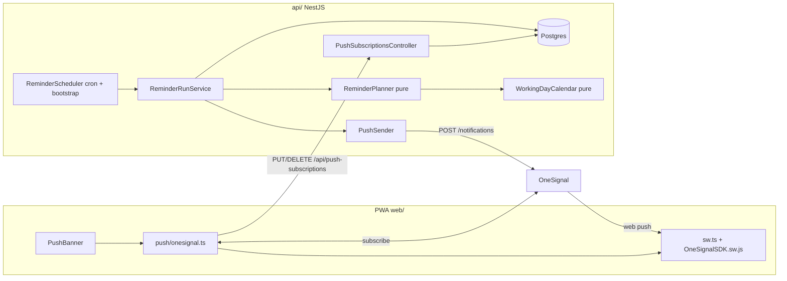

# 002 – Task reminders: design

- Requirements: docs/requirements/002-task-reminders.md
- Status: Designed – ready for implementation
- Date: 2026-09-19
- Architecture: docs/architecture/overview.md

## Summary
A new `reminders` module in the existing NestJS api runs a daily job at 07:00 Europe/Berlin. On working days (own Bavarian holiday calculation, R1) it computes, from the tasks as they are at that moment, at most one employee reminder per employee and one Meister notice per Meister, stores them in an outbox table and sends them as web push through OneSignal (stakeholder preference, ADR 0005). Devices register through the OneSignal Web SDK in the existing PWA; the api stores which OneSignal subscription belongs to which logged-in user and sends to subscription ids, never to client-chosen identities. Each push carries the URL of the single task or of the right list (S4). A missed 07:00 run is caught up until 07:59 the same day and otherwise dropped, never shifted (ADR 0006).

Code baseline: this repository snapshot contains only `docs/`; the `api/` and `web/` code described in `overview.md` (001, status Built) is not present. This design is written against `overview.md`. Where the real code differs (module names, route guards, service worker setup), extend the real code in its own style and keep the behaviour specified here.

## Drivers and constraints
| Driver | Source | In numbers | How the design meets it | Verified by |
|---|---|---|---|---|
| Messages at 07:00 German local time, only on working days | R2, QE1, LA3 | 1 run/working day; cron fires at 07:00:00 Europe/Berlin (05:00 UTC in summer, 06:00 UTC in winter); send finished < 60 s after 07:00 for ≤ 8 recipients | `@nestjs/schedule` cron with `timeZone: 'Europe/Berlin'`, working-day check inside the run, OneSignal `priority: 10` | T-RUN-1, T-RUN-2, T-CAL-3 (DST), T-MAN-1 |
| Never a message on weekend or R1 holiday | R1, R2, QE3 | 0 messages on 104 weekend days + up to 12 holidays per year | Run aborts before planning when `!isWorkingDay(today)`; catch-up and retries only ever send rows planned for a working day, and only on that same day | T-CAL-1, T-CAL-2, T-RUN-2, T-RUN-6 |
| Holiday calendar correct across years | R1, LA2 | 7 fixed + 5 Easter-based dates per year, computed for any year 1900–2199 | Pure function, Easter by the Anonymous Gregorian algorithm (ADR 0007) | T-CAL-1 (table 2026–2030), T-CAL-2 |
| At most one message per person per day | R7 | ≤ 1 employee reminder per employee, ≤ 1 Meister notice per Meister per date | DB unique `(runDate, recipientId, kind)`, `ReminderRun` per date, OneSignal `idempotency_key` | T-RUN-3, T-RUN-4 |
| Missed run (api down at 07:00) | LA3, R2 | Catch-up window 07:00–07:59:59 Berlin; after that the day's messages are dropped | Cron every 5 min 07:00–07:55 + run on api bootstrap; both idempotent | T-RUN-5, T-RUN-6 |
| Push to company phones (Android PWA) and Meister's devices | R11, LA1, SC1, 001 constraint | ~7 users, ~8–10 devices, ≤ 8 push requests/day | OneSignal Web Push (free plan, web push unlimited), SDK v16 imported into the PWA's own service worker | T-WEB-1..3, T-MAN-1 |
| Employee only sees own tasks | QE4, R9 | – | Planner groups strictly by `task.assigneeId`; subscriptions bound to the authenticated user on the server | T-PLAN-8, T-API-2 |
| Resource budget (CX22, 2 vCPU, 4 GB, shared with Postgres, Caddy) | overview | No new process or container; job < 1 s CPU/day, < 10 MB extra heap | Runs inside the existing `api` process | – (negligible; no new limit) |

## Decisions
- Push provider: OneSignal Web Push, targeted by subscription id stored server-side. ADR 0005.
- Scheduling: in-process cron (`@nestjs/schedule` 4.x) in the api, outbox table, catch-up window until 07:59. ADR 0006.
- Holiday calendar: own pure implementation with Easter computation, no library, no hand-maintained list. ADR 0007.
- Date/time library: `luxon` 3.x in the api for Europe/Berlin conversions. Reason: explicit zone handling independent of the server's UTC setting; well known. Calendar dates are handled as `YYYY-MM-DD` strings (`LocalDate` type alias) to avoid time-of-day bugs.
- Rules evaluated statelessly from `Task` at run time; no reminder flags on `Task`. Reason: R8, R9 and R10 then hold by construction (current assignee, current due date, state at 07:00); "once" for the Meister notice follows from "exactly 2 working days overdue" + one run per date.
- Deep links: the push carries an absolute app URL; OneSignal's click handler navigates the existing PWA window/tab. Reason: no custom notification-click code needed.
- Web SDK: npm package `react-onesignal` 3.x (wraps OneSignal Web SDK v16). Reason: typed, official, already known to the stakeholder's ecosystem.
- Service worker: vite-plugin-pwa switches to (or stays on) `injectManifest` with `web/src/sw.ts`, which imports the OneSignal SW script. Reason: one service worker per scope; OneSignal and the PWA must share scope `/`.

## Components


api (`api/src/reminders/`, new module `RemindersModule`, imported in `AppModule`):
- `working-day-calendar.ts`: pure functions `easterSunday(year)`, `bavarianHolidays(year): LocalDate[]`, `isWorkingDay(d)`, `workingDaysBetween(afterExclusive, untilInclusive)`. No Nest dependencies.
- `reminder-planner.ts`: pure function `planMessages(today: LocalDate, tasks: PlannerTask[], users: PlannerUser[], baseUrl: string): PlannedMessage[]`. Implements R3–R7, R9, R10 and the texts.
- `reminder-run.service.ts`: `runIfDue(now: Date)`. Checks window and working day, plans in a transaction, writes the outbox, sends pending rows, closes the run. Housekeeping.
- `reminder-scheduler.ts`: `@Cron('*/5 7 * * *', { timeZone: 'Europe/Berlin', name: 'daily-reminders' })` calling `runIfDue(clock.now())`; `onApplicationBootstrap()` calls it once as well. In-process guard: if a run is in progress, the next call returns immediately.
- `push-sender.ts`: interface `PushSender { send(msg: OutgoingPush, subscriptionIds: string[]): Promise<PushResult> }`; `OneSignalPushSender` (REST via Node 22 `fetch`) and `LogPushSender` (logs only; used when `ONESIGNAL_REST_API_KEY` is empty, e.g. local dev, CI).
- `clock.ts`: injectable `Clock { now(): Date }`, default `SystemClock`; tests inject a fixed clock.
- `push-subscriptions.controller.ts` + service: register/unregister devices.
- `cli/reminders-dry-run.ts`: `npm run reminders:dry-run -- --date=YYYY-MM-DD` prints the planned messages for that date from the current DB without writing or sending. For operations and manual checks.

web (`web/src/`):
- `push/onesignal.ts`: `initPush()` (once per app load, only when logged in), `syncSubscription()`, `unregisterPush()` (called by logout).
- `push/PushBanner.tsx`: banner shown on `/tasks` and `/overview`.
- `sw.ts`: custom service worker (injectManifest), first line `importScripts('https://cdn.onesignal.com/sdks/web/v16/OneSignalSDK.sw.js')`, then the existing Workbox precache/runtime caching unchanged.
- Login redirect keeps the target: unauthenticated visit to a protected route → `/login?next=<path>`; after login navigate to `next`.
- Task detail `/tasks/:id`: new "not available" state (see User interface).

## Data model
New Prisma models; `User` gets the back-relations. `Task` is unchanged.

`PushSubscription` (one row per registered browser/device)
| Field | Type | Null | Default | Notes |
|---|---|---|---|---|
| id | String | no | – | `@id`. The OneSignal subscription id (UUID string) |
| userId | String | no | – | FK `User.id`, `onDelete: Cascade`, `@@index([userId])` |
| userAgent | String | yes | – | For support/diagnosis only, max 512 chars (truncate) |
| createdAt | DateTime | no | `now()` | |
| lastSeenAt | DateTime | no | – | Updated on every PUT |

Visibility: never exposed through any read endpoint. A subscription id belongs to at most one user (primary key); the last user who registers it owns it.

`ReminderRun` (one row per Berlin date on which a run was planned)
| Field | Type | Null | Default | Notes |
|---|---|---|---|---|
| runDate | DateTime `@db.Date` | no | – | `@id`, Berlin calendar date |
| startedAt | DateTime | no | `now()` | |
| completedAt | DateTime | yes | – | Set when no row of this date is `PENDING` |

`ReminderMessage` (outbox, one row per recipient, kind and date)
| Field | Type | Null | Default | Notes |
|---|---|---|---|---|
| id | String | no | `uuid()` | Also used as OneSignal `idempotency_key` |
| runDate | DateTime `@db.Date` | no | – | FK `ReminderRun.runDate`, `onDelete: Cascade` |
| recipientId | String | no | – | FK `User.id`, `onDelete: Cascade` |
| kind | enum `ReminderKind` (`EMPLOYEE_REMINDER`, `MEISTER_NOTICE`) | no | – | |
| title | String | no | – | Push heading |
| body | String | no | – | Push text |
| url | String | no | – | Absolute click URL |
| taskIds | String[] | no | – | All task ids listed (also those cut by truncation) |
| status | enum `ReminderMessageStatus` (`PENDING`, `SENT`, `NO_DEVICE`, `FAILED`) | no | `PENDING` | |
| attempts | Int | no | 0 | |
| lastError | String | yes | – | max 1000 chars |
| oneSignalId | String | yes | – | Notification id returned by OneSignal |
| sentAt | DateTime | yes | – | |
| createdAt | DateTime | no | `now()` | |

Constraints and indexes: `@@unique([runDate, recipientId, kind])`, `@@index([status, runDate])`.

Migration: one `prisma migrate` migration `002_task_reminders` creating the three tables and two enums. No change to existing data. Retention: each run deletes `ReminderRun` rows (cascading to messages) with `runDate` older than 90 days.

## Interfaces

### API
Both endpoints: any authenticated user (existing JWT cookie guard), no role restriction. Errors in the NestJS standard exception format.

`PUT /api/push-subscriptions/:subscriptionId`
- Path param: `subscriptionId`, must be a UUID (class-validator `IsUUID()` via a param DTO) → otherwise `400`.
- Body: `{ "userAgent"?: string }` (optional, max 512 chars; longer is truncated, not rejected).
- Effect: upsert by `id`: set `userId = currentUser.id`, `lastSeenAt = now`, `userAgent`. If the row belonged to another user, it is moved to the current user (shared or handed-over device: whoever logged in last gets the reminders).
- Response: `204`. `401` if not logged in.

`DELETE /api/push-subscriptions/:subscriptionId`
- Deletes the row only if `userId = currentUser.id`. Always `204` (idempotent; does not reveal whether the id exists or belongs to someone else). `400` for a non-UUID, `401` if not logged in.

No read endpoint, no admin endpoint.

### Job: daily reminders
Trigger: cron `*/5 7 * * *` in `Europe/Berlin` (07:00, 07:05, …, 07:55) and once on api bootstrap. Every trigger calls `runIfDue(now)`:

1. `local = now` in Europe/Berlin; `today = local.toISODate()`.
2. Housekeeping: set every `PENDING` message with `runDate < today` to `FAILED`, `lastError = 'window closed'`, set `completedAt` on their runs; delete runs older than 90 days.
3. If `local.hour !== 7` → return (outside 07:00:00–07:59:59; nothing is planned or sent, R2, R8).
4. If `!isWorkingDay(today)` → return (log INFO "no reminders: non-working day").
5. Planning, in one DB transaction: `INSERT ReminderRun(today)`; on unique violation skip to step 6 (already planned; content stays as planned at the first trigger). Otherwise load tasks (`status = OPEN AND dueDate IS NOT NULL AND dueDate < today + 2 days`, with assignee) and active users, call `planMessages`, insert one `ReminderMessage` per planned message. Commit.
6. Sending: for each `ReminderMessage` of `today` with `status = PENDING`, load the recipient's `PushSubscription` ids.
   - None → `NO_DEVICE` (log WARN with user id).
   - Otherwise `attempts += 1`, call `PushSender.send`. Result mapping in "External service" below.
7. If no `PENDING` row remains for `today` → set `ReminderRun.completedAt = now`.

Idempotency: planning happens once per date (primary key); a row once `SENT`, `NO_DEVICE` or `FAILED` is never sent again; a crash between OneSignal accepting and the row being marked `SENT` is covered by OneSignal's `idempotency_key` (= row id, deduplicated by OneSignal for 30 days). Concurrency: the api runs as exactly one replica (compose); an in-memory `running` flag makes overlapping triggers return immediately; the unique constraints protect against anything else.

Missed run: api down at 07:00 and up again before 08:00 → bootstrap plans and sends immediately; still-pending rows are retried at the next 5-minute trigger. Up only at 08:00 or later → nothing is sent that day; the next working day's run is normal (nothing is carried over, R2). Transient send failure → retried at each following trigger until 07:55; still pending at the next day's housekeeping → `FAILED`.

### External service: OneSignal
- Account and app created once by the operator: OneSignal app "Taskli", platform Web, integration "Custom Code", site URL `https://taskli.elektro-huber.de`, OneSignal's own slide prompts and welcome notification off, default icon = PWA icon 192 px. Accept OneSignal's data processing agreement (task titles and customer names pass through OneSignal).
- Config: `ONESIGNAL_APP_ID` (api), `ONESIGNAL_REST_API_KEY` (api, secret), `VITE_ONESIGNAL_APP_ID` (web build arg, public).
- Request: `POST https://api.onesignal.com/notifications`, headers `Authorization: Key <ONESIGNAL_REST_API_KEY>`, `Content-Type: application/json`, timeout 10 s. Body:
  `{ app_id, target_channel: "push", include_subscription_ids: [...], headings: { de: title, en: title }, contents: { de: body, en: body }, url, priority: 10, ttl: 43200, idempotency_key: message.id }` (`en` is required by OneSignal; both carry the German text.) `ttl` 12 h: a phone that is off at 07:00 still gets the day's message until 19:00, not the next day.
- Result mapping:
  - HTTP 200 with non-empty `id` → `SENT`, store `oneSignalId`, `sentAt`. If the response lists invalid subscription ids (`errors.invalid_player_ids` or `errors.invalid_subscription_ids`), delete those `PushSubscription` rows.
  - HTTP 200 with empty `id` (no valid subscription) → `NO_DEVICE`, delete the listed invalid subscriptions.
  - HTTP 429, 5xx, timeout, network error → stays `PENDING`, `lastError` set; retried at the next trigger.
  - Other 4xx (bad key, bad app id, bad request) → `FAILED`, log ERROR with response body; no retry.
- Limits: free plan, web push subscribers unlimited; ≤ 8 requests/day, far below any rate limit.
- When OneSignal is down all morning: nobody gets that day's reminders (R11: no fallback). Logged at ERROR.

## Business rules

Types: `LocalDate` = `'YYYY-MM-DD'` in Europe/Berlin. `today` = Berlin date of the run. `Task.dueDate` (`@db.Date`) is read as its `YYYY-MM-DD` value (Prisma returns UTC midnight; use `toISOString().slice(0, 10)`, never local-time getters).

### R1 – Working day (`isWorkingDay(d)`)
`d` is a working day iff weekday(d) ∈ Mon–Fri and `d ∉ bavarianHolidays(year(d))`.
`bavarianHolidays(y)` = fixed `y-01-01, y-01-06, y-05-01, y-10-03, y-11-01, y-12-25, y-12-26` plus, with `E = easterSunday(y)`: `E−2` (Good Friday), `E+1` (Easter Monday), `E+39` (Ascension), `E+50` (Whit Monday), `E+60` (Corpus Christi).
`easterSunday(y)`: Anonymous Gregorian algorithm (Meeus/Jones/Butcher): `a=y%19, b=⌊y/100⌋, c=y%100, d=⌊b/4⌋, e=b%4, f=⌊(b+8)/25⌋, g=⌊(b−f+1)/3⌋, h=(19a+b−d−g+15)%30, i=⌊c/4⌋, k=c%4, l=(32+2e+2i−h−k)%7, m=⌊(a+11h+22l)/451⌋, month=⌊(h+l−7m+114)/31⌋, day=((h+l−7m+114)%31)+1`.
Not holidays: 15 Aug, 8 Aug, 24 Dec, 31 Dec, Easter Sunday/Whit Sunday (Sundays anyway).

Expected movable holidays (test table T-CAL-1):
| Year | Easter Sunday | Good Friday | Easter Monday | Ascension | Whit Monday | Corpus Christi |
|---|---|---|---|---|---|---|
| 2026 | 04-05 | 04-03 | 04-06 | 05-14 | 05-25 | 06-04 |
| 2027 | 03-28 | 03-26 | 03-29 | 05-06 | 05-17 | 05-27 |
| 2028 | 04-16 | 04-14 | 04-17 | 05-25 | 06-05 | 06-15 |
| 2029 | 04-01 | 03-30 | 04-02 | 05-10 | 05-21 | 05-31 |
| 2030 | 04-21 | 04-19 | 04-22 | 05-30 | 06-10 | 06-20 |

Boundary cases (T-CAL-2): 2028-08-15 (Tue) and 2028-08-08 (Tue) are working days; 2026-12-24 (Thu) and 2026-12-31 (Thu) are working days; 2026-01-06 (Tue) is not; 2026-12-25 (Fri) is not; 2026-10-03 is a Saturday (not a working day either way).

### R6 – Working days overdue
`workingDaysOverdue(due, today)` = number of dates `w` with `due < w ≤ today` and `isWorkingDay(w)`. Iterate day by day (range is small).
Examples: due Thu 2026-09-24 → Fri 09-25 = 1, Mon 09-28 = 2. Due Thu 2027-03-25 → Fri 03-26 (Good Friday) 0, Mon 03-29 (Easter Monday) 0, Tue 03-30 = 1, Wed 03-31 = 2. Due Thu 2026-12-24 → Mon 12-28 = 1, Tue 12-29 = 2. Due Sat 2026-09-26 → Mon 09-28 = 1, Tue 09-29 = 2.

### Planner (`planMessages`) – R3, R4, R5, R6, R7, R9, R10, QE4
Called only when `today` is a working day. Input tasks: `status = OPEN` and `dueDate != null` (R3; done tasks and tasks without due date never enter).

For each task `t` with `due = t.dueDate`:
- **Due tomorrow (R4)**: `due == today + 1 calendar day` → section "due tomorrow" of `t.assignee`. (Because the run only happens on working days, the "day before is not a working day" case produces nothing by construction; nothing is moved, R2/R4.)
- **Due today (R5)**: `due == today` → nothing.
- **Overdue (R6)**: `due < today` → section "overdue" of `t.assignee`.
- **Meister notice (R10)**: `due < today` and `workingDaysOverdue(due, today) == 2` → listed in the notice for every active user with role `MEISTER`. Exactly 2 (not ≥ 2): a task is noticed only on its 2nd working day overdue; a changed due date yields a new 2nd day and therefore a new notice; a task whose 2nd day has passed without notice (missed run, done-then-reopened, due date moved into the past) is not noticed later.

Recipients:
- Employee sections go to the task's current `assigneeId` (R9) only if that user is `active` and has role `EMPLOYEE`. Tasks assigned to a `MEISTER` user produce no employee reminder (out of scope: Meister's own tasks); tasks assigned to an inactive user produce no employee reminder. Both still count for the Meister notice.
- One `EMPLOYEE_REMINDER` per employee with ≥ 1 listed task; one `MEISTER_NOTICE` per Meister with ≥ 1 listed task; nobody else gets anything (R7).

Texts (German, QE2):
- Employee title: `Taskli: deine Aufgaben`
- Employee body: sections in this order, a section is omitted when empty:
  ```
  Morgen fällig:
  • <title> (<customerName>)
  Überfällig:
  • <title> (<customerName>)
  ```
  "Morgen fällig" sorted by title (German collation, `localeCompare(…, 'de')`); "Überfällig" sorted by due date ascending, then title.
- Meister title: `Taskli: 2 Werktage überfällig`
- Meister body: one line per task `• <title> (<customerName>) – <assignee.name>`, sorted by assignee name, then title.
- Length cap: body ≤ 1500 characters. If exceeded, keep lines in order until the next line plus the suffix `… und N weitere` would exceed 1500, then append that suffix (N = number of omitted tasks). The tap target is then the list (≥ 2 tasks anyway).

Click URL (S4), `baseUrl = APP_BASE_URL`:
- Employee message with exactly 1 task in total → `${baseUrl}/tasks/<taskId>`; ≥ 2 tasks → `${baseUrl}/tasks`.
- Meister notice with exactly 1 task → `${baseUrl}/tasks/<taskId>`; ≥ 2 tasks → `${baseUrl}/overview`.

Worked examples (T-PLAN-*, all dates 2026, Tom and Lisa employees, Max Meister):
1. Tom: A due Thu 09-24; run Wed 09-23 → Tom: "Morgen fällig: • A (Kunde)"; url `/tasks/A`. (S1.1)
2. A due Mon 09-28; runs Fri 09-25 and Mon 09-28 → A in no message; Tue 09-29 → overdue. (S1.2)
3. A due Wed 2026-01-07 (Tue 01-06 is Epiphany); run Mon 01-05 → A absent (due is 2 days ahead); no run on 01-06 → no pre-due reminder. (S1.3)
4. A due Wed 09-23; run Wed 09-23 → no message for Tom. (S1.4)
5. A without due date, any run → absent. (S1.5)
6. A due 09-24, DONE before run 09-23 → absent; Tom gets no message. (S1.6, S2.4)
7. A due 09-24 created Wed 09-23 08:00 → Wed's run at 07:00 did not see it; Thu run: due today → nothing; Fri: overdue. (S1.7, R8) – verified at run level (T-RUN-7).
8. A due Thu 09-24 open; runs Fri 09-25, Mon 09-28, Tue 09-29 → A under "Überfällig" each time. (S2.1)
9. Tom: A due Thu 10-01 and B due Mon 09-28; run Wed 09-30 → one message, both sections, url `/tasks`. (S2.3)
10. Run on Sat 09-26 / Sun / 2026-10-03 (Sat) / 2026-12-25 → `runIfDue` returns before planning (run level, T-RUN-2).
11. A due Thu 09-24 assigned Tom; reassigned to Lisa Mon 09-28 10:00; run Tue 09-29 → A in Lisa's "Überfällig", not in Tom's; Max's notice was on Mon 09-28 (2nd day), not repeated Tue. (S2.6, R9)
12. A due Thu 09-24 open; run Mon 09-28 → Max: "• A (Kunde) – Tom", url `/tasks/A`; run Tue 09-29 → A not in Max's notice. (S3.1, S3.2)
13. A and B both due Thu 09-24; run Mon 09-28 → Max gets one notice with both, url `/overview`. (S3.3)
14. A due Thu 09-24 marked done Fri 09-25 → no notice Mon. (S3.4)
15. A due Thu 09-24, noticed Mon 09-28; due date changed on 09-28 to Fri 10-02; runs: Mon 10-05 = 1, Tue 10-06 = 2 → second notice Tue 10-06. (S3.5)
16. Due Thu 2027-03-25 → notice Wed 2027-03-31; due Thu 2026-12-24 → notice Tue 2026-12-29. (R1/R6 boundary)
17. Employee message with 1 task → `/tasks/<id>`; with 2 → `/tasks`; Meister with 2 → `/overview`. (S4)
18. Lisa's tasks never appear in Tom's message; task assigned to Max (role MEISTER) due tomorrow → no employee reminder for anyone. (QE4, Out of scope)

## User interface
UI language German. Serves S4 and the device registration (LA1). No settings screen (Out of scope).

### Push notification (Android system tray / desktop browser)
Title and body as in the planner. Tapping: OneSignal SDK init option `notificationClickHandlerMatch: 'origin'`, `notificationClickHandlerAction: 'navigate'` → an open Taskli window/tab is focused and navigated to the URL; otherwise a new one is opened (on Android the installed PWA handles its own scope).

### PushBanner (on `/tasks` and `/overview`, above the list)
- Shown only when: user is logged in, `OneSignal.Notifications.isPushSupported()` is true, and `Notification.permission === 'default'`.
- Text: `Erinnerungen als Push-Nachricht erhalten` · button `Aktivieren`.
- Action: `OneSignal.Notifications.requestPermission()`. On grant the subscription change handler registers the device (below) and the banner disappears. On dismiss/deny the banner disappears once permission is `denied`; while still `default` it stays.
- Permission `denied` or push unsupported → nothing is shown (R11: switching push on is the user's responsibility; no fallback).
- Offline: banner still shown; the registration PUT is retried by `syncSubscription()` on the next app start.

### Device registration (no screen)
- `initPush()` runs once after the app knows the user is logged in (app start with a valid session, or after login). It calls `OneSignal.init({ appId: VITE_ONESIGNAL_APP_ID, serviceWorkerPath: 'sw.js', serviceWorkerParam: { scope: '/' }, notificationClickHandlerMatch: 'origin', notificationClickHandlerAction: 'navigate', autoResubscribe: true })`. No `OneSignal.login` / external id is used.
- `syncSubscription()`: if `OneSignal.User.PushSubscription.id` is set and `optedIn` is true → `PUT /api/push-subscriptions/<id>` with `userAgent`. Called after init and from `OneSignal.User.PushSubscription.addEventListener('change', …)` whenever the current id is set and opted in. Failures are ignored (retried next app start).
- Logout: before the existing logout call, `unregisterPush()` sends `DELETE /api/push-subscriptions/<id>` (if an id exists; failure ignored). The browser subscription itself is kept, so the next user who logs in on this device takes it over via PUT.

### `/tasks/:id` opened from a push
- Not logged in → existing redirect to `/login`, now with `?next=/tasks/<id>`; after successful login navigate to `next`. `next` is accepted only if it starts with `/` and not with `//` (no open redirect); otherwise `/tasks`. Same for `/tasks` and `/overview`.
- Task done since 07:00 → existing detail shows it with status done.
- Task reassigned to someone else or deleted (API 403/404) → state "not available": text `Diese Aufgabe ist dir nicht mehr zugewiesen oder wurde gelöscht.` and link `Zu meinen Aufgaben` → `/tasks` (Meister: `Zur Übersicht` → `/overview`).
- The Meister must be able to open `/tasks/:id` for any task (001 S3/S4: he sees all tasks). If the existing detail route/API restricts it to the assignee, allow `MEISTER` for all tasks (read-only detail as it exists).
- Offline/loading/error: existing states of the task detail.

### `/tasks` and `/overview`
Unchanged apart from the banner. The Meister's multi-task notice opens the existing `/overview` (no "overdue only" view, Out of scope).

## Cross-cutting concerns
- **Authorization**: both new endpoints require login; a user can only bind subscriptions to themselves and delete their own. The target of every push is decided server-side from `PushSubscription.userId`, so no client can subscribe to someone else's reminders (QE4).
- **Time**: all rule logic uses Berlin calendar dates via `luxon` (`DateTime.fromJSDate(now).setZone('Europe/Berlin')`), independent of the container's UTC `TZ`. Cron zone `Europe/Berlin` handles DST (07:00 exists on every day; the switch happens at 02:00/03:00). The `node:22-alpine` image ships full ICU, so zone data is available; no `tzdata` package needed.
- **Concurrency**: tasks edited during planning — planning reads in one transaction; the state at the planning read is the content (R8).
- **Privacy**: task title, customer name and assignee name are sent to OneSignal (processor). DPA accepted at setup. No other personal data is sent; subscriptions are identified by OneSignal ids only (no external id, no email).
- **Observability**: Logger context `Reminders`: INFO per run (date, planned counts per kind, sent/no-device/failed), WARN per `NO_DEVICE`, ERROR per `FAILED` and for a working day on which no run was planned by 08:00 (detected by housekeeping on the next trigger: working day without `ReminderRun` → ERROR "reminders missed for <date>"; checks only the previous working day).
- **Security headers**: if the Caddyfile or app sets a Content-Security-Policy, add `https://cdn.onesignal.com` to `script-src` and `worker-src`, and `https://onesignal.com https://api.onesignal.com` to `connect-src`.

## Deployment and runtime
- New api dependencies: `@nestjs/schedule` ^4, `luxon` ^3 (+ `@types/luxon`). New web dependency: `react-onesignal` ^3.
- vite-plugin-pwa config: `strategies: 'injectManifest'`, `srcDir: 'src'`, `filename: 'sw.ts'`; output served at `/sw.js`. Keep existing precache and runtime caching rules inside `sw.ts`. Caddy must serve `/sw.js` with `Cache-Control: no-cache`.
- `.env` on the server gains: `ONESIGNAL_APP_ID`, `ONESIGNAL_REST_API_KEY` (secret, never in repo), `APP_BASE_URL=https://taskli.elektro-huber.de`. Web build gets `VITE_ONESIGNAL_APP_ID` as build arg in `docker-compose.yml`. `.env.example` lists all four with empty values.
- If `ONESIGNAL_REST_API_KEY` is empty, the api uses `LogPushSender` and logs WARN at startup "push disabled". Local dev and CI never send real pushes.
- Deploy: `prisma migrate deploy` as today. Deploying between 07:00 and 08:00 is safe (bootstrap catch-up + idempotency).
- Backups: new tables are in the existing daily `pg_dump`. Restoring an older dump can at most cause a repeat of a same-day message only if restored between 07:00 and 08:00 (OneSignal idempotency still suppresses re-sends of the same row ids).

Resource budget: no new container or process. `api` extra heap < 10 MB; CPU < 1 s per day. The existing CX22 budget is unchanged.

## Test strategy
Clock is injected everywhere (`Clock` in api, fixed `now` passed to `runIfDue`). `PushSender` is replaced by a recording fake in unit and integration tests.

- **Unit (Jest, `api/src/reminders/*.spec.ts`)**
  - T-CAL-1: `easterSunday` and all movable holidays equal the table above for 2026–2030; plus Easter 2024-03-31, 2025-04-20.
  - T-CAL-2: boundary days from R1 (15 Aug, 8 Aug, 24/31 Dec working; fixed holidays not working; weekends not working).
  - T-CAL-3: `Europe/Berlin` conversion: `2026-03-30T05:00Z` and `2026-10-26T06:00Z` are both 07:00 local; `today` derivation at `2026-09-23T22:30Z` is `2026-09-24`.
  - T-CAL-4: `workingDaysOverdue` examples from R6.
  - T-PLAN-1..18: the worked examples above, one test each, asserting recipients, sections, order, texts and URL.
  - T-PLAN-19: truncation at 1500 characters with `… und N weitere`.
- **Integration (Jest + Testcontainers Postgres, `api/test/reminders.e2e-spec.ts`)**
  - T-RUN-1: working day 07:00 → run planned, messages sent to all subscription ids of each recipient, `SENT`, run completed.
  - T-RUN-2: Saturday, Sunday, 2026-12-25 at 07:00 → no `ReminderRun`, no send.
  - T-RUN-3: second trigger same day (07:05) → no new rows, no second send.
  - T-RUN-4: crash simulation: rows `PENDING` after planning, new service instance triggers → each row sent exactly once; `idempotency_key` = row id.
  - T-RUN-5: bootstrap at 07:40 on a working day with no run → planned and sent; bootstrap at 08:00 → nothing.
  - T-RUN-6: transient failure (fake returns 503) at 07:00 → `PENDING`; 07:05 → `SENT`. Failure until 07:55 → next day's housekeeping marks `FAILED`; nothing for the old date is sent on the next day.
  - T-RUN-7: task created/assigned/due-date-set after the 07:00 planning → not in that day's messages even at the 07:05 trigger (S1.7, R8).
  - T-RUN-8: recipient without subscription → `NO_DEVICE`; OneSignal response with invalid subscription ids → those rows deleted; 401 from OneSignal → `FAILED`, no retry.
  - T-API-1: PUT creates/updates, moves a subscription from user A to user B; 400 non-UUID; 401 unauthenticated.
  - T-API-2: DELETE of another user's subscription → 204 and row unchanged; own → deleted.
  - T-SEND-1: `OneSignalPushSender` request body/headers match the spec (HTTP mocked with `nock` or a local stub server).
- **Web (Vitest, `web/src/push/*.test.ts(x)`)**
  - T-WEB-1: banner visibility for permission `default`/`granted`/`denied`/unsupported.
  - T-WEB-2: `syncSubscription` PUTs on init and on change event; `unregisterPush` DELETEs before logout.
  - T-WEB-3: `next` param handling incl. rejection of `//evil.com` and absolute URLs.
- **End-to-end (Playwright, mobile viewport)**
  - T-E2E-1: logged-out open of `/tasks/<id>` → login → lands on task detail.
  - T-E2E-2: employee opens `/tasks/<id>` of a task reassigned away → "not available" state with link.
  - T-E2E-3: Meister opens `/tasks/<id>` of any task and `/overview`.
  - T-E2E-4: service worker registered at `/sw.js`, existing offline behaviour tests still pass.
- **Manual (T-MAN-1, once after first deployment, on one company phone and the Meister's phone)**: enable push via banner; create a task due tomorrow for the test employee; `npm run reminders:dry-run -- --date=<tomorrow's run date>` shows the expected message; next working day 07:00: message arrives by 07:01, tap opens the task. Record result in the deployment notes.

## Build order
1. `WorkingDayCalendar` + `workingDaysOverdue` + tests (T-CAL).
2. `ReminderPlanner` + texts + URLs + tests (T-PLAN).
3. Prisma migration, `ReminderRunService`, `ReminderScheduler`, `LogPushSender`, `reminders:dry-run` (T-RUN with fake sender). Runnable: logs planned messages at 07:00.
4. `PushSubscriptions` endpoints (T-API) and `OneSignalPushSender` (T-SEND).
5. Web: `sw.ts` with OneSignal import, `initPush`/`syncSubscription`/`unregisterPush`, `PushBanner`, `next` redirect, task detail "not available" state, Meister access to `/tasks/:id` (T-WEB, T-E2E).
6. Config and compose changes, OneSignal app setup, deploy, T-MAN-1.

## Assumptions
- A1: If the api is down at 07:00, the day's messages are still sent when it comes back before 08:00, with content as at that moment (not as at 07:00); from 08:00 on they are dropped for that day. Reason: closest to "07:00" and "nothing is moved to another day" (R2) while not losing a whole day to a short restart.
- A2: A Meister notice missed on the 2nd working day (outage, OneSignal down) is not sent later. Reason: R10 fixes the day; R2 forbids moving.
- A3: A person's one daily message is delivered to every device they have registered (e.g. the Meister's phone and laptop browser). "One message per person" (R7) counts messages, not devices.
- A4: The push-permission banner is the only registration step; users who denied push see no hint (R11). No settings screen.
- A5: Tasks assigned to an inactive user or to a Meister user produce no employee reminder; they still count for the Meister notice.
- A6: If several active users have role `MEISTER`, each gets the Meister notice.
- A7: Very long messages are cut at 1500 characters with "… und N weitere"; tapping opens the full list.
- A8: The Meister's phone, if it is an iPhone, needs Taskli installed to the home screen (iOS 16.4+) to receive web push. Employees' company phones are Android (overview).
- A9: A pushed message stays deliverable for 12 h; a phone that is off all day does not get it the next day.

## Requirement conflicts
None. The OneSignal preference (stakeholder technical constraint) is compatible with all requirements and hard constraints and is honoured (ADR 0005).

## Traceability
| Requirement | Design element | Verified by |
|---|---|---|
| S1.1 due Thursday → Wednesday 07:00 "due tomorrow" with title, customer | Planner "due tomorrow", texts; cron 07:00 Berlin | T-PLAN-1, T-RUN-1 |
| S1.2 due Monday → no pre-due reminder | Run only on working days; planner `due == today+1` | T-PLAN-2, T-RUN-2 |
| S1.3 due day after holiday → none | Calendar R1 + run only on working days | T-PLAN-3, T-CAL-2 |
| S1.4 due today → not in message | Planner R5 | T-PLAN-4 |
| S1.5 no due date → never | Planner input filter (R3), query `dueDate IS NOT NULL` | T-PLAN-5 |
| S1.6 done before 07:00 → absent | Query `status = OPEN` at planning | T-PLAN-6 |
| S1.7 created/assigned/due set after 07:00 → nothing that day | Plan once per date at 07:00, no intraday sends | T-RUN-3, T-RUN-7 |
| S2.1 overdue every working day | Planner "overdue" `due < today` | T-PLAN-8 |
| S2.2 done → no longer listed | Query `status = OPEN` | T-PLAN-6, T-PLAN-8 |
| S2.3 one message with two sections | One message per employee, section order | T-PLAN-9 |
| S2.4 nothing to report → no message | Planner emits only non-empty messages | T-PLAN-6 |
| S2.5 weekend/holiday → nothing, nothing later | `runIfDue` working-day check; housekeeping never sends old dates | T-RUN-2, T-RUN-6 |
| S2.6 reassignment moves reminder, count unchanged | Planner uses current `assigneeId`; count from `dueDate` | T-PLAN-11 |
| S3.1 notice on 2nd working day with title, customer, assignee | Planner Meister rule, text | T-PLAN-12, T-CAL-4 |
| S3.2 no further notice | Exactly `== 2` + one plan per date | T-PLAN-12, T-RUN-3 |
| S3.3 several tasks → one message | One `MEISTER_NOTICE` per Meister per date | T-PLAN-13 |
| S3.4 done before 2nd day → no notice | Query `status = OPEN` | T-PLAN-14 |
| S3.5 changed due date → counts from new date, can notice again | Stateless rule on current `dueDate` | T-PLAN-15 |
| S3.6 no due date → no notice | R3 filter | T-PLAN-5 |
| S4.1 one task → opens the task | URL `/tasks/<id>`, OneSignal navigate, login `next`, Meister detail access | T-PLAN-17, T-E2E-1, T-E2E-3, T-MAN-1 |
| S4.2 employee several → own list | URL `/tasks` | T-PLAN-17 |
| S4.3 Meister several → existing overview | URL `/overview` | T-PLAN-13, T-PLAN-17, T-E2E-3 |
| R1 working day / Bavarian holidays | `WorkingDayCalendar`, ADR 0007 | T-CAL-1, T-CAL-2 |
| R2 07:00 German time, working days only, no shifting | Cron `Europe/Berlin`, window 07:00–07:59, ADR 0006 | T-CAL-3, T-RUN-1, T-RUN-2, T-RUN-5, T-RUN-6 |
| R3 open tasks with due date only | Query + planner filter | T-PLAN-5, T-PLAN-6 |
| R4 due tomorrow once, only if day before is working day | Planner rule + working-day runs | T-PLAN-1..3 |
| R5 nothing on due date | Planner rule | T-PLAN-4 |
| R6 overdue from next working day; counting | Planner rule, `workingDaysOverdue` | T-PLAN-8, T-CAL-4 |
| R7 one message per person/day, sections, content, none if empty | Planner grouping, texts, unique constraint | T-PLAN-9, T-PLAN-12, T-RUN-3 |
| R8 state at 07:00, no catch-up during day | Plan once per date; no triggers outside 07:xx | T-RUN-3, T-RUN-7 |
| R9 current assignee | Planner uses `assigneeId` at planning | T-PLAN-11 |
| R10 Meister notice once, restarts on due-date change | `workingDaysOverdue == 2`, stateless | T-PLAN-12, T-PLAN-15 |
| R11 push only, no fallback | OneSignal web push only; `NO_DEVICE` logged, no other channel | T-RUN-8 |
| R12 no absence handling | No absence data; reminders to current assignee regardless | T-PLAN-11 |
| QE1 arrive at 07:00 | Cron 07:00, priority 10, send < 60 s | T-RUN-1, T-MAN-1 |
| QE2 German | German texts in planner and UI | T-PLAN-1, T-WEB-1 |
| QE3 nothing on weekends/holidays | Working-day gate before planning; no sending for past dates | T-RUN-2, T-RUN-6, T-CAL-1 |
| QE4 only own tasks | Planner groups by assignee; server-bound subscriptions | T-PLAN-18, T-API-1, T-API-2 |
| Stakeholder constraint: OneSignal | OneSignal Web Push, ADR 0005 | T-SEND-1, T-MAN-1 |
| LA1 push delivery and device registration | OneSignal SDK in PWA SW, `PushBanner`, `/api/push-subscriptions`, ADR 0005 | T-WEB-1, T-WEB-2, T-API-1, T-MAN-1 |
| LA2 holiday calendar across years | Computed Easter, ADR 0007 | T-CAL-1 |
| LA3 reliable 07:00 trigger, missed run | Cron every 5 min 07:00–07:55 + bootstrap, outbox, ADR 0006 | T-RUN-4, T-RUN-5, T-RUN-6 |
| LA4 tap opens task/list | Push `url` + OneSignal navigate + login `next` | T-E2E-1, T-MAN-1 |
| Inherited 001: works on company phones over mobile network | Web push via OneSignal over mobile data; PWA unchanged | T-E2E-4, T-MAN-1 |
| Out of scope: email/other channels | Not built | – |
| Out of scope: reminders without due date | Not built (R3 filter) | T-PLAN-5 |
| Out of scope: shifting to other days | Not built | T-RUN-2, T-RUN-6 |
| Out of scope: reminder on due date | Not built | T-PLAN-4 |
| Out of scope: settings/opt-out/times | Not built | – |
| Out of scope: vacation/absence | Not built | – |
| Out of scope: "overdue only" view | Not built; `/overview` reused | – |
| Out of scope: Meister reminders for own tasks | Not built; MEISTER assignees skipped | T-PLAN-18 |
