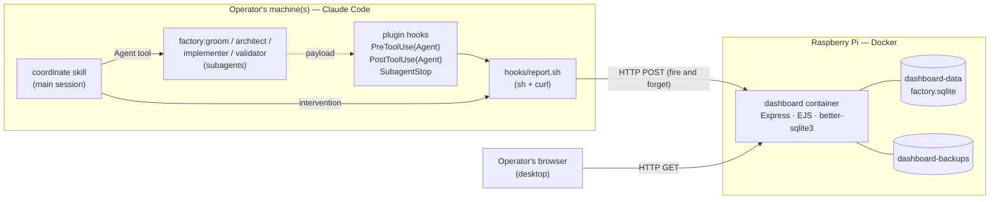

# 001 – Agent Factory Dashboard: design

- Requirements: docs/requirements/001-agent-factory-dashboard.md
- Status: Designed – ready for implementation
- Date: 2026-09-20
- Architecture: docs/architecture/overview.md

## Summary

Two halves in this repository. **The dashboard** is a small Node 22 application in `dashboard/`
that stores what the factory reports in a SQLite file and renders it as server-side HTML: three
tabs (Attention, Pipeline, Analytics) and a ticket detail page, in the supplied dark design. It is
one Docker container with two named volumes, started by the repository's `docker-compose.yml` on
the operator's Raspberry Pi, and it never writes anything back to the factory. **The reporting
side** is three Claude Code hooks shipped with the `factory` plugin: they fire when the coordinator
spawns an agent and when that agent finishes, and a five-line POSIX shell script posts the raw hook
payload to the dashboard with `curl`. The script always exits 0, so a dashboard that is down costs
history and never work (R9); the dashboard does all parsing, so the agent's output is stored byte
for byte as Claude Code produced it (R6). Operator interventions are the one thing no hook can
attribute to a ticket, so the coordinate skill reports them by calling the same script.

Everything the screens show is derived at request time from three tables. There is no client
framework, no build step for the browser, no second service, no login and no write path from the
browser.

## Drivers and constraints

| Driver | Source | In numbers | How the design meets it | Verified by |
|---|---|---|---|---|
| Runs on a Raspberry Pi shared with the factory | SC1, QE1 | Assume Pi 4/5, arm64, ≥ 4 GB RAM. Product budget: ≤ 256 MB RAM, ≤ 1.0 CPU, leaving ≥ 3.3 GB for Claude Code, the agents and the OS | One container, one process, no database server, Node heap capped at 192 MB, `mem_limit: 256m`, `cpus: "1.0"` | T-RES-1, T-PERF-1 |
| Dockerized despite the hardware | SC2 | 1 service, 2 named volumes, one command | `docker-compose.yml` at the repository root; `docker compose up -d` is the whole start | T-DEPLOY-1 |
| Images exist for the target CPU | SC1 | `linux/arm64` | `node:22-bookworm-slim` (glibc, arm64); build stage carries a compiler for `better-sqlite3` | T-ARCH-1 |
| Opening the dashboard and switching tabs feels immediate | QE2, QE5 | `GET /` p95 < 300 ms, `GET /ticket/...` p95 < 200 ms at 300 tickets / 3 000 runs on 1 CPU / 256 MB; tab switch < 50 ms, no network | All three tabs are rendered into one response and toggled client-side; every aggregate is one indexed SQLite query | T-PERF-1, T-PERF-2 |
| Reporting never breaks the factory | R9, QE6 | Hook adds ≤ 2 s (start) and ≤ 5 s (finish) worst case on a run that takes minutes; script exits 0 on every path; 0 tokens | `curl --connect-timeout 1 --max-time 2/5`; `exit 0` unconditionally; no LLM step in the report path | T-R9-1, T-R9-2, T-R9-3 |
| The factory must not become less reliable | QE6, R5 | 0 changes to what an agent writes or prints; 3 changed lines in the coordinate skill, 0 in the agent files | Hooks observe, they do not participate; the agent's Claude Code output is untouched | T-HOOK-2, review item in T-DEPLOY-1 |
| Agents in any repository report to the same dashboard | SC3, R3, R10 | 1 config file per installation (`~/.factory/dashboard.env`), 0 absolute paths in the repository | Reporter resolves URL, token and project key from the environment, then from that file | T-CFG-1, T-CFG-2 |
| Others host the dashboard elsewhere | SC4, R10 | Everything configurable through `.env`; nothing hard-codes a host, a port or a path | `.env.example` lists every variable; the image has no baked-in host | T-CFG-1 |
| History kept forever | R8, D9 | Nothing is deleted, ever. 300 tickets / 3 000 runs ≈ 80 MB; growth ≈ 50 tickets and 500 runs per year ≈ 13 MB/year | Append-only tables, no retention job, nightly backup of the volume | T-DATA-1, T-BACKUP-1 |
| Dark only, desktop browser only | QE3, QE4, OS5 | 1 stylesheet, 0 `prefers-color-scheme` rules, 0 breakpoints below 1024 px | The design file's own inline styles are kept verbatim | T-UI-1 |
| No login, no accounts, no roles | D8, OS3 | 0 user tables, 0 sessions, 0 auth on read routes | Read routes are open; the optional ingest token is transport configuration, not a login | T-UI-1 review item |
| The dashboard never acts | D1, OS1, OS2 | 0 write routes reachable from the browser | Only the factory's three ingest endpoints accept POST; every page is a GET | T-INT-9 |

## Decisions

| # | Decision | Reason |
|---|---|---|
| 1 | One Node 22 + Express 5 + EJS + SQLite container, server-rendered HTML | ADR-0001 |
| 2 | The supplied design file becomes EJS templates with its inline styles kept verbatim | ADR-0002 |
| 3 | The factory reports through Claude Code hooks, not through a skill the agent calls | ADR-0003 |
| 4 | The reporter posts raw payloads; the dashboard parses; tokens are a cumulative delta | ADR-0004 |
| 5 | The two attention thresholds are `.env` configuration, not a screen | ADR-0005 |
| 6 | A ticket is `(project, number)` internally and its number on screen | ADR-0006, CR1 |
| 7 | Fonts (IBM Plex Sans/Mono) are self-hosted `woff2` files, copied in the build stage from the pinned `@fontsource/ibm-plex-sans` and `@fontsource/ibm-plex-mono` dev dependencies | The Pi and the browser must not depend on Google Fonts at page load; the product otherwise has no outbound dependency |
| 8 | Interventions are rows in the same `run` table with `actor = 'human'` | R4 says an intervention is recorded "like an agent run"; one table gives the lane, the run list, the separate list and the count from one source |
| 9 | Run expansion uses native `<details>`; client JavaScript exists only for tab switching (~40 lines) | Fewer moving parts; the detail page works with JavaScript disabled |
| 10 | Timestamps are epoch milliseconds (`INTEGER`); the display zone comes from `TZ` (default `Europe/Berlin`) | One representation, one conversion point, testable with a fixed clock |
| 11 | `docs/.factory/run-NNN.md` is not read (LTA7) | It has no timestamps, no tokens and no agent output, and it only exists in repositories the coordinator ran in; everything the dashboard needs arrives through the hooks and the requirements document |
| 12 | The requirements document *is* read — by the reporter, on the machine where the agent runs (LTA7) | Title and requirements status are in `docs/requirements/NNN-*.md`; two `sed` lines produce them, and R2's stage mapping needs the status |

## Components



| Component | Responsibility | Code |
|---|---|---|
| `dashboard/src/server.ts` | Express app, config loading and validation, routes, error handler, request log, startup (migrations, sweeper, backup timer) | `dashboard/src/` |
| `dashboard/src/db/schema.ts`, `dashboard/migrations/*.sql` | Tables, indexes, forward-only migrations | `dashboard/src/db/` |
| `dashboard/src/db/queries.ts` | Every prepared statement; no SQL anywhere else | `dashboard/src/db/` |
| `dashboard/src/ingest/meta.ts` | Decode and validate `X-Factory-Meta` | `dashboard/src/ingest/` |
| `dashboard/src/ingest/payload.ts` | Extract output text, result, error flag and usage from a hook payload or a transcript tail; all the tolerant parsing lives here | `dashboard/src/ingest/` |
| `dashboard/src/ingest/routes.ts` | The three ingest endpoints, run matching, idempotency | `dashboard/src/ingest/` |
| `dashboard/src/domain/rules.ts` | R1 attention rules, R2 stage mapping, R7 online count, loop counting (D13) | `dashboard/src/domain/` |
| `dashboard/src/domain/metrics.ts` | Per-ticket metrics, per-agent spend, bounce counts | `dashboard/src/domain/` |
| `dashboard/src/domain/trends.ts` | Weekly bucketing, the four trends, delta and improvement, period naming (R8) | `dashboard/src/domain/` |
| `dashboard/src/domain/format.ts` | `fmtH`, `fmtTok`, `pct`, week labels — ported from the design file | `dashboard/src/domain/` |
| `dashboard/src/views/*.ejs` | `layout`, `overview`, `attention`, `pipeline`, `analytics`, `detail`, `empty`, `error` | `dashboard/src/views/` |
| `dashboard/src/public/` | `app.js` (tab switching), `app.css` (shared rules, `@font-face`, `:hover`), `fonts/*.woff2` | `dashboard/src/public/` |
| `dashboard/src/jobs/` | Abandoned-run sweeper, nightly backup with catch-up | `dashboard/src/jobs/` |
| `plugins/factory/hooks/hooks.json` | Registers the three hooks | `plugins/factory/hooks/` |
| `plugins/factory/hooks/report.sh` | The reporter: `run-start`, `run-finish`, `intervention` | `plugins/factory/hooks/` |

Nothing in `domain/` reads the clock, the database or the environment: every function takes plain
data plus `now` and the thresholds, so each rule is unit-testable with a fixed clock.

## Data model

One SQLite file, `/data/factory.sqlite`, WAL mode, `synchronous = NORMAL`, `busy_timeout = 5000`,
`foreign_keys = ON`. All timestamps are epoch milliseconds (`INTEGER`), UTC.

### `ticket`

| Field | Type | Null | Default | Notes |
|---|---|---|---|---|
| `project_key` | TEXT | no | – | e.g. `github.com/vkuras/factory`; never displayed (ADR-0006) |
| `number` | TEXT | no | – | as written in the filename, e.g. `001`; displayed as the ticket id |
| `title` | TEXT | no | – | from the `# NNN – Title` heading of the requirements document, verbatim |
| `slug` | TEXT | yes | `NULL` | from the filename, for diagnostics only |
| `requirements_status` | TEXT | yes | `NULL` | the `- Status:` line, verbatim; drives R2 |
| `agent_status` | TEXT | yes | `NULL` | the `STATUS:` value of the newest finished run |
| `first_seen_at` | INTEGER | no | – | earliest reported event for this ticket |
| `last_activity_at` | INTEGER | no | – | latest of any run's `started_at`, `ended_at`, or intervention time |
| `validated_at` | INTEGER | yes | `NULL` | when `requirements_status` first became `Validated` |
| `created_at`, `updated_at` | INTEGER | no | – | row bookkeeping |

Primary key `(project_key, number)`. Indexes: `idx_ticket_activity (last_activity_at DESC)`.
`title`, `requirements_status` and `slug` are overwritten by every report that carries them (the
newest report wins); `first_seen_at` is only ever set once; `validated_at` is only ever set once.

### `run`

One row per agent run **and** per operator intervention (decision 8).

| Field | Type | Null | Default | Notes |
|---|---|---|---|---|
| `id` | TEXT | no | – | UUID v4, generated by the dashboard |
| `project_key`, `number` | TEXT | no | – | FK → `ticket(project_key, number)`, `ON DELETE CASCADE` (nothing ever deletes) |
| `actor` | TEXT | no | – | `groom` \| `architect` \| `implementer` \| `validator` \| `human`; CHECK constraint |
| `started_at` | INTEGER | no | – | hook timestamp of the start (or of the intervention) |
| `ended_at` | INTEGER | yes | `NULL` | `NULL` = still running; for `human` equal to `started_at` |
| `result` | TEXT | yes | `NULL` | see §Run result below |
| `agent_status` | TEXT | yes | `NULL` | the parsed `STATUS:` value, `NULL` when there is none |
| `tokens` | INTEGER | yes | `NULL` | total tokens (all four usage counters); `NULL` = unknown; `0` for `human` |
| `output` | TEXT | yes | `NULL` | the agent's final message, verbatim, up to 64 KiB |
| `output_truncated` | INTEGER | no | `0` | `1` when the output exceeded 64 KiB |
| `summary` | TEXT | yes | `NULL` | the `SUMMARY:` line, else the first non-empty output line, else `NULL` |
| `status_before` | TEXT | yes | `NULL` | requirements status read at run start |
| `status_after` | TEXT | yes | `NULL` | requirements status read at run finish |
| `tool_use_id` | TEXT | yes | `NULL` | when the hook payload carries one; used for matching |
| `session_id` | TEXT | yes | `NULL` | Claude Code session; used for matching |
| `transcript_path` | TEXT | yes | `NULL` | used for the token delta |
| `created_at`, `updated_at` | INTEGER | no | – | row bookkeeping |

Indexes: `idx_run_ticket (project_key, number, started_at)`, `idx_run_open (ended_at) WHERE
ended_at IS NULL`, `idx_run_started (started_at)`, `uq_run_tool_use (tool_use_id) WHERE
tool_use_id IS NOT NULL` (unique).

**Run result.** The value shown as the badge in the run list and inside the swimlane block:

| Value | When |
|---|---|
| the agent's own `STATUS:` value (`groomed`, `in-grooming`, `designed`, `designed-with-conflicts`, `ready-for-validation`, `needs-architect`, `validated`, `changes-requested`, `needs-groomer`, `blocked-environment`, `escalated`, `nothing-to-do`) | a `STATUS:` line was parsed from the output |
| `failed` | the tool payload flags an error, or the parsed `STATUS:` is `failed` |
| `unreported` | the run finished but carried no parsable output |
| `abandoned` | no finish arrived within `RUN_STALE_HOURS` (default 12) |
| `intervention` | `actor = 'human'` |

### `ticket_status_event`

| Field | Type | Null | Notes |
|---|---|---|---|
| `id` | INTEGER | no | PK, autoincrement — also the tie-breaker for equal timestamps |
| `project_key`, `number` | TEXT | no | FK → `ticket` |
| `status` | TEXT | no | the requirements status, verbatim |
| `at` | INTEGER | no | when it was first observed |
| `run_id` | TEXT | yes | the run whose report revealed it |

Index `idx_status_ticket (project_key, number, at, id)`. A row is appended only when the observed
status differs from the ticket's most recent `ticket_status_event.status` (or when there is none).

### `hook_cursor`

Supports the cumulative token delta (ADR-0004).

| Field | Type | Null | Notes |
|---|---|---|---|
| `session_id` | TEXT | no | PK part; `''` when the payload has none |
| `transcript_path` | TEXT | no | PK part; `''` when the payload has none |
| `cum_tokens` | INTEGER | no | the last cumulative counter reported for this pair |
| `updated_at` | INTEGER | no | |

### `schema_migration`

| Field | Type | Notes |
|---|---|---|
| `version` | INTEGER | PK |
| `name` | TEXT | file name |
| `applied_at` | INTEGER | |

### Migration from the current state

There is no current state: the database does not exist yet. Migration `001_init.sql` creates all
five tables and their indexes. There is no user, session, role, permission or settings table
(ADR-0005), and no retention job (R8).

## Interfaces

### Write API — the factory to the dashboard

Common to all three endpoints:

- Method `POST`, `Content-Type: text/plain; charset=utf-8`. The body is read as raw text
  (`express.text({ type: '*/*', limit: '2mb' })`) and is **not** parsed by a JSON body parser,
  because a finish body carries two documents: the raw hook payload, then the line `---8<---`, then
  the tail of the transcript file. The dashboard splits on the first such line, `JSON.parse`s the
  first part (a parse failure is answered `400`) and treats the second part as JSONL, ignoring a
  leading partial line. A start body is the hook payload alone; an intervention body is empty.
  Maximum body size 2 MiB; larger is answered `413` and dropped.
- Header `X-Factory-Meta: <base64 of a UTF-8 JSON object>`, built by the reporter:

```json
{
  "v": 1,
  "event": "run-start",
  "ts": 1758367200000,
  "project": "github.com/vkuras/factory",
  "repo_path": "/home/pi/IdeaProjects/factory",
  "ticket": "001",
  "title": "Agent Factory Dashboard",
  "slug": "agent-factory-dashboard",
  "req_status": "Groomed – ready for architecture",
  "agent": "architect",
  "session_id": "1c0f…",
  "tool_use_id": "toolu_01…",
  "transcript_path": "/home/pi/.claude/projects/…/1c0f….jsonl",
  "cum_tokens": 4821334,
  "what": "…"
}
```

  `v`, `event`, `ts`, `project` and `ticket` are mandatory; a payload missing any of them is
  answered `400` and dropped. `agent` is mandatory for `run-start`, `what` for `intervention`.
- Header `Authorization: Bearer <token>` is required **if and only if** `FACTORY_INGEST_TOKEN` is
  set and non-empty on the dashboard; otherwise the header is ignored. A wrong or missing token
  when one is required is answered `401` and nothing is stored.
- Success is `204 No Content`. The reporter ignores the response either way and never retries
  (R9); every non-2xx is written to the reporter's local log so a silently broken setup can be
  diagnosed.

#### `POST /api/hook/run-start`

Creates the run and, if needed, the ticket.

1. Upsert `ticket (project, number)`: set `title`, `slug`, `requirements_status` from the meta;
   set `first_seen_at = min(existing, ts)`; set `last_activity_at = max(existing, ts)`; append a
   `ticket_status_event` if the status changed; set `validated_at` if the status is `Validated`
   and it is still `NULL`.
2. If `tool_use_id` is given and a run with it exists → do nothing (duplicate delivery).
3. If an open run exists for the same `(project, number, actor, session_id)` → do nothing.
4. Otherwise insert a run: `id = uuid()`, `actor = meta.agent`, `started_at = ts`,
   `status_before = meta.req_status`, `ended_at = NULL`, `result = NULL`.

#### `POST /api/hook/run-finish`

Resolves which run this finishes, in this order:

1. `tool_use_id`, when the meta carries one and a run has it.
2. the newest open run with the same `session_id` for `(project, number)`.
3. the newest open run for `(project, number)`.

If none of the three matches, the report is dropped and logged as `report_drop` — a finish without
a start is never turned into a run, because its actor is unknown. If the resolved run is already
finished, only fields that are still `NULL` are filled (`tokens`, `output`, `summary`,
`agent_status`, `status_after`); `ended_at` and `result` are never overwritten. That makes the
double delivery of `PostToolUse` and `SubagentStop` harmless in any order.

A payload that yields neither output text nor an error flag is **ignored** (answered `204`, logged
as `report_ignored`): that is what a `PostToolUse` acknowledgement of a backgrounded agent looks
like, and the real finish arrives later through `SubagentStop`.

Extraction from the body, in this order, all implemented in `ingest/payload.ts`:

| Field | Resolution order | When nothing matches |
|---|---|---|
| output text | `tool_response.content[]` text blocks joined with `\n` → `tool_response.content` as a string → `tool_response.text` → `tool_response` as a string → last transcript entry with `type = "assistant"` and `isSidechain = true`, else the last `type = "assistant"` entry, text blocks joined | the payload is *ignored* (see above) unless an error flag was found |
| error flag | `tool_response.is_error` \| `tool_response.isError` \| `is_error` is truthy, or `tool_response` is a string starting with `Error:` | `false` |
| usage | `tool_response.usage` (sum of `input_tokens`, `output_tokens`, `cache_creation_input_tokens`, `cache_read_input_tokens`) → `tool_response.totalTokens` → `tool_response.total_tokens` → `meta.cum_tokens` minus `hook_cursor.cum_tokens` for `(session_id, transcript_path)`, clamped at ≥ 0 | `NULL` |

Then:

- `result` = `failed` if the error flag is set, else the parsed `STATUS:` value, else `unreported`.
  The `STATUS:` value is the first match of `/^STATUS:[ \t]*([a-z-]+)/m` in the output; anything
  after a `|` or a space is ignored, so `STATUS: designed` yields `designed`.
- `agent_status` = the same parsed value, or `NULL`.
- `summary` = the text after `SUMMARY:` on the first line matching `/^SUMMARY:[ \t]*(.+)$/m`,
  trimmed; else the first non-empty line of the output, truncated to 200 characters with `…`;
  else `NULL`.
- `output` = the extracted text, unchanged, truncated to 64 KiB at a character boundary with
  `output_truncated = 1` (R6: no reformatting, no normalising, no reordering).
- `ended_at = meta.ts`, `status_after = meta.req_status`.
- `hook_cursor` is upserted to `meta.cum_tokens` whenever the meta carries one.
- The ticket is updated as in `run-start`, plus `agent_status` and a status event for
  `status_after`.

#### `POST /api/intervention`

Body is ignored. Creates the ticket if needed, then inserts a run with `actor = 'human'`,
`started_at = ended_at = meta.ts`, `tokens = 0`, `result = 'intervention'`,
`output = meta.what`, `summary = meta.what`, `status_before = status_after = meta.req_status`.
Idempotency: an intervention with the same `(project, number, ts, what)` already present is
ignored, so a repeated call by the coordinator cannot double-count (R4).

#### `GET /healthz`

`200 application/json`: `{"status":"ok","version":"<package version>","tickets":<count>,"openRuns":<count>}`.
Used by the compose healthcheck. Never requires a token.

### Read routes

| Route | Purpose | Notes |
|---|---|---|
| `GET /` | The three tabs in one response | `?tab=attention\|pipeline\|analytics`, default and fallback `attention` (R11) |
| `GET /ticket/:project/:number` | The detail view | `?from=attention\|pipeline\|analytics`, default `attention`, drives the "back to …" label. `:project` is URL-encoded; an unknown ticket renders the 404 page |
| `GET /assets/*` | `app.css`, `app.js`, `fonts/*.woff2` | `Cache-Control: public, max-age=604800` |
| `GET /healthz` | Liveness | – |

All HTML responses send `Cache-Control: no-store` (R12: the page is the state at load time, and a
reload must really reload) and the CSP of §Cross-cutting concerns. All read routes are open: there
is no login (D8). No read route writes anything except the lazy sweeper's `UPDATE` (below).

### Jobs

| Job | Trigger | What it does | Idempotency | Missed run |
|---|---|---|---|---|
| Abandoned-run sweeper | every 10 min, and at startup | Open runs with `started_at < now − RUN_STALE_HOURS` get `result = 'abandoned'`; `ended_at` stays `NULL` because the real end is unknown | `WHERE ended_at IS NULL AND result IS NULL` — re-running changes nothing | Nothing accumulates: the next sweep catches every stale run. The read path applies the same age filter itself, so "agents online" (R7) is correct even between sweeps |
| Nightly backup | daily at `BACKUP_AT` (default `03:15`) local time, and at startup if the newest backup is older than 24 h | SQLite online backup (`db.backup()`) to `/backups/factory-YYYY-MM-DD.sqlite`, then delete all but the newest `BACKUP_KEEP` (default 14) | Same-day backup overwrites the same file name | The startup catch-up covers a Pi that was off at 03:15; a run that is late never produces two files for one day |

Both jobs run inside the single application process; there is no cron container and nothing on the
host. Timers are scheduled from `Date.now()` in the `TZ` zone and re-armed after each run, so a DST
change shifts the next run at most one hour.

### External services

None. No API, no CDN, no font service, no telemetry, no outbound connection of any kind from the
container. The only inbound traffic is the operator's browser and the factory's reports.

## Business rules

Formatting helpers are ported from the design file and are part of the specification:

- `fmtTok(n)`: `n ≥ 1e6` → `(n/1e6).toFixed(2) + "M"`; `n ≥ 1000` → `(n/1000).toFixed(n >= 10000 ? 0 : 1) + "k"`; else the plain integer. `NULL` renders as `—`.
- `fmtH(h)` (hours): `h < 1` → `round(h*60) + "m"`; `h < 24` → `h.toFixed(h < 10 ? 1 : 0) + "h"`; else `(h/24).toFixed(1) + "d"`. Unknown renders as `—`.
- `pct(v, max)`: `max <= 0` → `"0%"`, else `max(2, round(v/max*100)) + "%"`.
- Week label: `"w" + ISO week number` of the bucket's Monday, in `TZ`.

### R1 – Attention rules

Evaluated per ticket, in this exact order; the **first** match decides reason, note and severity.
`LOOP` is `LOOP_THRESHOLD`, `IDLE` is `IDLE_HOURS` (ADR-0005). `loops` is defined under
§Ticket metrics. `failedRun` is true when any run of the ticket has `result` `failed` or
`blocked-environment` (see assumption A4).

| # | Condition | Reason | Severity | Colour | Note sentence |
|---|---|---|---|---|---|
| 1 | `requirements_status = 'Blocked – waiting for requirements'` | `needs requirements` | `blocking` | `#FF6B6B` | `Grooming needs a decision from you before anything moves.` |
| 2 | `requirements_status = 'Blocked – waiting for architecture'` | `design gap` | `blocking` | `#FF6B6B` | `The implementer hit a gap the design does not cover. The architect needs a ruling before the work continues.` |
| 3 | `failedRun && requirements_status != 'Validated'` | `agent run failed` | `check` | `#F5A524` | `An agent run aborted before it finished. Worth a glance that the re-run covered everything.` |
| 4 | `requirements_status = 'Changes requested – back to implementation'` | `changes requested` | `review` | `#F5A524` | `The validator sent the ticket back to implementation with findings.` |
| 5 | `loops >= LOOP` | `loop threshold` | `review` | `#F5A524` | `{loops} re-runs on this ticket, over your threshold of {LOOP}. The factory is spinning rather than converging.` |
| 6 | `agent_status = 'in-grooming'` | `open questions` | `answer` | `#5BC8F5` | `Grooming is holding open questions only you can answer.` |
| 7 | `idleHours >= IDLE && requirements_status != 'Validated'` | `idle` | `review` | `#F5A524` | `No agent has touched this for {fmtH(idleHours)}. Nothing is blocking it on paper.` |

The badge background is the colour at 12 % alpha (`colour + "1F"`), as in the design.
`idleHours = (now − last_activity_at)/3 600 000`.

**Ordering (S1.3):** severity rank `blocking = 0`, `check = 1`, `review = 2`, `answer = 3`,
ascending; within one rank, the larger `idleHours` first (untouched longest first); ties broken by
`number` ascending, so the order is stable.

Worked examples (test cases T-UNIT-R1-*):

| Ticket state | Expected |
|---|---|
| status `Blocked – waiting for requirements`, 5 loops, idle 40 h | rule 1, `needs requirements`, `blocking` |
| status `Implemented – ready for validation`, one earlier run with `result = failed`, idle 2 h | rule 3, `agent run failed`, `check` |
| status `Validated`, one earlier run with `result = failed`, idle 400 h | no attention (rules 3 and 7 both exclude `Validated`) |
| status `Designed – ready for implementation`, 3 loops, `LOOP = 3`, idle 1 h | rule 5, `loop threshold`, note `3 re-runs on this ticket, over your threshold of 3. …` |
| status `In grooming`, agent status `in-grooming`, 0 loops, idle 30 h, `IDLE = 24` | rule 6, `open questions`, `answer` (rule 6 precedes rule 7) |
| status `Groomed – ready for architecture`, 0 loops, idle 25 h, `IDLE = 24` | rule 7, `idle`, `review` |
| two tickets, both `blocking`, idle 30 h and 50 h | the 50 h one first |

### R2 – Stage of a ticket

| `requirements_status` | Stage | Owner | Stage colour |
|---|---|---|---|
| `In grooming` | Grooming | groom | `#5BC8F5` |
| `Groomed – ready for architecture` | Grooming | groom | `#5BC8F5` |
| `Designed – ready for implementation` | Design | architect | `#A78BFA` |
| `Implemented – ready for validation` | Implementation | implementer | `#F5A524` |
| `Validated` | Verification | validator | `#9EE84B` |
| `Changes requested – back to implementation` | Implementation | implementer | `#FF6B6B` |
| `Blocked – waiting for architecture` | Design | architect | `#FF6B6B` |
| `Blocked – waiting for requirements` | Grooming | groom | `#FF6B6B` |

The status colour is the card dot and the detail status badge. Owner colours are the agent colours:
groom `#5BC8F5`, architect `#A78BFA`, implementer `#F5A524`, validator `#9EE84B`, you `#FF7AB6`.

**Unknown or missing status** (a ticket reported before its requirements document had a status
line, or a status the factory later invents): stage = the stage owned by the actor of the newest
run (`groom` → Grooming, `architect` → Design, `implementer` → Implementation, `validator` →
Verification, `human` → the stage of the newest non-human run); no runs, or none of those → Grooming.
Owner = that actor, status colour `#6E7887`, and the status text is shown verbatim (empty →
`unknown`). Nothing is dropped from a column.

### R3 – Ticket identity

Internally `(project_key, number)`; on screen only `number` and `title` (ADR-0006, CR1). The
project is never rendered — not as a label, not as a tooltip, not as a table column. It appears in
the URL of the detail page because a URL needs to address the row; the operator never types it.

### R4 – The operator is part of the history

An intervention is a `run` row with `actor = 'human'` (decision 8). Consequences, all automatic
because every screen reads the same table:

- the `You` lane of the swimlane holds its block (zero length → clamped to the design's 3.5 %
  minimum width);
- it appears in the run list like any run, with the badge `intervention`, `no tokens`, its time and
  `0m`; expanded it shows `Your note` instead of `Final output` and lists `meta.what` as the single
  numbered line;
- it appears again in the `Your involvement` panel with its text and `t+…`;
- it counts towards `interventions`;
- it never contributes to `tokens` (stored as 0) or to agent working time (human runs are excluded
  from every duration sum).

### R5 / R6 – The agent's output

**R5** holds by construction: hooks observe the payload Claude Code has already produced. Nothing
in the report path changes what an agent writes, prints or returns; the agent is not even aware of
it. The verification is T-HOOK-2: the same run is captured with and without a dashboard and the
Claude Code transcript is byte-identical.

**R6** is a storage and rendering rule:

- The run's `output` is the agent's final message, stored exactly as received — no trimming beyond
  the 64 KiB cap, no normalising of whitespace, no reordering, no markdown rendering.
- The **numbered list** of an expanded run is that text split on `\n`, with empty lines removed,
  each remaining line numbered `01`, `02`, … in its original order, rendered as plain text
  (HTML-escaped, never as markdown). Line content is not classified, categorised, labelled or
  shortened; the design's `kind` column is gone (D6).
- The **one-line summary** in the collapsed run is the `SUMMARY:` line the agents already write,
  quoted verbatim; without one, the first non-empty line. The dashboard never composes a sentence
  of its own about a run.
- Under the numbered list, the design's `Final output` box keeps its role: it shows the summary
  line and the verdict `Ticket moved to "<status_after>"`, or `No status change` when
  `status_after` is missing or equal to `status_before` (S4.4).

What "output" means for a Claude Code subagent is its final message: that is the only thing the
operator sees in Claude Code today, which is what R6 measures the dashboard against (assumption A8).

### R7 – Agents online

At the moment the page is rendered: `count(runs where ended_at IS NULL and result IS NULL and
started_at > now − RUN_STALE_HOURS*3600000)`. The header shows
`{n} agents online` (`1 agent online` for exactly one) with the pulsing green dot `#9EE84B`; for
`n = 0` the dot is `#39414D`, static, and the text is `no agents running` (S2.2). The number is not
refreshed and no age indication is shown (R12, D5).

### R8 – History and trends

Nothing is deleted: there is no retention job, no archiving, no compaction, and every table only
ever grows.

**Buckets.** ISO weeks, Monday 00:00 in `TZ`. `currentWeek` is the week containing `now`;
`windowStart` is the Monday 25 weeks before `currentWeek`'s Monday (26 buckets in total, D4);
`dataStart` is the week containing the earliest `run.started_at` in the database. The rendered
buckets run from `max(windowStart, dataStart)` to `currentWeek` inclusive — between 1 and 26
buckets. A run belongs to the bucket of its `started_at`.

**The four series**, with `active(W)` = the distinct tickets with at least one run (any actor)
started in `W`:

| Card label (design wording) | Value for week `W` | Format |
|---|---|---|
| `Human calls / ticket` | `count(runs in W with actor='human') / |active(W)|`, `0` if `active(W)` is empty | `toFixed(1)` |
| `Loops / ticket` | `count(loop runs in W) / |active(W)|`, `0` if empty. A run is a *loop run* when it is not the first run of its actor on that ticket over the ticket's whole life, ordered by `started_at` (D13); human runs never count | `toFixed(1)` |
| `Lead time (h)` | mean over the tickets whose `validated_at` falls in `W` of `(validated_at − first_seen_at)/3.6e6`; `null` when no ticket was validated in `W` | `toFixed(0)` |
| `Compute (h)` | `sum over runs in W with actor != 'human' and ended_at not null of (ended_at − started_at)/3.6e6 / |active(W)|`; `0` if `active(W)` is empty | `toFixed(1)` |

**Delta and improvement (S5.2).** `first` = the earliest rendered bucket with a non-null value,
`last` = the latest one. `d = (last − first) / first * 100`.

- `first` is null, or `first = 0`, or `first === last` bucket → text `no comparison yet`, colour
  `#6E7887`, no improvement word.
- `d < 0` → `{d.toFixed(0)}% vs {firstLabel} · better`, colour `#9EE84B`.
- `d > 0` → `+{d.toFixed(0)}% vs {firstLabel} · worse`, colour `#FF6B6B`.
- `d = 0` → `0% vs {firstLabel} · unchanged`, colour `#6E7887`.

All four metrics are better when lower, which is what makes one improvement rule enough.

**Naming the period (S5.3).** Each card carries the line
`{firstLabel} – {lastLabel} · {n} weeks of data` under the card label. With a full window that
reads `w13 – w38 · 26 weeks of data`; with three weeks of history, `w36 – w38 · 3 weeks of data`.

**Bars.** Height `max(6, round(v / maxOfSeries * 68)) + "px"`; the last bucket is drawn in the full
card colour, all others at 33 % alpha (`colour + "55"`), as in the design. A `null` value draws no
bar. Every bar carries `title="{weekLabel} · {formatted value}"` (`no data` for null). Only the
last bar prints its value above the bar, and only the first, the middle and the last bucket print
their week label underneath — 26 labels do not fit in the design's card width (assumption A5).

### R9 – Reporting never breaks the factory

Enforced in four places:

1. `report.sh` has `exit 0` as its only exit, including on unset configuration, an unreadable
   transcript, a missing `curl`, a non-2xx answer and a `curl` timeout. It writes nothing to stdout
   and nothing to stderr that Claude Code would surface.
2. `curl --connect-timeout 1 --max-time 2` for a start, `--max-time 5` for a finish; `hooks.json`
   sets `"timeout": 10` per hook as a second net.
3. Nothing in the report path asks a model for anything: no skill call, no tool call, no token.
4. The dashboard answers every accepted report with `204` and never asks for a retry; there is no
   queue, no backpressure and no state on the factory side. A report that is lost is lost, and the
   ticket simply has a gap in its history.

Failure modes and their effect: dashboard down → nothing stored, run unaffected; dashboard slow →
at most 2 s + 5 s added to a multi-minute run; wrong token → `401`, logged locally, run unaffected;
start lost, finish arrives → finish is dropped (no actor) and the run is missing; finish lost →
the run stays open and the sweeper marks it `abandoned` after 12 h.

### R10 – Where to report is configurable

The reporter resolves its configuration per installation:

1. environment variables of the Claude Code process;
2. `~/.factory/dashboard.env`, a `KEY=value` file sourced by `sh`; a value already set in the
   environment wins over the file.

| Variable | Meaning | Default |
|---|---|---|
| `FACTORY_DASHBOARD_URL` | Base URL of the dashboard, e.g. `http://pi.local:8787` | unset → **reporting is off**, the hook exits immediately |
| `FACTORY_INGEST_TOKEN` | Bearer token, must match the dashboard's | empty |
| `FACTORY_PROJECT_KEY` | Overrides the derived project key | derived |
| `FACTORY_REPORT_LOG` | Where failures are logged | `~/.factory/report.log`, trimmed to the last 200 lines |
| `FACTORY_TRANSCRIPT_TAIL_BYTES` | How much transcript tail is sent on finish | `262144` |

The project key is `git -C <repo> remote get-url origin` reduced to `host/owner/repo` (scheme,
`.git` suffix, credentials and `ssh://git@` form removed), else the basename of the repository
directory. No repository path, host name or port is hard-coded anywhere in the repository, which is
what makes another person's installation a matter of one file (SC4).

### R11 – Landing tab

`GET /` renders with `tab = attention` unless `?tab=` names another one; an unknown value falls
back to `attention`. Tab switching happens client-side and does not change the URL, so a reload
always lands on Attention again.

### R12 – The page is a snapshot

No polling, no websocket, no `<meta http-equiv="refresh">`, no "synced …" text anywhere (D5), no
relative age of the data. Every HTML response carries `Cache-Control: no-store` so the operator's
reload really re-reads the database. All times rendered as `t+…` or as durations are computed from
the request's `now`.

### Ticket metrics (S1.4, S3.2, S4.1, S5.4)

For one ticket, over its whole life:

| Metric | Definition |
|---|---|
| `runs` | count of runs with `actor != 'human'` |
| `loops` | `sum over actors of max(0, count(runs of that actor) − 1)` (D13; human excluded) |
| `interventions` | count of runs with `actor = 'human'` |
| `tokens` | sum of `tokens` over runs with `actor != 'human'`; `NULL` values are skipped, not counted as 0 |
| `workingTime` (design: *compute*) | sum of `(ended_at − started_at)` over runs with `actor != 'human'` and `ended_at NOT NULL`, in hours |
| `leadTime` (design: *lead time*, *elapsed*) | `((validated_at ?? now) − first_seen_at)` in hours — a validated ticket's lead time freezes (assumption A12) |
| `idle` | `(now − last_activity_at)` in hours |
| `byAgent` | per agent: summed tokens and summed duration, for the detail page's `Tokens per agent` |

### S7 – Thresholds

`LOOP_THRESHOLD` (default `3`) and `IDLE_HOURS` (default `24`) come from the environment
(ADR-0005), are validated at startup as integers ≥ 1, and are passed into the rule functions. The
loop threshold also appears in the note text of R1 rule 5, so a changed threshold is visible in the
UI without any other change. No other threshold exists and no threshold is editable in the browser.

## User interface

English, dark only, desktop only. Colours, spacing, fonts, captions and icons come from
`Agent Factory Dashboard.dc.html`; every literal string below is from that file unless it is marked
as new. Page background `#0A0C0F`, text `#E6E9EE`, IBM Plex Sans 14 px / 1.45, IBM Plex Mono for
every number, id and label.

### Screen 1 — Overview, `GET /`

**Header** (always): eyebrow `Control room`, title `Agent Factory`; on the right the online
indicator of R7. The design's `/ synced 2 min ago` is removed (D5).

**Tab bar**: `Attention`, `Pipeline`, `Analytics`, each with a mono count badge — attention count,
total tickets, total tickets. The active tab is `#E6E9EE` with a `#9EE84B` underline. Hidden
entirely when there is no ticket at all.

**Tab 1 – Attention** (S1). Serves S1.1–S1.6, S2.

- One card per ticket that matches an attention rule, in R1's order. Left border in the severity
  colour. Card content: mono id, bold title, the reason badge (mono, uppercase, tinted), the note
  sentence, then the mono meta row `status · {status}`, `owner · {ownerLabel}`,
  `idle · {fmtH(idle)}`, `loops · {loops}`, `you · {interventions}x`. On the right the severity
  word in the severity colour and the `open ticket →` chip. The whole card links to
  `/ticket/{project}/{number}?from=attention`.
- Below: `Running on their own · {count}` and a responsive grid of compact chips (owner dot, mono
  id, title, ellipsised) for every ticket that matches no rule, ordered by `last_activity_at`
  descending. Each chip links to the detail page with `from=attention`.
- **Empty state (S1.6)**: when tickets exist but none needs attention, the card list is replaced by
  one panel in the card style: `Nothing needs you.` (18 px, `#E6E9EE`) and, underneath,
  `All {n} tickets are running on their own.` (13 px, `#A6B0BE`). The `Running on their own`
  section is still rendered below it. *(New text; the design has no empty state.)*

**Tab 2 – Pipeline** (S3). Four columns in the R2 order — `Grooming` (`requirements & open
questions`), `Design` (`architecture decisions`), `Implementation` (`code & fix rounds`),
`Verification` (`validated or in review`) — each with its stage colour, its count and its hint line.
Cards inside a column are ordered by `last_activity_at` descending and show: mono id and the status
dot, the title, the status text, and the mono row `↻ {loops}`, `◔ {fmtH(leadTime)}`,
`⌁ {fmtTok(tokens)}`, `☺ {interventions}` (the last in `#FF7AB6` when there were interventions,
`#5D6673` otherwise). A column with no ticket shows its header, its count `0` and nothing else.

**Tab 3 – Analytics** (S5).

1. Four trend cards in the order `Human calls / ticket`, `Loops / ticket`, `Lead time (h)`,
   `Compute (h)`, each with the delta text, the period line, the bars and the week labels of R8.
2. `Per ticket · lifetime` table with the design's columns `ticket`, `title`, `your calls`,
   `loops`, `lead time`, `compute`, `tokens`; every numeric cell except tokens carries the design's
   mini bar (`#FF7AB6`, `#F5A524`, `#5BC8F5`, `#9EE84B`) at `pct(value, columnMax)`. Ordered by
   interventions desc, then loops desc, then number asc. Every row links to the detail page with
   `from=analytics`.
3. `Token spend per agent`: one bar per agent that has runs, in the order groom, architect,
   implementer, validator, with `{fmtTok(tokens)} · {fmtH(time)}` and a bar at
   `pct(tokens, maxTokens)` (S5.5).
4. `Where tickets bounce back` (S5.6): `validator → implementer` (runs with `actor = validator`
   and `result = changes-requested`, `#F5A524`), `validator → architect`
   (`result = needs-architect`, `#A78BFA`), `validator → groom` (`result = needs-groomer`,
   `#5BC8F5`), `implementer → architect` (`actor = implementer`, `result = needs-architect`,
   `#A78BFA`), `agent run failed` (`result` in `failed`, `blocked-environment`, `#FF6B6B`). Five
   rows instead of the design's four, because the validator can hand back to the architect as well
   and S5.6 asks for every junction; the row layout is the design's, repeated.

**Empty state of the whole page (S1.7)**: when no ticket exists at all, the tab bar and all three
tabs are replaced by a single centred panel: `Nothing here yet.` and
`The dashboard fills up as soon as the factory reports its first agent run.` The header, including
`no agents running`, stays. *(New text.)*

**Loading, offline, error, no-permission states**: there is no loading state — the page is rendered
complete or not at all (R12). Offline is the browser's own error page; the product has no client
data and nothing to cache. A server error renders the dark error page (`Something went wrong.` plus
the request id) with status 500. There is no permission state, because there are no permissions.

### Screen 2 — Ticket detail, `GET /ticket/:project/:number`

Serves S4 and is reachable from every ticket in every tab.

- `← back to {from}` button (mono, uppercase, `#9EE84B`), linking to `/?tab={from}`.
- Head: mono id, title, the status badge tinted in the status colour, and
  `agent status · {agent_status}` in the owner colour (`—` when there is none).
- Six metric tiles in the design's order: `lead time` `{fmtH(leadTime)}`, `agent compute`
  `{fmtH(workingTime)}` (`#9EE84B`), `loops` (`#F5A524` when `>= LOOP_THRESHOLD`), `your calls`
  (`#FF7AB6` when `> 0`), `tokens` `{fmtTok(tokens)}` (`#5BC8F5`), `runs` (S4.1).
- `Route · swimlanes over time` with `span {fmtH(span)} · {n} agent runs` on the right. Five lanes
  in the order groom, architect, implementer, validator, You. `t0` is the ticket's
  `first_seen_at`, `span` is `max(ended_at ?? now) − t0`; a block sits at
  `left = (started_at − t0)/span`, `width = max(3.5 %, duration/span)`, filled with the lane colour
  at 18 % alpha and bordered in it at 47 %. A run whose result is `failed`, `blocked-environment`
  or `abandoned` is bordered `#FF6B6B` with `#FF9B9B` text and a lower fill, which is how "marked
  as such" (S4.2) is rendered. A block wider than 11 % prints its result inside; every block has
  `title="{Agent} · {result} · t+{fmtH(offset)} · {fmtH(duration)}"`. A still-running block ends at
  `now`; an `abandoned` block without an end is drawn at the 3.5 % minimum. Six ticks underneath at
  `fmtH(span*i/5)`, and the legend of the five lane colours.
- `Agent output log` (S4.3, S4.4), newest `started_at` first, one `<details>` per run:
  - collapsed: the agent label in its colour, the result badge, on the right
    `t+{fmtH(offset)} · {fmtH(duration)} · {fmtTok(tokens)} tok` (`no tokens` when 0, `—` when
    unknown), the summary line, `→ {status_after}` when the ticket moved, and the toggle
    `show full run ▼`. The `t+…` element carries `title="{YYYY-MM-DD HH:mm}"` in `TZ`, so "when it
    started" (S4.3) is available as an absolute time as well as an offset;
  - expanded: `run #{k} · {n} steps · {fmtH(duration)} · {tokens}` (for a human run
    `manual · 1 step · 0m · no tokens`), where `k` counts that actor's runs on this ticket; the
    numbered output lines of R6 in a two-column grid (`01`, text) — the design's `kind` column is
    gone (D6); then the `Final output` box (`Your note` for a human run) with the summary and the
    verdict `Ticket moved to "…"` or `No status change`; and the toggle `hide full run ▲`.
- Right column: `Tokens per agent` (bars per agent that has runs on this ticket),
  `Your involvement` (S4.5: one pink-dotted entry per intervention, its text and `t+{fmtH(offset)}`,
  oldest first; `No interventions yet.` when there are none — *new text*), and `Status trail`
  (S4.6: the `ticket_status_event` rows oldest first, each with a dot in that status's colour).
- Unknown ticket → 404 page `That ticket is not here.` with a link back to the overview.
  *(New text.)*

### Client behaviour

`app.js` (~40 lines, no framework, no bundler): it hides all tab panels but the one named by
`?tab=` (default Attention), and switches the visible panel plus the active tab style on a click.
It stores nothing, fetches nothing and touches no timer (R12). With JavaScript disabled all three
panels are visible one below the other and every link still works. Run expansion is native
`<details>`; the two toggle labels are one element each, shown and hidden by
`details[open] .af-when-closed { display:none }`.

## Cross-cutting concerns

- **Identity and access.** None. No accounts, no login, no roles (D8, OS3). Read routes are open.
  The ingest endpoints take an optional bearer token (`FACTORY_INGEST_TOKEN`); empty by default,
  because the normal installation is a private network and `docker compose up -d` has to be the
  whole setup. When it is empty and `DASHBOARD_BIND` is not a loopback address, the startup log
  prints one warning line. There is nothing to leak: no personal data, no credential and no secret
  is stored.
- **Data ownership and concurrency.** One process is the only writer; SQLite in WAL mode serialises
  the rest. Two reports for the same run are resolved by the matching and fill rules of
  §Interfaces, so the later one never overwrites the earlier one's facts. The browser never writes.
- **Untrusted content.** Everything an agent reports is untrusted text and is rendered with EJS's
  escaping `<%= %>`; `<%- %>` is forbidden for reported data and allowed only for markup this
  codebase produced. Output is never rendered as markdown or HTML. CSP on every HTML response:
  `default-src 'self'; script-src 'self'; style-src 'self' 'unsafe-inline'; img-src 'self' data:;
  frame-ancestors 'none'; base-uri 'none'`. `X-Content-Type-Options: nosniff`.
- **Time.** Stored in epoch milliseconds UTC; rendered in `TZ` (default `Europe/Berlin`) through
  `Intl`. ISO weeks start Monday. DST is handled by the zone, and the two timers re-arm after each
  run, so the nightly backup stays at its wall-clock time. Every domain function takes `now`, so
  tests are deterministic.
- **Failure and recovery paths.** A missed backup is caught up at startup; a re-run of the sweeper
  changes nothing; a duplicated report is ignored or merged, never double-counted; a crash mid-run
  leaves an open run that becomes `abandoned` after 12 h, which keeps R7 honest; a restore replaces
  the database file while the container is down, and the next reports simply append. No recovery
  path can produce a second `run` row for the same run, because every write is keyed by
  `tool_use_id` or by the open-run match.
- **Errors.** One Express error handler. Render errors produce the dark 500 page with a request id;
  ingest errors produce `400`/`401`/`413` and a log line; an unexpected ingest exception produces
  `500` and a log line, and the reporter still exits 0. No error is ever shown to the factory.
- **Observability.** One JSON line per request on stdout
  (`{"t","lvl","event","method","path","status","ms","id"}`), plus `report_drop`,
  `report_ignored`, `backup_done`, `sweep_done` and the startup configuration line with the token
  redacted. Docker's json-file driver is capped at 3 × 10 MB, because the Pi writes to an SD card.
- **Locale and accessibility.** UI language English (project rule). Numbers use the design's own
  formatters, not locale formatting. `<html lang="en">`, semantic `<button>`/`<a>`/`<details>`,
  `title` attributes for every bar and block, focus outlines left at the browser default. Contrast
  is the design's; no colour is the only carrier of meaning (severity, result and failure are
  always spelled out in words as well).
- **Files and media.** None: no upload, no image, no attachment.
- **Offline use.** Not a requirement for this product (R12 makes the page a snapshot); nothing is
  cached and no service worker exists.

## Changes to the factory plugin (S6)

Six files. Nothing changes in what an agent does or writes (R5).

### 1. `plugins/factory/hooks/hooks.json` (new)

```json
{
  "hooks": {
    "PreToolUse": [
      { "matcher": "Agent|Task",
        "hooks": [ { "type": "command", "timeout": 10,
                     "command": "sh \"${CLAUDE_PLUGIN_ROOT}/hooks/report.sh\" run-start" } ] }
    ],
    "PostToolUse": [
      { "matcher": "Agent|Task",
        "hooks": [ { "type": "command", "timeout": 15,
                     "command": "sh \"${CLAUDE_PLUGIN_ROOT}/hooks/report.sh\" run-finish" } ] }
    ],
    "SubagentStop": [
      { "hooks": [ { "type": "command", "timeout": 15,
                     "command": "sh \"${CLAUDE_PLUGIN_ROOT}/hooks/report.sh\" run-finish" } ] }
    ]
  }
}
```

`plugins/factory/.claude-plugin/plugin.json` gains `"hooks": "./hooks/hooks.json"`. The implementer
verifies in slice 1 that the installed plugin registers all three (`claude plugin details factory`)
and, if the manifest key is rejected by the installed Claude Code version, keeps only the
conventional `hooks/hooks.json` location and records that in the implementation report.

### 2. `plugins/factory/hooks/report.sh` (new)

POSIX `sh`, no bashisms, uses only `cat`, `grep`, `sed`, `awk`, `date`, `base64`, `curl` and
`git`. Structure:

1. `exec 2>/dev/null`; every path ends in `exit 0`.
2. Read stdin into `$TMP` (`mktemp`), always removed by a `trap`.
3. Load configuration: remember the environment values, `. ~/.factory/dashboard.env` if it exists,
   restore the remembered environment values. No `FACTORY_DASHBOARD_URL` → `exit 0`.
4. `REPO` = the `"cwd"` value from the payload
   (`sed -n 's/.*"cwd"[ ]*:[ ]*"\([^"]*\)".*/\1/p'`, first match), else `$PWD`.
5. `TICKET` = the first match of `grep -oE 'docs\\?/requirements\\?/[0-9]{3,}'` over the payload
   (which also catches the JSON-escaped `docs\/requirements\/001`), reduced to its digits. For
   `run-finish` the transcript file is searched as well. No ticket → `exit 0`. This is also the
   filter that keeps non-factory subagents out of the dashboard.
6. For `run-start`: `AGENT` = the first match of
   `grep -oE '"subagent_type"[ ]*:[ ]*"(factory:)?(groom|architect|implementer|validator)"'`,
   reduced to the bare agent name. No agent → `exit 0`.
7. `TITLE` and `REQ_STATUS` from `"$REPO"/docs/requirements/$TICKET-*.md`: the first line
   (`# NNN – Title`, with `# NNN – ` stripped) and the first `- Status:` line (with `- Status: `
   stripped). Missing file → both empty; the dashboard then keeps what it already knows and falls
   back to the ticket number as the title.
8. `PROJECT` = `$FACTORY_PROJECT_KEY`, else `git -C "$REPO" remote get-url origin` normalised to
   `host/owner/repo`, else `basename "$REPO"`.
9. For `run-finish`: `TRANSCRIPT` = the `"transcript_path"` value; `CUM` = the cumulative token
   counter, `grep '"isSidechain":true' "$TRANSCRIPT"` (falling back to the whole file when that
   yields nothing) piped through
   `grep -oE '"(input_tokens|output_tokens|cache_creation_input_tokens|cache_read_input_tokens)":[0-9]+'`
   and summed with `awk -F: '{s+=$2} END{print s+0}'`.
10. Build the meta JSON by hand, escaping `\` and `"` in `TITLE`, `REQ_STATUS` and `WHAT`
    (`sed 's/\\/\\\\/g; s/"/\\"/g'`), then `base64 | tr -d '\n'`.
11. POST: body = the payload for `run-start`, the payload plus the last
    `FACTORY_TRANSCRIPT_TAIL_BYTES` of the transcript for `run-finish` (sent as the body of
    `/api/hook/run-finish` with the transcript tail appended after a `\n---8<---\n` separator line,
    which the dashboard splits on), nothing for `intervention`.
    `curl -sS -o /dev/null -w '%{http_code}' --connect-timeout 1 --max-time 2|5 -X POST -H
    'Content-Type: application/json' -H "X-Factory-Meta: $META" [-H "Authorization: Bearer …"]
    --data-binary @- "$URL/api/hook/run-start|run-finish|/api/intervention"`.
12. A non-2xx status or a `curl` failure appends one line to `$FACTORY_REPORT_LOG`, which is then
    trimmed to its last 200 lines. Then `exit 0`.

`intervention` mode takes flags instead of stdin: `--ticket NNN --repo <abs path> --what "<text>"`,
runs steps 3, 7, 8, 10 and 11 and exits 0 the same way.

### 3. `plugins/factory/skills/coordinate/SKILL.md` (changed)

Three additions, nothing removed:

- In §2 *Run the stage*, after the task-message template: the first two lines of every task message
  are exactly `Product repo: <abs path>` and `Requirements: NNN (docs/requirements/NNN-<slug>.md)`,
  because the dashboard's reporting hook reads the ticket and the repository from them. Without the
  requirements path in the message the run is not reported and the ticket loses that piece of its
  history.
- A new §4a *Record the stakeholder's interventions*: whenever the stakeholder has decided,
  answered, unblocked or changed something and you continue, record it before you route on:

  ```
  sh "<this skill's base directory>/../../hooks/report.sh" intervention \
     --ticket NNN --repo /abs/path/to/repo --what "<one line, what they did, in the repo language>"
  ```

  It always succeeds and always exits 0; if the file is not there, skip it and continue. Never let
  it block the pipeline, and never report an intervention you invented — only something the
  stakeholder actually did.
- In §*Never*: never describe the dashboard's state to the stakeholder as if you had read it; you
  report to it, you do not read from it.

### 4. `plugins/factory/agents/{groom,architect,implementer,validator}.md` (unchanged)

No change is needed: the hooks read the final message these files already prescribe. The
`STATUS:` line gives the result and the agent status, the `SUMMARY:` line gives the one-line
summary, and `REQUIREMENTS: docs/requirements/NNN-<slug>.md` is the fallback ticket marker. The
implementer must not change these formats while building this MVP; if one of them changes later,
§Interfaces is the contract that breaks.

### 5. `.env.example` (new, repository root) and `README.md` (changed)

`.env.example` lists every dashboard variable (see §Deployment). The README gains a
*Dashboard* section: what it shows, `docker compose up -d`, the `.env` variables, how to point a
machine at it (`~/.factory/dashboard.env`), how to verify reporting
(`GET /healthz`, then one coordinator round), and how to restore a backup.

## Deployment and runtime

The dashboard is built from `dashboard/` and started by `docker-compose.yml` at the repository
root. The reporting side needs no deployment: it ships with the plugin and is configured with one
file per machine.

### Compose stack

| Service | Image or build | Ports (internal / published) | Volumes | Depends on | Healthcheck | Memory limit | Restart |
|---|---|---|---|---|---|---|---|
| `dashboard` | build `./dashboard` (multi-stage, `node:22-bookworm-slim`) | `8787` / `${DASHBOARD_BIND:-0.0.0.0}:${DASHBOARD_PORT:-8787}:8787` | `dashboard-data:/data`, `dashboard-backups:/backups` | – | `CMD-SHELL node -e "fetch('http://127.0.0.1:8787/healthz').then(r=>process.exit(r.ok?0:1)).catch(()=>process.exit(1))"`, interval 30 s, timeout 5 s, retries 3, start_period 20 s | `mem_limit: 256m`, `cpus: "1.0"` | `unless-stopped` |

Named volumes: `dashboard-data` holds `/data/factory.sqlite` and its WAL files — the entire history
(R8); `dashboard-backups` holds `/backups/factory-YYYY-MM-DD.sqlite`, the last 14. Logging:
`json-file`, `max-size: 10m`, `max-file: "3"`. There is no second service, no reverse proxy and no
published database port, because there is no database server and no TLS requirement on a home
network.

**Environment and secrets.** `.env` at the repository root is not committed (`*.env` is already in
`.gitignore`); `.env.example` is committed and lists all of them:

| Variable | Purpose | Default |
|---|---|---|
| `DASHBOARD_PORT` | published port | `8787` |
| `DASHBOARD_BIND` | published bind address (`127.0.0.1` locks it to the Pi itself) | `0.0.0.0` |
| `TZ` | display zone and the backup's wall-clock time | `Europe/Berlin` |
| `LOOP_THRESHOLD` | R1 rule 5 / S7 | `3` |
| `IDLE_HOURS` | R1 rule 7 / S7 | `24` |
| `RUN_STALE_HOURS` | when an unfinished run counts as abandoned | `12` |
| `FACTORY_INGEST_TOKEN` | bearer token required on ingest when non-empty | empty |
| `BACKUP_AT` | local time of the nightly backup, `HH:MM` | `03:15` |
| `BACKUP_KEEP` | backups retained | `14` |

Fixed inside the image: `NODE_ENV=production`, `PORT=8787`, `DB_PATH=/data/factory.sqlite`,
`BACKUP_DIR=/backups`, `NODE_OPTIONS=--max-old-space-size=192`. The only secret in the product is
the optional ingest token; it exists only in `.env` and in each machine's
`~/.factory/dashboard.env`.

**Dockerfile.** Two stages on `node:22-bookworm-slim`, pinned to the current `22.x.y` patch tag at
build time and recorded in the implementation report.

- *builder*: `apt-get install -y --no-install-recommends python3 make g++` (fallback for
  `better-sqlite3` when no arm64 prebuild matches), `npm ci`, `npm run build` (TypeScript → ESM in
  `dist/`), copy the IBM Plex `woff2` files out of the `@fontsource/*` dev dependencies into
  `dist/public/fonts/`, then `npm prune --omit=dev`.
- *runtime*: copy `dist/`, `node_modules/`, `migrations/`, `package.json`; `mkdir -p /data
  /backups && chown node:node /data /backups`; `USER node`; `EXPOSE 8787`;
  `CMD ["node","dist/server.js"]`. No shell entrypoint, no init system, no compiler in the final
  image.

**Startup.** `docker compose up -d` is the whole start, locally and on the Pi. The process: loads
and validates the configuration (aborting with one line naming the offending variable), opens the
database, applies pending migrations from `migrations/*.sql` in order, each in its own transaction,
recorded in `schema_migration`, runs the sweeper and the backup catch-up, then listens. There is no
start order to manage because there is one service.

**Backups and restore.** Nightly online backup as described in §Jobs. Restore:
`docker compose down`, copy the chosen `factory-YYYY-MM-DD.sqlite` over
`dashboard-data/factory.sqlite` (for example with a throwaway `busybox` container that mounts both
volumes), delete any `-wal`/`-shm` files next to it, `docker compose up -d`. The README carries the
exact commands, and T-BACKUP-1 runs them.

### Resource budget

| Component | Limit | Expected use | Notes |
|---|---|---|---|
| `dashboard` container | 256 MB, 1.0 CPU | ≈ 60 MB idle, ≈ 110 MB peak while rendering the analytics tab at 300 tickets / 3 000 runs | Node heap capped at 192 MB; the rest is the runtime and SQLite's page cache (`cache_size = -8000`, 8 MB) |
| Disk, database | – | ≈ 80 MB at 300 tickets / 3 000 runs; ≈ 13 MB/year growth | Dominated by `run.output` (≈ 4 KB per run, 64 KiB cap) |
| Disk, backups | – | 14 × the database size, ≈ 1.1 GB worst case at the volumes above, ≈ 30 MB in the first year | `BACKUP_KEEP` bounds it |
| Reporter on the host | – | one `sh` + one `curl`, < 10 MB, 2–3 times per agent run | Not a container: it runs inside the operator's Claude Code session |
| **Left for the factory and the OS** | – | ≥ 3.3 GB of a 4 GB Pi | Claude Code and the agents are the machine's real workload |

SD-card wear: 2–3 small transactions per agent run (tens per day) in WAL mode with
`synchronous = NORMAL`, plus one backup file a night. That is orders of magnitude below what wears
a card out.

## Test strategy

Vitest 3 for unit and integration tests, `supertest` for HTTP, `cheerio` for DOM assertions,
`shellcheck` plus a `sh`-driven test for the reporter. `npm test` runs everything that does not
need Docker; `npm run test:stack` runs the ones that do. Every domain function takes an injected
`now`, so no test depends on the real clock.

| ID | Level | What it proves |
|---|---|---|
| T-UNIT-R1-1…7 | unit | Each attention rule fires on its own condition, with the exact reason, severity and note text, including the worked examples of §R1 |
| T-UNIT-R1-ORD | unit | Ordering by severity, then longest untouched, then number (S1.3) |
| T-UNIT-R2-1 | unit | All eight statuses map to the right stage and owner; an unknown status falls back as specified |
| T-UNIT-MET-1 | unit | loops (D13), interventions, tokens with `NULL`s, working time, lead time frozen at `validated_at`, idle |
| T-UNIT-TRD-1…4 | unit | Weekly bucketing over 26 weeks, each of the four series, `null` lead-time weeks, delta, the three improvement words, the period line with 1, 3 and 26 weeks of data (S5.1–S5.3) |
| T-UNIT-FMT-1 | unit | `fmtH`, `fmtTok`, `pct` reproduce the design's output for a table of inputs including `0`, `59 m`, `9.9 h`, `10 h`, `24 h`, `999`, `1 000`, `9 999`, `10 000`, `1 000 000` |
| T-UNIT-OUT-1 | unit | Output handling: verbatim storage, the numbered split (blank lines dropped, order kept, no classification), `SUMMARY:` extraction and its fallback, `STATUS:` extraction, the 64 KiB cap (R6) |
| T-HOOK-1 | unit | `ingest/payload.ts` against **real captured payloads** — `PreToolUse`, a foreground `PostToolUse`, a background `PostToolUse` acknowledgement, a `SubagentStop` with a transcript tail, and an error case — committed as fixtures in slice 1 |
| T-HOOK-2 | manual, scripted | One coordinator round with and without a reachable dashboard: the Claude Code output is identical (R5) and the run appears in the dashboard (S6.1–S6.3) |
| T-HOOK-3 | integration | The token delta: two consecutive runs in one shared transcript are charged their own share; a per-subagent transcript charges the full sum; a missing counter stores `NULL` |
| T-INT-1…9 | integration | Ingest: start creates ticket and run; finish fills it; duplicate start and duplicate finish change nothing; finish before start is dropped and logged; both hooks delivering a finish merge; `400` on bad meta; `401` with a token set; `413` over 2 MiB; `GET` is the only verb the browser can use (T-INT-9) |
| T-INT-A1…A7 | integration | The Attention tab: every S1 criterion, both empty states, the calm list and its count |
| T-INT-P1…P3 | integration | The Pipeline tab: four columns, counts, card fields, placement per R2 |
| T-INT-D1…D6 | integration | The detail page: six metrics, lanes with a failed run marked, run list newest first, expansion with the numbered list and the verdict, interventions panel, status trail |
| T-INT-N1…N6 | integration | The Analytics tab: four trends, delta and improvement word, the short-history period line, the per-ticket table and its order, per-agent spend, the five bounce rows |
| T-UI-1 | integration | The rendered HTML contains the design's literal captions (`Control room`, `Agent Factory`, `Running on their own`, `Route · swimlanes over time`, `Agent output log`, `Tokens per agent`, `Your involvement`, `Status trail`, `Per ticket · lifetime`, `Token spend per agent`, `Where tickets bounce back`) and its palette (`#0A0C0F`, `#12151A`, `#9EE84B`, `#FF7AB6`, `#5BC8F5`, `#A78BFA`, `#F5A524`, `#FF6B6B`); no `synced`, no `prefers-color-scheme`, no media query below 1024 px, no step-kind label, no form, no input, no POST target in any page (D5, D6, QE4, OS1) |
| T-R9-1 | shell | `report.sh` exits 0 with: no configuration, an unreachable URL, a closed port, a malformed payload, an empty stdin, a missing transcript, a `401` answer. `shellcheck -s sh` is clean |
| T-R9-2 | shell | With the dashboard unreachable, `run-start` returns within 2.5 s and `run-finish` within 5.5 s, measured over 5 runs |
| T-R9-3 | shell | With `FACTORY_DASHBOARD_URL` unset the script returns in < 50 ms and makes no network call |
| T-CFG-1 | shell | Configuration resolution: file only, environment only, environment overriding the file, and the project key derived from an `origin` remote, from a directory name and from `FACTORY_PROJECT_KEY` |
| T-CFG-2 | integration | Two different project keys reporting a ticket `001` each produce two tickets, two histories and two rows, and no repository string appears in the rendered HTML (CR1, R3) |
| T-PERF-1 | stack | Seeded with 300 tickets / 3 000 runs / 26 weeks of history, in a container limited to `--cpus=1 --memory=256m`: `GET /?tab=analytics` p95 < 300 ms over 100 requests |
| T-PERF-2 | stack | Same seed: `GET /ticket/...` for the ticket with the most runs, p95 < 200 ms over 100 requests |
| T-RES-1 | stack | Same seed, 200 requests across all tabs: peak container memory from `docker stats` < 256 MB and the container is never OOM-killed |
| T-ARCH-1 | stack | `docker buildx build --platform linux/arm64 ./dashboard` succeeds |
| T-DEPLOY-1 | stack | From a clean checkout with only `.env` copied from `.env.example`: `docker compose up -d` reaches `healthy` within 60 s, `GET /` answers 200 with the empty state, a report creates a ticket, `docker compose down && up -d` still shows it (volume persistence) |
| T-BACKUP-1 | stack | The startup catch-up writes a backup; retention keeps `BACKUP_KEEP` files; the documented restore procedure reproduces the data |
| T-DATA-1 | unit | Nothing deletes: a grep over the source finds no `DELETE FROM` other than the backup-file retention, and no `TTL`, `retention` or `purge` path |

Acceptance-criteria coverage is the traceability table; every criterion names the test that proves
it.

## Build order

Each slice ends with a running application and green tests.

1. **Skeleton and ingest.** `dashboard/` project, Dockerfile, compose service, `.env.example`,
   migrations, the three ingest endpoints, `healthz`, the plugin's `hooks.json` and `report.sh`.
   **First task of this slice**: install the plugin locally, run one real coordinator round with a
   hook that dumps its payloads to `/tmp`, and commit the five captured payloads as the fixtures of
   T-HOOK-1 — every parser in `ingest/payload.ts` is written against them, not against a guess.
   Done when a real agent run appears in the database.
2. **Domain and the Attention tab.** `domain/`, the layout, the header with R7, the tab bar, the
   Attention tab with both empty states. Done when the operator can see what needs them.
3. **Pipeline tab.** Four columns, cards, R2 placement.
4. **Detail page.** Metrics, swimlanes, run log with expansion, interventions panel, status trail;
   the intervention endpoint and the coordinate-skill change.
5. **Analytics tab.** Trends, per-ticket table, per-agent spend, bounces.
6. **Operations and hardening.** Sweeper, nightly backup and restore, logging caps, the perf,
   resource, arm64 and deploy tests, README section.

## Assumptions

1. **The Raspberry Pi is a Pi 4 or 5, arm64, with at least 4 GB of RAM.** The requirements say
   "Raspberry Pi" without a model. The 256 MB budget would still fit a 2 GB Pi, and arm64 is what
   every current model runs.
2. **The dashboard and the factory usually share the machine**, but nothing assumes it: the
   reporter takes a URL, so the dashboard may equally sit on another host (SC4).
3. **A run with no finish after 12 hours is `abandoned`, not failed.** The requirements do not say
   what happens when Claude Code dies mid-run. Calling it failed would invent a failure and put the
   ticket into Attention under R1 rule 3; leaving it open forever would make R7 permanently wrong.
   `abandoned` stops the online count and leaves R1 rule 7 (idle) to raise it, which it does within
   the operator's own threshold.
4. **R1 rule 3 counts `blocked-environment` as well as `failed`.** The glossary defines a run's
   result as "what a run ended as, including `failed` and `blocked-environment`", and the design
   file lumps both under "agent run failed" in the bounce chart. A validator run that could not run
   its suite needs the operator as much as a crashed one. `abandoned` does not count, per
   assumption 3.
5. **26 weekly bars cannot each carry the design's value label.** D4 overrides the design on the
   period, so the card keeps its structure and moves the numbers into the last bar and the per-bar
   tooltip, with week labels on the first, middle and last bucket.
6. **A trend starts at the first week that has data**, not at the beginning of the 26-week window.
   R8 says the trend "covers only the period that has data and names that period"; 23 empty bars
   would satisfy the letter and defeat the purpose.
7. **The one-line summary is the agent's `SUMMARY:` line.** S4.3 wants one line, R6 forbids
   rewriting. The agents already end with `SUMMARY:`, so the dashboard quotes it. Without one it
   quotes the first non-empty line.
8. **The numbered list is the agent's final message split by lines.** For a Claude Code subagent
   that message is the whole of what the operator sees today, which is the yardstick R6 sets.
   Intermediate tool calls are not captured, not shown and not summarised.
9. **The trend "agent working time" is per active ticket**, like the two cards before it, not the
   weekly total. S5.1 names it without a qualifier, but the product's question is whether the
   factory is getting better, and a weekly total rises with throughput. All four cards are then
   "lower is better", which is what makes S5.2's improvement statement well defined.
10. **Only runs the coordinator spawns through the Agent tool are reported.** A stage invoked by
    hand in the main session (`/architect` in a chat) produces no run row; the status it wrote into
    the requirements document is picked up by the next reported run, so the ticket stays correct,
    only that one run is missing from its history. The coordinator is the factory's entry point;
    covering manual invocations would need either an LLM-driven report (rejected in ADR-0003) or a
    wrapper around Claude Code.
11. **Two agent runs never overlap inside one Claude Code session.** The coordinator runs stages one
    after another. If they ever did overlap, the token delta of ADR-0004 would attribute both runs'
    tokens to whichever finished first. Nothing else would be wrong, and no work would be affected.
12. **A validated ticket's lead time freezes at `validated_at`.** Otherwise every finished ticket's
    lead time would keep growing and the lead-time trend would measure the calendar.
13. **`docs/.factory/run-NNN.md` is not a source** (LTA7). It has no timestamps, no tokens and no
    agent output, and it exists only where the coordinator ran. The requirements document *is* a
    source, read by the reporter on the machine where the agent runs, for the ticket's title and
    its status.
14. **The ingest token is empty by default.** The product is a loginless dashboard on a private
    network (D8) and `docker compose up -d` has to be the whole setup. The token exists for the
    self-hosting case R10 names; when it is empty and the service is not bound to loopback, the
    startup log says so.
15. **Interventions appear in the run list as well**, not only in the separate panel — R4 states
    that an intervention is recorded "like an agent run: it appears in its own lane on the time
    axis, in the run list, in the separate list of interventions".

## Requirement conflicts

**CR1 – Two repositories both produce a ticket `001`.** R3 ("A ticket is identified by the `NNN`
number of its requirements document. The dashboard does not show which repository a ticket comes
from; the operator recognises that from the title.") cannot hold as the *storage* identity once
R10 and SC3 ("die agenten könnten auch in einem anderen repo laufen sollen aber trotzdem zum
dashboard reporten") are met, because every repository numbers its documents from `001` and the two
tickets would merge into one row with two titles and two interleaved histories.

Resolved by keying the ticket internally on `(repository, number)` while showing only the number
and the title, so nothing on screen contradicts R3 (ADR-0006). What is lost: two rows can display
the same id, told apart by their titles. Change request:
`docs/requirements/.change-requests/001-agent-factory-dashboard.md`.

## Traceability

| Requirement | Design element | Verified by |
|---|---|---|
| S1.1 | R11: `GET /` defaults to `tab=attention` | T-INT-A1 |
| S1.2 | Attention card: id, title, reason badge, note sentence, severity word (§UI Screen 1, §R1) | T-INT-A2, T-UNIT-R1-1…7 |
| S1.3 | Severity rank, then longest idle, then number (§R1 Ordering) | T-UNIT-R1-ORD, T-INT-A3 |
| S1.4 | Attention card meta row: status, owner, idle, loops, you (§UI) | T-INT-A2 |
| S1.5 | `Running on their own · {count}` grid (§UI) | T-INT-A4 |
| S1.6 | `Nothing needs you.` panel, calm list kept (§UI) | T-INT-A5 |
| S1.7 | Whole-page empty state, tabs hidden (§UI) | T-INT-A6 |
| S2.1 | R7 online count rendered in the header | T-INT-A7 |
| S2.2 | `no agents running` with the static grey dot (§R7) | T-INT-A7 |
| S3.1 | Four stage columns with counts (§UI Tab 2) | T-INT-P1 |
| S3.2 | Pipeline card fields incl. `↻ ◔ ⌁ ☺` (§UI Tab 2, §Ticket metrics) | T-INT-P2 |
| S3.3 | R2 mapping incl. unknown-status fallback | T-UNIT-R2-1, T-INT-P3 |
| S4.1 | Detail head plus six metric tiles (§UI Screen 2) | T-INT-D1 |
| S4.2 | Swimlanes, five lanes, block position and width, failure marking (§UI Screen 2) | T-INT-D2 |
| S4.3 | Run log newest first with agent, result, `t+`, duration, tokens, summary | T-INT-D3 |
| S4.4 | Expanded run: numbered output lines, `Final output`, verdict or `No status change` (§R5/R6) | T-INT-D4, T-UNIT-OUT-1 |
| S4.5 | `Your involvement` panel (§R4) | T-INT-D5 |
| S4.6 | `Status trail` from `ticket_status_event` | T-INT-D6 |
| S5.1 | Four trend cards, 26 weekly buckets (§R8) | T-UNIT-TRD-1…4, T-INT-N1 |
| S5.2 | Delta text with `better` / `worse` / `unchanged` (§R8) | T-UNIT-TRD-3, T-INT-N2 |
| S5.3 | Buckets start at `dataStart`; period line names the range | T-UNIT-TRD-4, T-INT-N3 |
| S5.4 | `Per ticket · lifetime` table, ordered by interventions then loops | T-INT-N4 |
| S5.5 | `Token spend per agent` | T-INT-N5 |
| S5.6 | `Where tickets bounce back`, five rows incl. failed runs | T-INT-N6 |
| S6.1 | `PreToolUse` hook → `POST /api/hook/run-start` with ticket and agent | T-HOOK-1, T-INT-1 |
| S6.2 | `PostToolUse` / `SubagentStop` → `run-finish` with output, result, duration, tokens | T-HOOK-1, T-HOOK-3, T-INT-2 |
| S6.3 | Verbatim storage and line-numbered rendering (§R5/R6) | T-UNIT-OUT-1, T-HOOK-2 |
| S6.4 | Hooks observe; nothing in the agent path changes (§R5) | T-HOOK-2 |
| S6.5 | `POST /api/intervention` called by the coordinate skill (§Changes 3, §R4) | T-INT-D5, T-INT-8 |
| S6.6 | `report.sh` always exits 0; no retry, no queue (§R9) | T-R9-1, T-R9-2, T-R9-3 |
| S6.7 | Project key per repository; both report to one dashboard (§R10, ADR-0006) | T-CFG-1, T-CFG-2 |
| S7.1 | `LOOP_THRESHOLD` feeds R1 rule 5 and its note text | T-UNIT-R1-5 |
| S7.2 | `IDLE_HOURS` feeds R1 rule 7 | T-UNIT-R1-7 |
| S7.3 | Defaults `3` and `24` validated at startup (ADR-0005) | T-UNIT-R1-5, T-DEPLOY-1 |
| R1 | §R1 table with note texts, colours and ordering | T-UNIT-R1-1…7, T-UNIT-R1-ORD |
| R2 | §R2 table plus the unknown-status rule | T-UNIT-R2-1 |
| R3 | Number and title on screen, `(project, number)` in storage (ADR-0006, CR1) | T-CFG-2 |
| R4 | Interventions are `run` rows with `actor='human'` (decision 8) | T-INT-D5, T-INT-8 |
| R5 | Hooks copy; the agent path is untouched | T-HOOK-2 |
| R6 | Verbatim `output`, numbered line split, no classification, no `kind` column | T-UNIT-OUT-1, T-UI-1 |
| R7 | Open runs younger than `RUN_STALE_HOURS`, counted at render time | T-INT-A7 |
| R8 | No deletion anywhere; 26-week buckets; short history named | T-DATA-1, T-UNIT-TRD-1…4 |
| R9 | `exit 0` on every path, bounded timeouts, no retry | T-R9-1, T-R9-2, T-R9-3 |
| R10 | Two-level configuration, derived project key (§R10) | T-CFG-1 |
| R11 | Default and fallback tab `attention` | T-INT-A1 |
| R12 | No refresh, no `synced`, `Cache-Control: no-store` | T-UI-1 |
| QE1 (Pi resources) | 256 MB / 1.0 CPU budget, one container, Node heap 192 MB | T-RES-1, T-PERF-1 |
| QE2 (immediate) | One response holds all three tabs; client-side switching | T-PERF-1, T-PERF-2 |
| QE3 (desktop browser) | No breakpoint below 1024 px, no touch affordance | T-UI-1 |
| QE4 (dark only) | The design's palette, no light mode, no `prefers-color-scheme` | T-UI-1 |
| QE5 (seconds to recognise) | Attention is the landing tab, ordered by severity, with the reason and its sentence on the card | T-INT-A1…A3 |
| QE6 (factory not slower or less reliable) | Zero tokens, ≤ 2 s + 5 s worst case, deterministic hooks, no LLM step | T-R9-2, T-HOOK-2 |
| SC1 (Raspberry Pi) | Resource budget and arm64 build | T-ARCH-1, T-RES-1 |
| SC2 (dockerized) | One compose service, `docker compose up -d` | T-DEPLOY-1 |
| SC3 (other repositories) | Project key per repository, hooks installed with the plugin | T-CFG-1, T-CFG-2 |
| SC4 (others host it elsewhere) | Everything in `.env` and `~/.factory/dashboard.env`; no hard-coded host | T-CFG-1, T-DEPLOY-1 |
| SC5 (leaning: a skill the agents call) | Decided against, with reasons, in ADR-0003; the need — the agents report — is met by hooks, and the coordinate skill does call the reporter for interventions | ADR-0003, T-HOOK-2 |
| SC6 (the supplied design is fixed) | ADR-0002: templates keep the design's structure, inline styles and wording; D4, D5, D6 applied | T-UI-1 |
| LTA1 (how an agent reports) | ADR-0003 | T-HOOK-1 |
| LTA2 (how output is captured) | ADR-0004, §R5/R6 | T-HOOK-1, T-UNIT-OUT-1 |
| LTA3 (how a run in progress is known) | `PreToolUse` start report, open runs, §R7 | T-INT-1, T-INT-A7 |
| LTA4 (the coordinator's reporting) | §Changes 3, `POST /api/intervention` | T-INT-8 |
| LTA5 (where history lives, how configured) | SQLite in `dashboard-data`, forever; `.env` (ADR-0001, ADR-0005) | T-DATA-1, T-DEPLOY-1 |
| LTA6 (design file → running UI) | ADR-0002 | T-UI-1 |
| LTA7 (existing artifacts as a source) | Decision 11 and 12: the requirements document yes, `run-NNN.md` no | T-HOOK-1 |
| D4 | 26 weekly buckets; bar labels adapted (assumption 5) | T-UNIT-TRD-1 |
| D5 | No `synced`, no self-refresh | T-UI-1 |
| D6 | No `kind` column in an expanded run | T-UI-1 |
| D13 | Loop definition in §Ticket metrics | T-UNIT-MET-1 |
| Out of scope: any action from the dashboard | No write route reachable from the browser; no form, no input | T-INT-9, T-UI-1 |
| Out of scope: the dashboard changing the factory | The dashboard makes no outbound connection at all | T-UI-1 review item |
| Out of scope: login, accounts, roles, permissions | No user table, no session, no auth on reads | T-UI-1 review item |
| Out of scope: cost in a currency | Tokens only; no price, no currency anywhere | T-UI-1 |
| Out of scope: light mode, phone layout | One dark stylesheet, no media query below 1024 px | T-UI-1 |
| Later: notifications | Not built | – |
| Later: repository indicator | Not built; the data model holds the repository for the day it is (CR1) | – |
