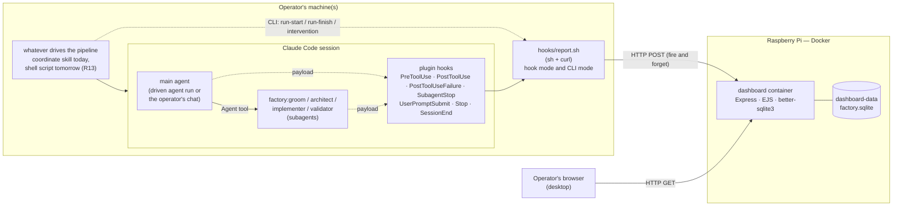

# 001 – Agent Factory Dashboard: design

- Requirements: docs/requirements/001-agent-factory-dashboard.md
- Status: Designed – ready for implementation
- Date: 2026-09-20 (revision 2: R3/D14–D17 repository display, R13 driver independence, no backup,
  all dependencies moved to their newest stable version. Revision 3 answers the implementer's gaps
  G1 and G2: a seventh hook `PostToolUseFailure`, the chip truncation rule, and three corrections
  the first build round proved necessary — the transcript delta leads the token resolution, the
  plugin manifest carries no `hooks` key, and `npm ci` runs with `--ignore-scripts`. Revision 4
  answers the validator's gap G3: §R8 states the change absolutely when the first rendered week is
  `0`, so all four trends keep stating a change and an improvement over the full six-month window)
- Architecture: docs/architecture/overview.md

## Summary

Two halves in this repository. **The dashboard** is a small Node 26 application in `dashboard/`
that stores what the factory reports in a SQLite file and renders it as server-side HTML: three
tabs (Attention, Pipeline, Analytics) and a ticket detail page, in the supplied dark design. It is
one Docker container with one named volume, started by the repository's `docker-compose.yml` on
the operator's Raspberry Pi, and it never writes anything back to the factory. **The reporting
side** is seven Claude Code hooks shipped with the `factory` plugin plus one POSIX shell script that
posts the raw hook payload to the dashboard with `curl`. The hooks cover both ways an agent can be
run: as a subagent (the coordinator today) and as the main agent of a session (a shell script
tomorrow, R13). The same script is also a command-line reporter, so a driver that never touches
Claude Code can report a run or an intervention with one line. The script always exits 0, so a
dashboard that is down costs history and never work (R9); the dashboard does all parsing, so the
agent's output is stored byte for byte as Claude Code produced it (R6).

Everything the screens show is derived at request time from four tables. A ticket is
`(repository, number)`; the repository is rendered on every ticket from the moment a second
repository has reported, and on none while there is only one (R3, D17). There is no client
framework, no build step for the browser, no second service, no login and no write path from the
browser.

## Drivers and constraints

| Driver | Source | In numbers | How the design meets it | Verified by |
|---|---|---|---|---|
| Runs on a Raspberry Pi shared with the factory | SC1, QE1 | Assume Pi 4/5, arm64, ≥ 4 GB RAM. Product budget: ≤ 256 MB RAM, ≤ 1.0 CPU, leaving ≥ 3.3 GB for Claude Code, the agents and the OS | One container, one process, no database server, Node heap capped at 192 MB, `mem_limit: 256m`, `cpus: "1.0"` | T-RES-1, T-PERF-1 |
| Dockerized despite the hardware | SC2 | 1 service, 1 named volume, one command | `docker-compose.yml` at the repository root; `docker compose up -d` is the whole start | T-DEPLOY-1 |
| Images exist for the target CPU | SC1 | `linux/arm64` | `node:26.9.0-trixie-slim` (glibc, arm64); `better-sqlite3` ships an N-API `linux-arm64` binary in its npm package, so the image needs no compiler | T-ARCH-1 |
| Every runtime, image and library is the newest stable one | SC9 | 0 components behind their newest stable release on 2026-09-20; every version verified against npm, Docker Hub and nodejs.org | §Dependency currency, all versions pinned exactly | T-DEP-1 |
| No backup | SC8 | 0 backup jobs, 0 backup volumes, 0 `BACKUP_*` variables | The history lives in `dashboard-data` and is never deleted (R8); durability is the volume's | T-DATA-1 |
| Opening the dashboard and switching tabs feels immediate | QE2, QE5 | `GET /` p95 < 300 ms, `GET /ticket/...` p95 < 200 ms at 300 tickets / 3 000 runs on 1 CPU / 256 MB; tab switch < 50 ms, no network | All three tabs are rendered into one response and toggled client-side; every aggregate is one indexed SQLite query | T-PERF-1, T-PERF-2 |
| Reporting never breaks the factory | R9, QE6 | Hook adds ≤ 2 s (start) and ≤ 5 s (finish) worst case on a run that takes minutes; script exits 0 on every path; 0 tokens | `curl --connect-timeout 1 --max-time 2/5`; `exit 0` unconditionally; no LLM step in the report path | T-R9-1, T-R9-2, T-R9-3 |
| The factory must not become less reliable | QE6, R5 | 0 changes to what an agent writes or prints; 2 formatting lines in the coordinate skill, 0 in the agent files | Hooks observe, they do not participate; the agent's Claude Code output is untouched | T-HOOK-2, review item in T-DEPLOY-1 |
| Reporting does not depend on the coordinator | R13, SC5 | 0 lines of the report path live in the coordinate skill; 2 of 2 ways of running an agent (subagent, main session) are hooked; 1 documented env variable is all a future driver must set | §R13, ADR-0008 | T-DRV-1…5 |
| Agents in any repository report to the same dashboard | SC3, R3, R10 | 1 config file per installation (`~/.factory/dashboard.env`), 0 absolute paths in the repository | Reporter resolves URL, token and project key from the environment, then from that file | T-CFG-1, T-CFG-2 |
| A ticket from a second repository is never confused with the first | R3, D14–D17 | Identity is the pair; the label appears on 5 of 5 places a ticket is rendered, from the 1st ticket of the 2nd repository, and on 0 places while there is 1 repository | `(project_key, number)` key, `repository` table, one `showRepository` flag per request | T-REPO-1…5 |
| Others host the dashboard elsewhere | SC4, R10 | Everything configurable through `.env`; nothing hard-codes a host, a port or a path | `.env.example` lists every variable; the image has no baked-in host | T-CFG-1 |
| History kept forever | R8, D9 | Nothing is deleted, ever. 300 tickets / 3 000 runs ≈ 80 MB; growth ≈ 50 tickets and 500 runs per year ≈ 13 MB/year | Append-only tables, no retention job | T-DATA-1 |
| Dark only, desktop browser only | QE3, QE4, OS5 | 1 stylesheet, 0 `prefers-color-scheme` rules, 0 breakpoints below 1024 px | The design file's own inline styles are kept verbatim | T-UI-1 |
| No login, no accounts, no roles | D8, OS3 | 0 user tables, 0 sessions, 0 auth on read routes | Read routes are open; the optional ingest token is transport configuration, not a login | T-UI-1 review item |
| The dashboard never acts | D1, OS1, OS2 | 0 write routes reachable from the browser | Only the factory's three ingest endpoints accept POST; every page is a GET | T-INT-9 |

## Decisions

| # | Decision | Reason |
|---|---|---|
| 1 | One Node 26 + Express 5 + EJS + SQLite container, server-rendered HTML | ADR-0001 |
| 2 | The supplied design file becomes EJS templates with its inline styles kept verbatim | ADR-0002 |
| 3 | The factory reports through Claude Code hooks, not through a skill the agent calls | ADR-0003 |
| 4 | The reporter posts raw payloads; the dashboard parses; tokens are a cumulative delta | ADR-0004 |
| 5 | The two attention thresholds are `.env` configuration, not a screen | ADR-0005 |
| 6 | A ticket is `(project_key, number)`, in storage and in its identity on screen | ADR-0006 |
| 6a | The repository is rendered on every ticket from the moment a second one has reported, and on none before | ADR-0007 (D14, D16, D17) |
| 6b | Reporting is hooked on both ways of running an agent and exposes a CLI, so any driver works | ADR-0008 (R13, D15, D18) |
| 6c | Every runtime, image and library is the newest stable release, verified on 2026-09-20 | ADR-0009 (SC9) |
| 7 | Fonts (IBM Plex Sans/Mono) are self-hosted `woff2` files, copied in the build stage from the pinned `@fontsource/ibm-plex-sans` and `@fontsource/ibm-plex-mono` dev dependencies | The Pi and the browser must not depend on Google Fonts at page load; the product otherwise has no outbound dependency |
| 8 | Interventions are rows in the same `run` table with `actor = 'human'` | R4 says an intervention is recorded "like an agent run"; one table gives the lane, the run list, the separate list and the count from one source |
| 9 | Run expansion uses native `<details>`; client JavaScript exists only for tab switching (~40 lines) | Fewer moving parts; the detail page works with JavaScript disabled |
| 10 | Timestamps are epoch milliseconds (`INTEGER`); the display zone comes from `TZ` (default `Europe/Berlin`) | One representation, one conversion point, testable with a fixed clock |
| 11 | `docs/.factory/run-NNN.md` is not read (LTA7) | It has no timestamps, no tokens and no agent output, and it only exists in repositories the coordinator ran in; everything the dashboard needs arrives through the hooks and the requirements document |
| 12 | The requirements document *is* read — by the reporter, on the machine where the agent runs (LTA7) | Title and requirements status are in `docs/requirements/NNN-*.md`; two `sed` lines produce them, and R2's stage mapping needs the status |

## Components



| Component | Responsibility | Code |
|---|---|---|
| `dashboard/src/server.ts` | Express app, config loading and validation, routes, error handler, request log, startup (migrations, sweeper) | `dashboard/src/` |
| `dashboard/src/db/schema.ts`, `dashboard/migrations/*.sql` | Tables, indexes, forward-only migrations | `dashboard/src/db/` |
| `dashboard/src/db/queries.ts` | Every prepared statement; no SQL anywhere else | `dashboard/src/db/` |
| `dashboard/src/ingest/meta.ts` | Decode and validate `X-Factory-Meta` | `dashboard/src/ingest/` |
| `dashboard/src/ingest/payload.ts` | Extract output text, result, error flag and usage from a hook payload or a transcript tail; all the tolerant parsing lives here | `dashboard/src/ingest/` |
| `dashboard/src/ingest/routes.ts` | The three ingest endpoints, run matching, idempotency | `dashboard/src/ingest/` |
| `dashboard/src/domain/rules.ts` | R1 attention rules, R2 stage mapping, R7 online count, loop counting (D13) | `dashboard/src/domain/` |
| `dashboard/src/domain/repository.ts` | R3 display: the `showRepository` flag and the repository label derivation (ADR-0007) | `dashboard/src/domain/` |
| `dashboard/src/domain/metrics.ts` | Per-ticket metrics, per-agent spend, bounce counts | `dashboard/src/domain/` |
| `dashboard/src/domain/trends.ts` | Weekly bucketing, the four trends, delta and improvement, period naming (R8) | `dashboard/src/domain/` |
| `dashboard/src/domain/format.ts` | `fmtH`, `fmtTok`, `pct`, week labels — ported from the design file | `dashboard/src/domain/` |
| `dashboard/src/views/*.ejs` | `layout`, `overview`, `attention`, `pipeline`, `analytics`, `detail`, `empty`, `error` | `dashboard/src/views/` |
| `dashboard/src/public/` | `app.js` (tab switching), `app.css` (shared rules, `@font-face`, `:hover`), `fonts/*.woff2` | `dashboard/src/public/` |
| `dashboard/src/jobs/` | Abandoned-run sweeper | `dashboard/src/jobs/` |
| `plugins/factory/hooks/hooks.json` | Registers the seven hooks | `plugins/factory/hooks/` |
| `plugins/factory/hooks/report.sh` | The reporter, in hook mode and in CLI mode: `run-start`, `run-finish`, `run-failed`, `intervention`, `prompt`, `session-finish`, `session-end` | `plugins/factory/hooks/` |

Nothing in `domain/` reads the clock, the database or the environment: every function takes plain
data plus `now` and the thresholds, so each rule is unit-testable with a fixed clock.

## Data model

One SQLite file, `/data/factory.sqlite`, WAL mode, `synchronous = NORMAL`, `busy_timeout = 5000`,
`foreign_keys = ON`. All timestamps are epoch milliseconds (`INTEGER`), UTC.

### `ticket`

| Field | Type | Null | Default | Notes |
|---|---|---|---|---|
| `project_key` | TEXT | no | – | e.g. `github.com/vkuras/factory`; FK → `repository(project_key)`; displayed as the repository label once a second repository has reported (ADR-0006, ADR-0007) |
| `number` | TEXT | no | – | as written in the filename, e.g. `001`; displayed as the ticket id |
| `title` | TEXT | no | – | from the `# NNN – Title` heading of the requirements document, verbatim |
| `slug` | TEXT | yes | `NULL` | from the filename, for diagnostics only |
| `requirements_status` | TEXT | yes | `NULL` | the `- Status:` line, verbatim; drives R2 |
| `agent_status` | TEXT | yes | `NULL` | the `STATUS:` value of the newest finished run |
| `first_seen_at` | INTEGER | no | – | earliest reported event for this ticket |
| `last_activity_at` | INTEGER | no | – | latest of any run's `started_at`, `ended_at`, or intervention time |
| `validated_at` | INTEGER | yes | `NULL` | when `requirements_status` first became `Validated` |
| `created_at`, `updated_at` | INTEGER | no | – | row bookkeeping |

Primary key `(project_key, number)`. Indexes: `idx_ticket_activity (last_activity_at DESC)`,
`idx_ticket_project (project_key)`.
`title`, `requirements_status` and `slug` are overwritten by every report that carries them (the
newest report wins); `first_seen_at` is only ever set once; `validated_at` is only ever set once.

### `repository`

One row per repository that has ever reported anything. It is the memory behind R3/D17: the label
appears as soon as this table holds two rows, and because no row is ever deleted, it keeps
appearing afterwards even when only one repository is active again.

| Field | Type | Null | Default | Notes |
|---|---|---|---|---|
| `project_key` | TEXT | no | – | PK; the reporter's project key, verbatim, e.g. `github.com/vkuras/factory` |
| `first_seen_at` | INTEGER | no | – | the first report that carried this key; only ever set once |
| `last_seen_at` | INTEGER | no | – | the newest report that carried it |
| `repo_path` | TEXT | yes | `NULL` | the last absolute path it reported from; diagnostics only, never displayed |

Every ingest call upserts this row before it touches the ticket, including an intervention and
including a report that is later dropped for another reason — "the dashboard has heard from this
repository" is exactly what R3 counts. Nothing else writes it; the operator never types a
repository (R3).

### `run`

One row per agent run **and** per operator intervention (decision 8).

| Field | Type | Null | Default | Notes |
|---|---|---|---|---|
| `id` | TEXT | no | – | UUID v4, generated by the dashboard |
| `project_key`, `number` | TEXT | no | – | FK → `ticket(project_key, number)`, `ON DELETE CASCADE` (nothing ever deletes) |
| `actor` | TEXT | no | – | `groom` \| `architect` \| `implementer` \| `validator` \| `human`; CHECK constraint |
| `started_at` | INTEGER | no | – | hook timestamp of the start (or of the intervention) |
| `ended_at` | INTEGER | yes | `NULL` | `NULL` = still running; for `human` equal to `started_at` |
| `result` | TEXT | yes | `NULL` | see §Run result below |
| `agent_status` | TEXT | yes | `NULL` | the parsed `STATUS:` value, `NULL` when there is none |
| `tokens` | INTEGER | yes | `NULL` | total tokens (all four usage counters); `NULL` = unknown; `0` for `human` |
| `output` | TEXT | yes | `NULL` | the agent's final message, verbatim, up to 64 KiB |
| `output_truncated` | INTEGER | no | `0` | `1` when the output exceeded 64 KiB |
| `summary` | TEXT | yes | `NULL` | the `SUMMARY:` line, else the first non-empty output line, else `NULL` |
| `status_before` | TEXT | yes | `NULL` | requirements status read at run start |
| `status_after` | TEXT | yes | `NULL` | requirements status read at run finish |
| `source` | TEXT | no | – | how this row was reported: `subagent-hook` \| `session-hook` \| `cli`; CHECK constraint. Diagnostics and the intervention merge rule; never displayed |
| `tool_use_id` | TEXT | yes | `NULL` | when the hook payload carries one; used for matching |
| `session_id` | TEXT | yes | `NULL` | Claude Code session; used for matching |
| `transcript_path` | TEXT | yes | `NULL` | used for the token delta |
| `created_at`, `updated_at` | INTEGER | no | – | row bookkeeping |

Indexes: `idx_run_ticket (project_key, number, started_at)`, `idx_run_open (ended_at) WHERE
ended_at IS NULL`, `idx_run_started (started_at)`, `uq_run_tool_use (tool_use_id) WHERE
tool_use_id IS NOT NULL` (unique).

**Run result.** The value shown as the badge in the run list and inside the swimlane block:

| Value | When |
|---|---|
| the agent's own `STATUS:` value (`groomed`, `in-grooming`, `designed`, `designed-with-conflicts`, `ready-for-validation`, `needs-architect`, `validated`, `changes-requested`, `needs-groomer`, `blocked-environment`, `escalated`, `nothing-to-do`) | a `STATUS:` line was parsed from the output |
| `failed` | the tool payload flags an error — a `PostToolUseFailure` delivery, or an error flag inside `tool_response` — or the parsed `STATUS:` is `failed` |
| `unreported` | the run finished but carried no parsable output |
| `interrupted` | the Claude Code session ended while this run was still open (`SessionEnd`) |
| `abandoned` | no finish arrived within `RUN_STALE_HOURS` (default 12) |
| `intervention` | `actor = 'human'` |

### `ticket_status_event`

| Field | Type | Null | Notes |
|---|---|---|---|
| `id` | INTEGER | no | PK, autoincrement — also the tie-breaker for equal timestamps |
| `project_key`, `number` | TEXT | no | FK → `ticket` |
| `status` | TEXT | no | the requirements status, verbatim |
| `at` | INTEGER | no | when it was first observed |
| `run_id` | TEXT | yes | the run whose report revealed it |

Index `idx_status_ticket (project_key, number, at, id)`. A row is appended only when the observed
status differs from the ticket's most recent `ticket_status_event.status` (or when there is none).

### `hook_cursor`

Supports the cumulative token delta (ADR-0004).

| Field | Type | Null | Notes |
|---|---|---|---|
| `session_id` | TEXT | no | PK part; `''` when the payload has none |
| `transcript_path` | TEXT | no | PK part; `''` when the payload has none |
| `cum_tokens` | INTEGER | no | the last cumulative counter reported for this pair |
| `updated_at` | INTEGER | no | |

### `schema_migration`

| Field | Type | Notes |
|---|---|---|
| `version` | INTEGER | PK |
| `name` | TEXT | file name |
| `applied_at` | INTEGER | |

### Migration from the current state

There is no current state: the database does not exist yet, and nothing of this design has been
built. Migration `001_init.sql` creates all six tables (`repository`, `ticket`, `run`,
`ticket_status_event`, `hook_cursor`, `schema_migration`) and their indexes. There is no user,
session, role, permission or settings table (ADR-0005), no retention job and no backup job
(R8, SC8).

**The switch to showing the repository needs no migration** (S1.8, R3): the repository is already
part of every ticket's key from the first row on, so the second repository's first report only adds
a row to `repository`, and the next page load renders the label on every ticket, old ones
included. No stored row is rewritten, moved or deleted by the switch.

## Interfaces

### Write API — the factory to the dashboard

Common to all three endpoints:

- Method `POST`, `Content-Type: text/plain; charset=utf-8`. The body is read as raw text
  (`express.text({ type: '*/*', limit: '2mb' })`) and is **not** parsed by a JSON body parser,
  because a finish body carries two documents: the raw hook payload, then the line `---8<---`, then
  the tail of the transcript file. The dashboard splits on the first such line, `JSON.parse`s the
  first part (a parse failure is answered `400`) and treats the second part as JSONL, ignoring a
  leading partial line. A start body is the hook payload alone; an intervention body is empty.
  Maximum body size 2 MiB; larger is answered `413` and dropped.
- Header `X-Factory-Meta: <base64 of a UTF-8 JSON object>`, built by the reporter:

```json
{
  "v": 1,
  "event": "run-start",
  "ts": 1758367200000,
  "project": "github.com/vkuras/factory",
  "repo_path": "/home/pi/IdeaProjects/factory",
  "ticket": "001",
  "title": "Agent Factory Dashboard",
  "slug": "agent-factory-dashboard",
  "req_status": "Groomed – ready for architecture",
  "agent": "architect",
  "source": "subagent-hook",
  "origin": "subagent",
  "driver": "coordinate",
  "session_id": "1c0f…",
  "tool_use_id": "toolu_01…",
  "transcript_path": "/home/pi/.claude/projects/…/1c0f….jsonl",
  "cum_tokens": 4821334,
  "result": null,
  "what": "…"
}
```

  `v`, `event`, `ts`, `project` and `ticket` are mandatory; a payload missing any of them is
  answered `400` and dropped. `agent` is mandatory for `run-start`, `what` for `intervention`.
  `source` is one of `subagent-hook`, `session-hook`, `cli` and defaults to `cli`. `origin` is
  `subagent` or `main` and says whether the reported agent ran as a subagent or as the session's
  main agent; it decides the sidechain filter on the transcript (§`POST /api/hook/run-finish`) and
  defaults to `subagent`. `driver` is free
  text the driver may set (`coordinate`, the value of `FACTORY_DRIVER`, or absent); it is stored
  nowhere and only appears in the dashboard's log line, so a broken wiring can be traced to the
  thing that produced it. `result` is only honoured on `run-finish` from `source = cli`, where the
  driver may state the outcome itself.
- Header `Authorization: Bearer <token>` is required **if and only if** `FACTORY_INGEST_TOKEN` is
  set and non-empty on the dashboard; otherwise the header is ignored. A wrong or missing token
  when one is required is answered `401` and nothing is stored.
- Success is `204 No Content`. The reporter ignores the response either way and never retries
  (R9); every non-2xx is written to the reporter's local log so a silently broken setup can be
  diagnosed.

#### `POST /api/hook/run-start`

Creates the run and, if needed, the repository and the ticket.

0. Upsert `repository (project_key)`: `first_seen_at = min(existing, ts)`,
   `last_seen_at = max(existing, ts)`, `repo_path = meta.repo_path`. This happens on every ingest
   call of every endpoint, before anything else and inside the same transaction.
1. Upsert `ticket (project, number)`: set `title`, `slug`, `requirements_status` from the meta;
   set `first_seen_at = min(existing, ts)`; set `last_activity_at = max(existing, ts)`; append a
   `ticket_status_event` if the status changed; set `validated_at` if the status is `Validated`
   and it is still `NULL`.
2. If `tool_use_id` is given and a run with it exists → do nothing (duplicate delivery).
3. If an open run exists for the same `(project, number, actor, session_id)` → do nothing.
4. Otherwise insert a run: `id = uuid()`, `actor = meta.agent`, `started_at = ts`,
   `status_before = meta.req_status`, `ended_at = NULL`, `result = NULL`,
   `source = meta.source`.

#### `POST /api/hook/run-finish`

Resolves which run this finishes, in this order:

1. `tool_use_id`, when the meta carries one and a run has it.
2. the newest open run with the same `session_id` for `(project, number)`.
3. the newest open run for `(project, number)`.

If none of the three matches, the report is dropped and logged as `report_drop` — a finish without
a start is never turned into a run, because its actor is unknown. A `PostToolUseFailure` for an
Agent call the start filter never reported (a non-factory subagent, an unknown `subagent_type`) is
therefore dropped like any other unmatched finish; nothing invents a run out of it.

If the resolved run is already finished, only fields that are still `NULL` are filled (`tokens`,
`output`, `summary`, `agent_status`, `status_after`); `ended_at` is never overwritten, and `result`
is never overwritten **except by one upgrade**: a later delivery whose error flag is set replaces a
`result` of `unreported` (or a `result` that is still `NULL`) with `failed`, and changes nothing
otherwise. An error flag is a statement that the run ended badly, while `unreported` is only the
absence of a statement; an agent that managed to print its own `STATUS:` keeps it, because that is
the agent's own word about its work (R6). The upgrade is idempotent.

Together with the matching rules this makes every order of the three possible finish deliveries for
one subagent run — `PostToolUse`, `PostToolUseFailure`, `SubagentStop` — produce the same row, and
the dashboard accepts any of them as the finish. Which ones a given Claude Code version fires is
not the dashboard's business: a subagent that dies mid-run may surface as a `SubagentStop` with a
half-finished message or as a `PostToolUseFailure`, and both end the run.

A payload that yields neither output text nor an error flag is **ignored** (answered `204`, logged
as `report_ignored`): that is what a `PostToolUse` acknowledgement of a backgrounded agent looks
like, and the real finish arrives later through `SubagentStop`. Two exceptions, because both are a
real end of a run and not an acknowledgement: `meta.event = "session-end"` and a `cli` finish that
carries `meta.result`. Both close the run with no output rather than being ignored. A
`PostToolUseFailure` body is never ignored either, because its `error` string always sets the error
flag. An ignored payload writes nothing at all, **including `hook_cursor`**: an acknowledgement must
not consume the token interval that the real finish of the same run is charged for.

For a run reported from the main session (`source = session-hook`, `meta.origin = "main"`), the
output text is taken from the transcript tail with the sidechain filter **inverted**: the last
entry with `type = "assistant"` and `isSidechain` absent or `false`. That entry is the main
agent's final message, which is exactly what the operator would have seen in Claude Code (R5, R6).
Everything else about the extraction is identical.

Extraction from the body, in this order, all implemented in `ingest/payload.ts`:

| Field | Resolution order | When nothing matches |
|---|---|---|
| output text | `tool_response.content[]` text blocks joined with `\n` → `tool_response.content` as a string → `tool_response.text` → `tool_response` as a string → `last_assistant_message` → last transcript entry with `type = "assistant"` and `isSidechain = true`, else the last `type = "assistant"` entry, text blocks joined. **The transcript steps are skipped when the body carries no `tool_response` and the error flag is set** (the `PostToolUseFailure` case): the agent produced nothing, and the transcript's last assistant entry then belongs to the calling session, not to the failed run | the top-level `error` string when there is one, else the payload is *ignored* (see above) unless an error flag was found |
| error flag | `tool_response.is_error` \| `tool_response.isError` \| `is_error` is truthy, or `tool_response` is a string starting with `Error:`, or the payload has a non-empty top-level `error` string (`PostToolUseFailure`) | `false` |
| usage | `meta.cum_tokens` minus `hook_cursor.cum_tokens` for `(session_id, transcript_path)`, clamped at ≥ 0, whenever the meta carries `cum_tokens` → `tool_response.usage` (sum of `input_tokens`, `output_tokens`, `cache_creation_input_tokens`, `cache_read_input_tokens`) → `tool_response.totalTokens` → `tool_response.total_tokens` | `NULL` |

Then:

- `result` = `interrupted` if `meta.event = "session-end"`, else `meta.result` when the meta carries
  one and `source = cli`, else `failed` if the error flag is set, else the parsed `STATUS:` value,
  else `unreported`.
  The `STATUS:` value is the first match of `/^STATUS:[ \t]*([a-z-]+)/m` in the output; anything
  after a `|` or a space is ignored, so `STATUS: designed` yields `designed`.
- `agent_status` = the same parsed value, or `NULL`.
- `summary` = the text after `SUMMARY:` on the first line matching `/^SUMMARY:[ \t]*(.+)$/m`,
  trimmed; else the first non-empty line of the output, truncated to 200 characters with `…`;
  else `NULL`.
- `output` = the extracted text, unchanged, truncated to 64 KiB at a character boundary with
  `output_truncated = 1` (R6: no reformatting, no normalising, no reordering). For a failure with no
  agent text that is the harness's `error` string, stored the same way, verbatim: it is what the
  operator would have seen in Claude Code, it is not a sentence the dashboard composed, and without
  it a failed run would show a badge and nothing else.
- `ended_at = meta.ts`, `status_after = meta.req_status`.
- `hook_cursor` is upserted to `meta.cum_tokens` whenever the meta carries one — on a stored finish
  only, never on an ignored payload and never on a dropped one.
- The ticket is updated as in `run-start`, plus `agent_status` and a status event for
  `status_after`.

#### `POST /api/intervention`

Body is ignored. Creates the repository and the ticket if needed, then inserts a run with
`actor = 'human'`, `started_at = ended_at = meta.ts`, `tokens = 0`, `result = 'intervention'`,
`output = meta.what`, `summary = meta.what` (first line, truncated to 200 characters with `…`),
`status_before = status_after = meta.req_status`, `source = meta.source`.

`meta.what` is what the operator did, verbatim and untouched, capped at 4 KiB: the prompt they
submitted when the hook captured it (§R13), or the text a driver passed on the command line.

**Idempotency and merge (R4).** Before inserting, the dashboard looks for an existing intervention
on the same `(project, number)` whose `started_at` is within 120 000 ms of `meta.ts`:

- none → insert.
- one with the same `what` → do nothing (a repeated delivery).
- one with a different `what` → it is the same act of the operator seen twice (once by the prompt
  hook, once by an explicit driver call). Keep one row; the `cli` text wins over the
  `session-hook` text, because a driver that bothers to describe the intervention describes it
  better than the raw prompt. `source` is updated with it.

So neither a retry nor a driver that reports an intervention the hook already captured can
double-count, which matters because "how many times I have intervened" is one of the numbers S5
trends.

#### `GET /healthz`

`200 application/json`: `{"status":"ok","version":"<package version>","tickets":<count>,"openRuns":<count>}`.
Used by the compose healthcheck. Never requires a token.

### Read routes

| Route | Purpose | Notes |
|---|---|---|
| `GET /` | The three tabs in one response | `?tab=attention\|pipeline\|analytics`, default and fallback `attention` (R11) |
| `GET /ticket/:project/:number` | The detail view, canonical form | `?from=attention\|pipeline\|analytics`, default `attention`, drives the "back to …" label. `:project` is URL-encoded; an unknown ticket renders the 404 page |
| `GET /ticket/:number` | The detail view, short form | Used in every link while `showRepository` is false, so that not even a URL carries a repository then (S1.7). Resolves to the one ticket with that number; with more than one, it answers `302` to the canonical URL of the most recently active one, so a bookmark taken before the second repository reported still works |
| `GET /assets/*` | `app.css`, `app.js`, `fonts/*.woff2` | `Cache-Control: public, max-age=604800` |
| `GET /healthz` | Liveness | – |

All HTML responses send `Cache-Control: no-store` (R12: the page is the state at load time, and a
reload must really reload) and the CSP of §Cross-cutting concerns. All read routes are open: there
is no login (D8). No read route writes anything except the lazy sweeper's `UPDATE` (below).

### Jobs

| Job | Trigger | What it does | Idempotency | Missed run |
|---|---|---|---|---|
| Abandoned-run sweeper | every 10 min, and at startup | Open runs with `started_at < now − RUN_STALE_HOURS` get `result = 'abandoned'`; `ended_at` stays `NULL` because the real end is unknown | `WHERE ended_at IS NULL AND result IS NULL` — re-running changes nothing | Nothing accumulates: the next sweep catches every stale run. The read path applies the same age filter itself, so "agents online" (R7) is correct even between sweeps |

That is the only job. There is no backup job (SC8), no retention job (R8), no cron container and
nothing on the host. The timer runs inside the single application process, is scheduled from
`Date.now()` and re-armed after each sweep.

### External services

None. No API, no CDN, no font service, no telemetry, no outbound connection of any kind from the
container. The only inbound traffic is the operator's browser and the factory's reports.

## Business rules

Formatting helpers are ported from the design file and are part of the specification:

- `fmtTok(n)`: `n ≥ 1e6` → `(n/1e6).toFixed(2) + "M"`; `n ≥ 1000` → `(n/1000).toFixed(n >= 10000 ? 0 : 1) + "k"`; else the plain integer. `NULL` renders as `—`.
- `fmtH(h)` (hours): `h < 1` → `round(h*60) + "m"`; `h < 24` → `h.toFixed(h < 10 ? 1 : 0) + "h"`; else `(h/24).toFixed(1) + "d"`. Unknown renders as `—`.
- `pct(v, max)`: `max <= 0` → `"0%"`, else `max(2, round(v/max*100)) + "%"`.
- Week label: `"w" + ISO week number` of the bucket's Monday, in `TZ`.

### R1 – Attention rules

Evaluated per ticket, in this exact order; the **first** match decides reason, note and severity.
`LOOP` is `LOOP_THRESHOLD`, `IDLE` is `IDLE_HOURS` (ADR-0005). `loops` is defined under
§Ticket metrics. `failedRun` is true when any run of the ticket has `result` `failed` or
`blocked-environment` (see assumption 4). `abandoned` and `interrupted` do not count: neither is
an agent failing at its work.

| # | Condition | Reason | Severity | Colour | Note sentence |
|---|---|---|---|---|---|
| 1 | `requirements_status = 'Blocked – waiting for requirements'` | `needs requirements` | `blocking` | `#FF6B6B` | `Grooming needs a decision from you before anything moves.` |
| 2 | `requirements_status = 'Blocked – waiting for architecture'` | `design gap` | `blocking` | `#FF6B6B` | `The implementer hit a gap the design does not cover. The architect needs a ruling before the work continues.` |
| 3 | `failedRun && requirements_status != 'Validated'` | `agent run failed` | `check` | `#F5A524` | `An agent run aborted before it finished. Worth a glance that the re-run covered everything.` |
| 4 | `requirements_status = 'Changes requested – back to implementation'` | `changes requested` | `review` | `#F5A524` | `The validator sent the ticket back to implementation with findings.` |
| 5 | `loops >= LOOP` | `loop threshold` | `review` | `#F5A524` | `{loops} re-runs on this ticket, over your threshold of {LOOP}. The factory is spinning rather than converging.` |
| 6 | `agent_status = 'in-grooming'` | `open questions` | `answer` | `#5BC8F5` | `Grooming is holding open questions only you can answer.` |
| 7 | `idleHours >= IDLE && requirements_status != 'Validated'` | `idle` | `review` | `#F5A524` | `No agent has touched this for {fmtH(idleHours)}. Nothing is blocking it on paper.` |

The badge background is the colour at 12 % alpha (`colour + "1F"`), as in the design.
`idleHours = (now − last_activity_at)/3 600 000`.

**Ordering (S1.3):** severity rank `blocking = 0`, `check = 1`, `review = 2`, `answer = 3`,
ascending; within one rank, the larger `idleHours` first (untouched longest first); ties broken by
`number` ascending, so the order is stable.

Worked examples (test cases T-UNIT-R1-*):

| Ticket state | Expected |
|---|---|
| status `Blocked – waiting for requirements`, 5 loops, idle 40 h | rule 1, `needs requirements`, `blocking` |
| status `Implemented – ready for validation`, one earlier run with `result = failed`, idle 2 h | rule 3, `agent run failed`, `check` |
| status `Validated`, one earlier run with `result = failed`, idle 400 h | no attention (rules 3 and 7 both exclude `Validated`) |
| status `Designed – ready for implementation`, 3 loops, `LOOP = 3`, idle 1 h | rule 5, `loop threshold`, note `3 re-runs on this ticket, over your threshold of 3. …` |
| status `In grooming`, agent status `in-grooming`, 0 loops, idle 30 h, `IDLE = 24` | rule 6, `open questions`, `answer` (rule 6 precedes rule 7) |
| status `Groomed – ready for architecture`, 0 loops, idle 25 h, `IDLE = 24` | rule 7, `idle`, `review` |
| two tickets, both `blocking`, idle 30 h and 50 h | the 50 h one first |

### R2 – Stage of a ticket

| `requirements_status` | Stage | Owner | Stage colour |
|---|---|---|---|
| `In grooming` | Grooming | groom | `#5BC8F5` |
| `Groomed – ready for architecture` | Grooming | groom | `#5BC8F5` |
| `Designed – ready for implementation` | Design | architect | `#A78BFA` |
| `Implemented – ready for validation` | Implementation | implementer | `#F5A524` |
| `Validated` | Verification | validator | `#9EE84B` |
| `Changes requested – back to implementation` | Implementation | implementer | `#FF6B6B` |
| `Blocked – waiting for architecture` | Design | architect | `#FF6B6B` |
| `Blocked – waiting for requirements` | Grooming | groom | `#FF6B6B` |

The status colour is the card dot and the detail status badge. Owner colours are the agent colours:
groom `#5BC8F5`, architect `#A78BFA`, implementer `#F5A524`, validator `#9EE84B`, you `#FF7AB6`.

**Unknown or missing status** (a ticket reported before its requirements document had a status
line, or a status the factory later invents): stage = the stage owned by the actor of the newest
run (`groom` → Grooming, `architect` → Design, `implementer` → Implementation, `validator` →
Verification, `human` → the stage of the newest non-human run); no runs, or none of those → Grooming.
Owner = that actor, status colour `#6E7887`, and the status text is shown verbatim (empty →
`unknown`). Nothing is dropped from a column.

### R3 – Ticket identity and the repository label

**Identity.** A ticket is the pair `(project_key, number)`, always, in storage, in every query and
in the URL of its detail page (ADR-0006). Two repositories reporting a `001` are two rows, two
histories, two cards. Nothing about that depends on what is displayed.

**When the repository is displayed (D17, ADR-0007).** One boolean per request:

```
showRepository = (SELECT count(*) FROM repository) >= 2
```

- One repository has ever reported → `false` → no repository string is rendered anywhere: not on a
  card, not on a chip, not in the analytics table, not in the detail head, not as a tooltip, not as
  a hidden attribute (S1.7).
- The first report of a second repository inserts the second `repository` row, so the very next
  page load renders the label — on every ticket, including the ones stored long before (S1.8, R12).
- The flag can never go back to `false`: no row of `repository` is ever deleted (R8), so once two
  repositories have reported, the label stays even when only one of them is still active.
- Nothing is rewritten when it flips. It is one count, evaluated at render time, over data that was
  already there.

**What is displayed (LTA7).** The label is derived from the project key at render time; nothing
derived is stored. `keys` is the set of all `repository.project_key` values, `segs(k)` its
non-empty `/`-separated segments:

```
label(k):
  if length(segs(k)) == 1                                  -> segs(k)[0]
  base = last segment of k
  if no other key in keys has the same last segment        -> base
  if no other key in keys has the same last two segments   -> last two segments joined by "/"
  otherwise                                                -> k
```

Examples: `github.com/vkuras/factory` alone → `factory`; together with
`github.com/vkuras/shop` → `factory` and `shop`; together with `github.com/acme/factory` →
`vkuras/factory` and `acme/factory`; a key that is a bare directory name (`factory`) → `factory`.
The derivation is stable per page (it depends only on the set of repositories) and deterministic,
so the same ticket never shows two different labels on two tabs. `FACTORY_PROJECT_KEY` lets an
installation set the key, and therefore the label, by hand (R10).

**Where it is displayed (D16).** Everywhere a ticket appears, through one shared template partial
`ticketId`, so the five places cannot drift apart:

| Place | Rendering |
|---|---|
| Attention card (S1.2) | `{number}` then `·` then `{label}` in the mono id line |
| `Running on their own` chip (S1.5) | the same, after the owner dot, before the title |
| Pipeline card (S3.2) | the same, in the card's mono id line |
| `Per ticket · lifetime` row (S5.4) | the same, in the `ticket` cell |
| Detail head (S4.1) | the same, next to the id, above the title |

**The link, too.** While `showRepository` is false, every link to a ticket uses the short form
`/ticket/001`; from the moment it is true, every link uses the canonical `/ticket/{project}/{number}`.
So with one repository the repository appears in no text, no attribute and no URL — S1.7 holds even
against a grep of the page — and with two it appears exactly where R3 wants it. The short form keeps
resolving afterwards, so nothing that was bookmarked breaks.

The partial renders `<span class="af-id">001</span>` when `showRepository` is false, and
`<span class="af-id">001</span><span class="af-repo"> · factory</span>` when it is true. `af-repo`
is IBM Plex Mono 11 px, colour `#6E7887` (the design's muted mono colour), `title="{project_key}"`
so the full key is available on hover, and it never wraps: in every one of the five places, the
chip included, it is `max-width: 14ch` and is truncated with `text-overflow: ellipsis`. One rule in
one partial, so a long repository name can never widen a card, push a title out of a chip or wrap a
row, and the full key is one hover away (G2). This is the fourth deviation from the supplied
design file (D14), which has no such element; it is added in the design's own style and takes no
element away.

The operator never types a repository anywhere: it is derived by the reporter and rendered by the
dashboard (R3).

### R4 – The operator is part of the history

An intervention is a `run` row with `actor = 'human'` (decision 8). It is captured by the prompt
hook or reported by a driver over the CLI, never by the coordinate skill (§R13), so it is recorded
whoever or whatever drives the pipeline. Consequences, all automatic because every screen reads the
same table:

- the `You` lane of the swimlane holds its block (zero length → clamped to the design's 3.5 %
  minimum width);
- it appears in the run list like any run, with the badge `intervention`, `no tokens`, its time and
  `0m`; expanded it shows `Your note` instead of `Final output` and lists `meta.what` as the single
  numbered line;
- it appears again in the `Your involvement` panel with its text and `t+…`;
- it counts towards `interventions`;
- it never contributes to `tokens` (stored as 0) or to agent working time (human runs are excluded
  from every duration sum).

### R5 / R6 – The agent's output

**R5** holds by construction: hooks observe the payload Claude Code has already produced. Nothing
in the report path changes what an agent writes, prints or returns; the agent is not even aware of
it. The verification is T-HOOK-2: the same run is captured with and without a dashboard and the
Claude Code transcript is byte-identical.

**R6** is a storage and rendering rule:

- The run's `output` is the agent's final message, stored exactly as received — no trimming beyond
  the 64 KiB cap, no normalising of whitespace, no reordering, no markdown rendering.
- The **numbered list** of an expanded run is that text split on `\n`, with empty lines removed,
  each remaining line numbered `01`, `02`, … in its original order, rendered as plain text
  (HTML-escaped, never as markdown). Line content is not classified, categorised, labelled or
  shortened; the design's `kind` column is gone (D6).
- The **one-line summary** in the collapsed run is the `SUMMARY:` line the agents already write,
  quoted verbatim; without one, the first non-empty line. The dashboard never composes a sentence
  of its own about a run.
- Under the numbered list, the design's `Final output` box keeps its role: it shows the summary
  line and the verdict `Ticket moved to "<status_after>"`, or `No status change` when
  `status_after` is missing or equal to `status_before` (S4.4).

What "output" means for a Claude Code subagent is its final message: that is the only thing the
operator sees in Claude Code today, which is what R6 measures the dashboard against (assumption A8).
When there is no final message because the Agent call itself failed (§`POST /api/hook/run-finish`),
the stored output is Claude Code's own `error` string, again verbatim — the same rule applied to the
only text that run produced (assumption 19).

### R7 – Agents online

At the moment the page is rendered: `count(runs where ended_at IS NULL and result IS NULL and
started_at > now − RUN_STALE_HOURS*3600000)`. The header shows
`{n} agents online` (`1 agent online` for exactly one) with the pulsing green dot `#9EE84B`; for
`n = 0` the dot is `#39414D`, static, and the text is `no agents running` (S2.2). The number is not
refreshed and no age indication is shown (R12, D5).

### R8 – History and trends

Nothing is deleted: there is no retention job, no archiving, no compaction, and every table only
ever grows.

**Buckets.** ISO weeks, Monday 00:00 in `TZ`. `currentWeek` is the week containing `now`;
`windowStart` is the Monday 25 weeks before `currentWeek`'s Monday (26 buckets in total, D4);
`dataStart` is the week containing the earliest `run.started_at` in the database. The rendered
buckets run from `max(windowStart, dataStart)` to `currentWeek` inclusive — between 1 and 26
buckets. A run belongs to the bucket of its `started_at`.

**The four series**, with `active(W)` = the distinct tickets with at least one run (any actor)
started in `W`:

| Card label (design wording) | Value for week `W` | Format |
|---|---|---|
| `Human calls / ticket` | `count(runs in W with actor='human') / |active(W)|`, `0` if `active(W)` is empty | `toFixed(1)` |
| `Loops / ticket` | `count(loop runs in W) / |active(W)|`, `0` if empty. A run is a *loop run* when it is not the first run of its actor on that ticket over the ticket's whole life, ordered by `started_at` (D13); human runs never count | `toFixed(1)` |
| `Lead time (h)` | mean over the tickets whose `validated_at` falls in `W` of `(validated_at − first_seen_at)/3.6e6`; `null` when no ticket was validated in `W` | `toFixed(0)` |
| `Compute (h)` | `sum over runs in W with actor != 'human' and ended_at not null of (ended_at − started_at)/3.6e6 / |active(W)|`; `0` if `active(W)` is empty | `toFixed(1)` |

**Delta and improvement (S5.2).** `first` = the earliest rendered bucket with a non-null value,
`last` = the latest one, `firstLabel` = the week label of the `first` bucket. `fmt` = the card's own
value format (`toFixed(1)`, and `toFixed(0)` for `Lead time (h)`).

The change is stated **relatively while `first ≠ 0` and absolutely when `first = 0`**. A percentage
of zero is undefined, but the change is not, and S5.2 asks for the change and for a verdict, not for
a percentage. This matters in the ordinary case, not in an exotic one: three of the four series are
`0` (never `null`) in a week without activity, and with a history older than six months the window
always starts 26 weeks back, so the earliest rendered week is empty far more often than not. Sending
that case to `no comparison yet` cost S5.2 permanently for `Human calls / ticket`, `Loops / ticket`
and `Compute (h)` (gap G3). All four metrics are better when lower, so one improvement rule covers
both bases: fell → `better`, rose → `worse`, equal → `unchanged`.

- Fewer than two rendered buckets carry a value (`first` is null, or `first` and `last` are the same
  bucket) → text `no comparison yet`, colour `#6E7887`, no improvement word. This is the only case
  left without a statement: a dashboard in its first week, and a `Lead time (h)` card whose window
  contains at most one week with a validated ticket. There is no change to state there.
- `first ≠ 0` → `d = (last − first) / first * 100`:
  - `d < 0` → `{d.toFixed(0)}% vs {firstLabel} · better`, colour `#9EE84B`.
  - `d > 0` → `+{d.toFixed(0)}% vs {firstLabel} · worse`, colour `#FF6B6B`.
  - `d = 0` → `0% vs {firstLabel} · unchanged`, colour `#6E7887`.
- `first = 0` → `a = last − first`, stated without a `%` sign, in the card's own unit:
  - `a > 0` → `+{fmt(a)} vs {firstLabel} · worse`, colour `#FF6B6B`. Example from the acceptance
    dataset: `Loops / ticket` with `w14 = 0.0` and `w39 = 0.7` reads `+0.7 vs w14 · worse`,
    `Compute (h)` with `w39 = 1.8` reads `+1.8 vs w14 · worse`.
  - `a = 0` → `0% vs {firstLabel} · unchanged`, colour `#6E7887` — the same wording as the
    relative `d = 0` case, because a zero change is the same statement on either basis. This is
    what `Human calls / ticket` reads with `w14 = 0.0` and `w39 = 0.0`.
  - `a < 0` → `{fmt(a)} vs {firstLabel} · better`, colour `#9EE84B` (`fmt` carries the minus sign).

`deltaOf` therefore takes the card's digit count alongside the values and the labels; `−0` is
printed as `0` in both bases. The bars, the tooltips, the period line and the series definitions
above are untouched by this rule: an empty week is still `0` for the three per-ticket series and
still `null` for `Lead time (h)`, and every rendered bucket keeps its bar.

**Naming the period (S5.3).** Each card carries the line
`{firstLabel} – {lastLabel} · {n} weeks of data` under the card label. With a full window that
reads `w13 – w38 · 26 weeks of data`; with three weeks of history, `w36 – w38 · 3 weeks of data`.

**Bars.** Height `max(6, round(v / maxOfSeries * 68)) + "px"`; the last bucket is drawn in the full
card colour, all others at 33 % alpha (`colour + "55"`), as in the design. A `null` value draws no
bar. Every bar carries `title="{weekLabel} · {formatted value}"` (`no data` for null). Only the
last bar prints its value above the bar, and only the first, the middle and the last bucket print
their week label underneath — 26 labels do not fit in the design's card width (assumption A5).

### R9 – Reporting never breaks the factory

Enforced in four places:

1. `report.sh` has `exit 0` as its only exit, including on unset configuration, an unreadable
   transcript, a missing `curl`, a non-2xx answer and a `curl` timeout. It writes nothing to stdout
   and nothing to stderr that Claude Code would surface.
2. `curl --connect-timeout 1 --max-time 2` for a start and for an intervention, `--max-time 5` for
   a finish; `hooks.json` sets `"timeout": 10`–`15` per hook as a second net.
3. Nothing in the report path asks a model for anything: no skill call, no tool call, no token.
   No hook writes to stdout, so none of them can add a word to a model's context (R5).
4. The dashboard answers every accepted report with `204` and never asks for a retry; there is no
   queue, no backpressure and no state on the factory side. A report that is lost is lost, and the
   ticket simply has a gap in its history.

A fifth place matters now that three hooks fire in **every** Claude Code session on the machine,
including sessions that have nothing to do with the factory (ADR-0008): the prompt, stop and
session-end hooks decide from the environment and one small local file, and they `exit 0` before
any file is parsed and before any network call whenever the answer is "not a factory session". That
path costs a process start and a `test -f`, under 50 ms, and it is measured by T-R9-3.

Failure modes and their effect: dashboard down → nothing stored, run unaffected; dashboard slow →
at most 2 s + 5 s added to a multi-minute run, and at most 2 s added to the operator's own prompt
in a factory session; wrong token → `401`, logged locally, run unaffected; start lost, finish
arrives → finish is dropped (no actor) and the run is missing; finish lost → the run stays open
until `SessionEnd` marks it `interrupted`, or the sweeper marks it `abandoned` after 12 h; the
state file lost → interventions of that session are not recorded, runs are unaffected.

### R10 – Where to report is configurable

The reporter resolves its configuration per installation:

1. environment variables of the Claude Code process;
2. `~/.factory/dashboard.env`, a `KEY=value` file sourced by `sh`; a value already set in the
   environment wins over the file.

| Variable | Meaning | Default |
|---|---|---|
| `FACTORY_DASHBOARD_URL` | Base URL of the dashboard, e.g. `http://pi.local:8787` | unset → **reporting is off**, the hook exits immediately |
| `FACTORY_INGEST_TOKEN` | Bearer token, must match the dashboard's | empty |
| `FACTORY_PROJECT_KEY` | Overrides the derived project key, and therefore the label of R3 | derived |
| `FACTORY_REPORT_LOG` | Where failures are logged | `~/.factory/report.log`, trimmed to the last 200 lines |
| `FACTORY_TRANSCRIPT_TAIL_BYTES` | How much transcript tail is sent on finish | `262144` |
| `FACTORY_DRIVER` | Set by whatever drives the pipeline. Its presence is what makes a main-session run a reported agent run (§R13); its value is a free-text name that appears in the dashboard's log | unset → main-session runs are not reported (D18) |
| `FACTORY_AGENT` | Which agent this session runs, when the driver wants to state it instead of naming it in the prompt | derived from the prompt |
| `FACTORY_TICKET` | The ticket number this session works on, when the driver wants to state it | derived from the prompt, the payload or the transcript |
| `FACTORY_STATE_DIR` | Where per-session state files live | `~/.factory/sessions` |

The project key is `git -C <repo> remote get-url origin` reduced to `host/owner/repo` (scheme,
`.git` suffix, credentials and `ssh://git@` form removed), else the basename of the repository
directory. No repository path, host name or port is hard-coded anywhere in the repository, which is
what makes another person's installation a matter of one file (SC4).

### R11 – Landing tab

`GET /` renders with `tab = attention` unless `?tab=` names another one; an unknown value falls
back to `attention`. Tab switching happens client-side and does not change the URL, so a reload
always lands on Attention again.

### R12 – The page is a snapshot

No polling, no websocket, no `<meta http-equiv="refresh">`, no "synced …" text anywhere (D5), no
relative age of the data. Every HTML response carries `Cache-Control: no-store` so the operator's
reload really re-reads the database. All times rendered as `t+…` or as durations are computed from
the request's `now`.

### R13 – Reporting does not depend on the coordinator

The rule is that every agent run and every intervention reaches the dashboard whatever drives the
pipeline: the coordinate skill today, a shell script once the coordinator is switched off (D15),
and nothing at all in between. Runs the operator types into a chat themselves are deliberately not
covered (D18, S6.9). ADR-0008 holds the reasoning; this is the mechanism.

**Where the report path lives.** Entirely in the plugin: `plugins/factory/hooks/hooks.json` and
`plugins/factory/hooks/report.sh`. Not one line of it lives in the coordinate skill, in an agent
file or in a driver. Whoever runs a factory agent has the plugin installed — that is where the
agents themselves come from — so they have the reporting with it.

**The two ways an agent can run, and the hooks that cover each.**

| | How the agent runs | Who does it | Start | Finish |
|---|---|---|---|---|
| A | as a **subagent**, spawned with the Agent tool | the coordinate skill today; any driver that asks a session to spawn a stage | `PreToolUse(Agent\|Task)` | `PostToolUse(Agent\|Task)`, `PostToolUseFailure(Agent\|Task)` and `SubagentStop` — whichever the harness fires, in any order |
| B | as the **main agent** of its own session, e.g. `claude -p "…"` | a shell script that runs one stage per session | `UserPromptSubmit` | `Stop`, with `SessionEnd` as the net |

Case A is what the factory does today and needs nothing from the driver. Case B is the shell-script
future. Both fire from the same `hooks.json`, and both end in the same three endpoints.

**How a main-session run is recognised (case B).** The hook must be able to tell three situations
apart, because two of them must be reported and one must not:

| Situation | What the prompt hook sees | What it does |
|---|---|---|
| A driver runs a stage in its own session | `FACTORY_DRIVER` is set in the environment, **or** the prompt contains a line `Factory-Run: <agent> <ticket>` | `run-start` for that agent and ticket, and it writes the session state file `MODE=run` |
| The operator types into a session that the factory is already running in | no driver marker, but a session state file exists for this session (written when a run of that session was reported) | `intervention` on that session's ticket, with the prompt text as `what` |
| The operator starts an agent by hand in a chat, or chats about anything else | no driver marker and no session state file | nothing at all (D18, S6.9) |

`FACTORY_DRIVER` is the whole contract, and it exists because D18 and R13 pull in opposite
directions: a prompt that says `/factory:architect` looks exactly the same whether a script or a
person typed it, and S6.9 requires the person's run to stay invisible. An environment variable is
the one thing a script has and a chat has not.

**The session state file.** `${FACTORY_STATE_DIR}/<session_id>.state`, `KEY=value`, written by the
reporter, never read by anyone else:

```
MODE=run|observe
AGENT=architect
TICKET=001
REPO=/home/pi/IdeaProjects/factory
PROJECT=github.com/vkuras/factory
STARTED=1758367200000
```

`MODE=run` is written when a case-B run starts. `MODE=observe` is written when a case-A run start
is reported from this session — that is what later turns an operator's prompt in the coordinator's
chat into an intervention on the right ticket. Files are removed by the `SessionEnd` hook, and any
file older than 7 days is removed whenever the reporter writes one, so nothing accumulates. A lost
state file costs at most one intervention and never a run.

**The decision table of the prompt hook** (`UserPromptSubmit`), in this order:

1. prompt contains `Factory-Run:` or `FACTORY_DRIVER` is set → resolve agent
   (`FACTORY_AGENT`, else the marker, else `factory:(groom|architect|implementer|validator)` in the
   prompt) and ticket (`FACTORY_TICKET`, else the marker, else `docs/requirements/NNN` or a
   standalone `NNN` in the prompt). Both found → `run-start` (`source = session-hook`,
   `origin = main`) and `MODE=run`. Agent or ticket missing → nothing is sent and one line goes to
   the reporter's log saying which of the two was missing. That log line is the only way a
   mis-wired driver announces itself, and the README says to check it once after wiring one up.
2. state file exists with `MODE=observe` → `intervention` on `TICKET` (overridden by an `NNN` named
   in the prompt itself), `what` = the prompt text verbatim, capped at 4 KiB.
3. state file exists with `MODE=run` → nothing (a follow-up turn inside a driven run is part of
   that run, not a new one).
4. no state file → nothing (D18).

**The finish hooks of case B.** `Stop` reports `run-finish` only when the session's state file says
`MODE=run`; in every other session it does nothing at all, which is why a coordinator chat does not
produce a finish after every turn. The output comes from the transcript tail, from the last
non-sidechain assistant entry (§`POST /api/hook/run-finish`). `SessionEnd` closes a still-open
`MODE=run` run with `result = interrupted` and deletes the state file; if `Stop` already finished
the run, the fill rules make it a no-op.

**The CLI, for a driver that never uses Claude Code.** `report.sh` takes the same three events as
command-line calls, so a script can report without any hook at all:

```sh
report.sh run-start   --agent architect --ticket 001 --repo /abs/path [--session-id X]
report.sh run-finish  --ticket 001 --repo /abs/path [--session-id X] \
                      [--result designed] [--output-file <file>] [--tokens N]
report.sh intervention --ticket 001 --repo /abs/path --what "answered the open question on R3"
```

These set `source = cli`. `--output-file` is sent as the body and stored verbatim (R6), which is
what a script gets from `claude -p --output-format json`. A driver may use the CLI, the hooks, or
both: the run matching of §`POST /api/hook/run-finish` and the intervention merge of
§`POST /api/intervention` make a doubled report harmless.

**What a future shell script has to do.** The assumption is that it drives the pipeline by running
Claude Code once per stage, because that is the only way to run these agents at all; what it looks
like is not knowable today. Whatever it looks like, this is its whole contract:

1. Have the `factory` plugin installed and enabled in the session it starts — it needs that for the
   agents anyway.
2. Export `FACTORY_DRIVER=<a name>` for the Claude Code process, and either name the agent and the
   requirements document in the prompt (`/factory:architect`, `Requirements: 001
   (docs/requirements/001-…md)`) or export `FACTORY_AGENT` and `FACTORY_TICKET`.
3. Have `~/.factory/dashboard.env` on that machine with `FACTORY_DASHBOARD_URL` (R10).
4. When it takes an answer from the operator outside Claude Code — on its own terminal, in a file,
   in a merge-request comment — call `report.sh intervention …` with that answer. When the operator
   answers inside Claude Code instead, the prompt hook has it already.

Nothing in that list is the coordinator, and nothing in it is more than an environment variable and
a line the driver must say anyway. If a driver ignores the list completely, the failure mode is the
one R9 prescribes: the factory runs, the dashboard keeps whatever it did get, and the ticket has a
gap in its history.

**What this replaces.** The previous revision of this design reported interventions from a
paragraph inside the coordinate skill. That paragraph is gone: it was the only part of reporting
that a driver could take away by not existing.

### Ticket metrics (S1.4, S3.2, S4.1, S5.4)

For one ticket, over its whole life:

| Metric | Definition |
|---|---|
| `runs` | count of runs with `actor != 'human'` |
| `loops` | `sum over actors of max(0, count(runs of that actor) − 1)` (D13; human excluded) |
| `interventions` | count of runs with `actor = 'human'` |
| `tokens` | sum of `tokens` over runs with `actor != 'human'`; `NULL` values are skipped, not counted as 0 |
| `workingTime` (design: *compute*) | sum of `(ended_at − started_at)` over runs with `actor != 'human'` and `ended_at NOT NULL`, in hours |
| `leadTime` (design: *lead time*, *elapsed*) | `((validated_at ?? now) − first_seen_at)` in hours — a validated ticket's lead time freezes (assumption A12) |
| `idle` | `(now − last_activity_at)` in hours |
| `byAgent` | per agent: summed tokens and summed duration, for the detail page's `Tokens per agent` |

### S7 – Thresholds

`LOOP_THRESHOLD` (default `3`) and `IDLE_HOURS` (default `24`) come from the environment
(ADR-0005), are validated at startup as integers ≥ 1, and are passed into the rule functions. The
loop threshold also appears in the note text of R1 rule 5, so a changed threshold is visible in the
UI without any other change. No other threshold exists and no threshold is editable in the browser.

## User interface

English, dark only, desktop only. Colours, spacing, fonts, captions and icons come from
`Agent Factory Dashboard.dc.html`; every literal string below is from that file unless it is marked
as new. Page background `#0A0C0F`, text `#E6E9EE`, IBM Plex Sans 14 px / 1.45, IBM Plex Mono for
every number, id and label.

### Screen 1 — Overview, `GET /`

**Header** (always): eyebrow `Control room`, title `Agent Factory`; on the right the online
indicator of R7. The design's `/ synced 2 min ago` is removed (D5).

**Tab bar**: `Attention`, `Pipeline`, `Analytics`, each with a mono count badge — attention count,
total tickets, total tickets. The active tab is `#E6E9EE` with a `#9EE84B` underline. Hidden
entirely when there is no ticket at all.

**Tab 1 – Attention** (S1). Serves S1.1–S1.10 and S2.

- One card per ticket that matches an attention rule, in R1's order. Left border in the severity
  colour. Card content: the `ticketId` partial of §R3 (mono id, plus ` · {repository}` when
  `showRepository`), bold title, the reason badge (mono, uppercase, tinted), the note
  sentence, then the mono meta row `status · {status}`, `owner · {ownerLabel}`,
  `idle · {fmtH(idle)}`, `loops · {loops}`, `you · {interventions}x`. On the right the severity
  word in the severity colour and the `open ticket →` chip. The whole card links to
  the ticket link of §R3 (`/ticket/{number}` or `/ticket/{project}/{number}`) with
  `?from=attention`.
- Below: `Running on their own · {count}` and a responsive grid of compact chips (owner dot, the
  `ticketId` partial, title, ellipsised) for every ticket that matches no rule, ordered by
  `last_activity_at` descending. Each chip links to the detail page with `from=attention`. The chip
  keeps its width when the repository is shown: the id is never truncated, the repository label is
  capped and ellipsised at 14 characters of width by the partial's own rule (§R3), and the title is
  what gives way beyond that.
- **Empty state (S1.9)**: when tickets exist but none needs attention, the card list is replaced by
  one panel in the card style: `Nothing needs you.` (18 px, `#E6E9EE`) and, underneath,
  `All {n} tickets are running on their own.` (13 px, `#A6B0BE`). The `Running on their own`
  section is still rendered below it. *(New text; the design has no empty state.)*

**Tab 2 – Pipeline** (S3). Four columns in the R2 order — `Grooming` (`requirements & open
questions`), `Design` (`architecture decisions`), `Implementation` (`code & fix rounds`),
`Verification` (`validated or in review`) — each with its stage colour, its count and its hint line.
Cards inside a column are ordered by `last_activity_at` descending and show: the `ticketId` partial
and the status dot, the title, the status text, and the mono row `↻ {loops}`, `◔ {fmtH(leadTime)}`,
`⌁ {fmtTok(tokens)}`, `☺ {interventions}` (the last in `#FF7AB6` when there were interventions,
`#5D6673` otherwise). A column with no ticket shows its header, its count `0` and nothing else.

**Tab 3 – Analytics** (S5).

1. Four trend cards in the order `Human calls / ticket`, `Loops / ticket`, `Lead time (h)`,
   `Compute (h)`, each with the delta text, the period line, the bars and the week labels of R8.
2. `Per ticket · lifetime` table with the design's columns `ticket`, `title`, `your calls`,
   `loops`, `lead time`, `compute`, `tokens`; the `ticket` cell is the `ticketId` partial, so it
   carries the repository when `showRepository` is true and only the number otherwise (S5.4). No
   column is added, because a second column would change the design's table for a string that is
   usually absent. Every numeric cell except tokens carries the design's
   mini bar (`#FF7AB6`, `#F5A524`, `#5BC8F5`, `#9EE84B`) at `pct(value, columnMax)`. Ordered by
   interventions desc, then loops desc, then number asc. Every row links to the detail page with
   `from=analytics`.
3. `Token spend per agent`: one bar per agent that has runs, in the order groom, architect,
   implementer, validator, with `{fmtTok(tokens)} · {fmtH(time)}` and a bar at
   `pct(tokens, maxTokens)` (S5.5).
4. `Where tickets bounce back` (S5.6): `validator → implementer` (runs with `actor = validator`
   and `result = changes-requested`, `#F5A524`), `validator → architect`
   (`result = needs-architect`, `#A78BFA`), `validator → groom` (`result = needs-groomer`,
   `#5BC8F5`), `implementer → architect` (`actor = implementer`, `result = needs-architect`,
   `#A78BFA`), `agent run failed` (`result` in `failed`, `blocked-environment`, `#FF6B6B`). Five
   rows instead of the design's four, because the validator can hand back to the architect as well
   and S5.6 asks for every junction; the row layout is the design's, repeated.

**Empty state of the whole page (S1.10)**: when no ticket exists at all, the tab bar and all three
tabs are replaced by a single centred panel: `Nothing here yet.` and
`The dashboard fills up as soon as the factory reports its first agent run.` The header, including
`no agents running`, stays. *(New text.)*

**Loading, offline, error, no-permission states**: there is no loading state — the page is rendered
complete or not at all (R12). Offline is the browser's own error page; the product has no client
data and nothing to cache. A server error renders the dark error page (`Something went wrong.` plus
the request id) with status 500. There is no permission state, because there are no permissions.

### Screen 2 — Ticket detail, `GET /ticket/:project/:number` and `GET /ticket/:number`

Serves S4 and is reachable from every ticket in every tab.

- `← back to {from}` button (mono, uppercase, `#9EE84B`), linking to `/?tab={from}`.
- Head: the `ticketId` partial (mono id, plus ` · {repository}` when `showRepository`), title, the
  status badge tinted in the status colour, and
  `agent status · {agent_status}` in the owner colour (`—` when there is none).
- Six metric tiles in the design's order: `lead time` `{fmtH(leadTime)}`, `agent compute`
  `{fmtH(workingTime)}` (`#9EE84B`), `loops` (`#F5A524` when `>= LOOP_THRESHOLD`), `your calls`
  (`#FF7AB6` when `> 0`), `tokens` `{fmtTok(tokens)}` (`#5BC8F5`), `runs` (S4.1).
- `Route · swimlanes over time` with `span {fmtH(span)} · {n} agent runs` on the right. Five lanes
  in the order groom, architect, implementer, validator, You. `t0` is the ticket's
  `first_seen_at`, `span` is `max(ended_at ?? now) − t0`; a block sits at
  `left = (started_at − t0)/span`, `width = max(3.5 %, duration/span)`, filled with the lane colour
  at 18 % alpha and bordered in it at 47 %. A run whose result is `failed`, `blocked-environment`
  or `abandoned` is bordered `#FF6B6B` with `#FF9B9B` text and a lower fill, which is how "marked
  as such" (S4.2) is rendered. A block wider than 11 % prints its result inside; every block has
  `title="{Agent} · {result} · t+{fmtH(offset)} · {fmtH(duration)}"`. A still-running block ends at
  `now`; an `abandoned` block without an end is drawn at the 3.5 % minimum. Six ticks underneath at
  `fmtH(span*i/5)`, and the legend of the five lane colours.
- `Agent output log` (S4.3, S4.4), newest `started_at` first, one `<details>` per run:
  - collapsed: the agent label in its colour, the result badge, on the right
    `t+{fmtH(offset)} · {fmtH(duration)} · {fmtTok(tokens)} tok` (`no tokens` when 0, `—` when
    unknown), the summary line, `→ {status_after}` when the ticket moved, and the toggle
    `show full run ▼`. The `t+…` element carries `title="{YYYY-MM-DD HH:mm}"` in `TZ`, so "when it
    started" (S4.3) is available as an absolute time as well as an offset;
  - expanded: `run #{k} · {n} steps · {fmtH(duration)} · {tokens}` (for a human run
    `manual · 1 step · 0m · no tokens`), where `k` counts that actor's runs on this ticket; the
    numbered output lines of R6 in a two-column grid (`01`, text) — the design's `kind` column is
    gone (D6); then the `Final output` box (`Your note` for a human run) with the summary and the
    verdict `Ticket moved to "…"` or `No status change`; and the toggle `hide full run ▲`.
- Right column: `Tokens per agent` (bars per agent that has runs on this ticket),
  `Your involvement` (S4.5: one pink-dotted entry per intervention, its text and `t+{fmtH(offset)}`,
  oldest first; `No interventions yet.` when there are none — *new text*), and `Status trail`
  (S4.6: the `ticket_status_event` rows oldest first, each with a dot in that status's colour).
- Unknown ticket → 404 page `That ticket is not here.` with a link back to the overview.
  *(New text.)*

### Client behaviour

`app.js` (~40 lines, no framework, no bundler): it hides all tab panels but the one named by
`?tab=` (default Attention), and switches the visible panel plus the active tab style on a click.
It stores nothing, fetches nothing and touches no timer (R12). With JavaScript disabled all three
panels are visible one below the other and every link still works. Run expansion is native
`<details>`; the two toggle labels are one element each, shown and hidden by
`details[open] .af-when-closed { display:none }`.

## Cross-cutting concerns

- **Identity and access.** None. No accounts, no login, no roles (D8, OS3). Read routes are open.
  The ingest endpoints take an optional bearer token (`FACTORY_INGEST_TOKEN`); empty by default,
  because the normal installation is a private network and `docker compose up -d` has to be the
  whole setup. When it is empty and `DASHBOARD_BIND` is not a loopback address, the startup log
  prints one warning line. There is nothing to leak: no personal data, no credential and no secret
  is stored.
- **Data ownership and concurrency.** One process is the only writer; SQLite in WAL mode serialises
  the rest. Two reports for the same run are resolved by the matching and fill rules of
  §Interfaces, so the later one never overwrites the earlier one's facts. The browser never writes.
- **Untrusted content.** Everything an agent reports is untrusted text and is rendered with EJS's
  escaping `<%= %>`; `<%- %>` is forbidden for reported data and allowed only for markup this
  codebase produced. Output is never rendered as markdown or HTML. CSP on every HTML response:
  `default-src 'self'; script-src 'self'; style-src 'self' 'unsafe-inline'; img-src 'self' data:;
  frame-ancestors 'none'; base-uri 'none'`. `X-Content-Type-Options: nosniff`.
- **Time.** Stored in epoch milliseconds UTC; rendered in `TZ` (default `Europe/Berlin`) through
  `Intl`. ISO weeks start Monday. DST is handled by the zone; the sweeper runs on a fixed 10-minute
  interval and is unaffected by it. Every domain function takes `now`, so tests are deterministic.
- **Failure and recovery paths.** A re-run of the sweeper changes nothing; a duplicated report is
  ignored or merged, never double-counted; a duplicated intervention is merged within its 120 s
  window; a crash mid-run leaves an open run that `SessionEnd` closes as `interrupted`, or that the
  sweeper marks `abandoned` after 12 h, which keeps R7 honest; a container restart replays nothing,
  because there is no queue on either side. No recovery path can produce a second `run` row for the
  same run, because every write is keyed by `tool_use_id`, by the open-run match or by the
  intervention window.
- **Data durability.** There is no backup: the stakeholder decided against one ("Ich brauch kein
  backup.", SC8). What that means, stated plainly so nobody reintroduces it by accident: R8's
  "nothing is ever removed" is a retention rule the application honours — no `DELETE`, no
  retention job, no compaction — and the durability of the SD card is the operator's. If the card
  dies, the whole history is gone and the factory keeps working, because the dashboard is a
  read-only mirror of what the factory already did. Nothing else in the product depends on the
  database surviving. The volume is a plain named Docker volume, so an operator who changes their
  mind can copy it with one `docker run --rm -v dashboard-data:/d -v "$PWD":/out busybox cp
  /d/factory.sqlite /out/` while the stack is stopped; the README says that in one line and the
  product does not do it.
- **Errors.** One Express error handler. Render errors produce the dark 500 page with a request id;
  ingest errors produce `400`/`401`/`413` and a log line; an unexpected ingest exception produces
  `500` and a log line, and the reporter still exits 0. No error is ever shown to the factory.
- **Observability.** One JSON line per request on stdout
  (`{"t","lvl","event","method","path","status","ms","id"}`), plus `report_drop` (with `reason` and
  the meta's `driver` and `source`, so a mis-wired driver is visible), `report_ignored`,
  `intervention_merged`, `repository_first_seen` (with the key and the new repository count — the
  one line that explains why labels suddenly appear), `sweep_done` and the startup configuration
  line with the token redacted. Docker's json-file driver is capped at 3 × 10 MB, because the Pi writes to an SD card.
- **Locale and accessibility.** UI language English (project rule). Numbers use the design's own
  formatters, not locale formatting. `<html lang="en">`, semantic `<button>`/`<a>`/`<details>`,
  `title` attributes for every bar and block, focus outlines left at the browser default. Contrast
  is the design's; no colour is the only carrier of meaning (severity, result and failure are
  always spelled out in words as well).
- **Files and media.** None: no upload, no image, no attachment.
- **Offline use.** Not a requirement for this product (R12 makes the page a snapshot); nothing is
  cached and no service worker exists.

## Changes to the factory plugin (S6, R13)

Five files: `hooks/hooks.json` (new), `hooks/report.sh` (new),
`skills/coordinate/SKILL.md` (two formatting lines), `.env.example` (new) and `README.md`.
`.claude-plugin/plugin.json` is **not** changed (see below). The four agent files are untouched. Nothing changes in what an
agent does or writes (R5), and nothing that reports lives outside the plugin (R13).

### 1. `plugins/factory/hooks/hooks.json` (new)

```json
{
  "hooks": {
    "PreToolUse": [
      { "matcher": "Agent|Task",
        "hooks": [ { "type": "command", "timeout": 10,
                     "command": "sh \"${CLAUDE_PLUGIN_ROOT}/hooks/report.sh\" run-start" } ] }
    ],
    "PostToolUse": [
      { "matcher": "Agent|Task",
        "hooks": [ { "type": "command", "timeout": 15,
                     "command": "sh \"${CLAUDE_PLUGIN_ROOT}/hooks/report.sh\" run-finish" } ] }
    ],
    "PostToolUseFailure": [
      { "matcher": "Agent|Task",
        "hooks": [ { "type": "command", "timeout": 15,
                     "command": "sh \"${CLAUDE_PLUGIN_ROOT}/hooks/report.sh\" run-failed" } ] }
    ],
    "SubagentStop": [
      { "hooks": [ { "type": "command", "timeout": 15,
                     "command": "sh \"${CLAUDE_PLUGIN_ROOT}/hooks/report.sh\" run-finish" } ] }
    ],
    "UserPromptSubmit": [
      { "hooks": [ { "type": "command", "timeout": 10,
                     "command": "sh \"${CLAUDE_PLUGIN_ROOT}/hooks/report.sh\" prompt" } ] }
    ],
    "Stop": [
      { "hooks": [ { "type": "command", "timeout": 15,
                     "command": "sh \"${CLAUDE_PLUGIN_ROOT}/hooks/report.sh\" session-finish" } ] }
    ],
    "SessionEnd": [
      { "hooks": [ { "type": "command", "timeout": 10,
                     "command": "sh \"${CLAUDE_PLUGIN_ROOT}/hooks/report.sh\" session-end" } ] }
    ]
  }
}
```

The first four cover a stage that runs as a subagent (case A of §R13), the last three cover a
stage that runs as the main agent of its own session and the operator's interventions (case B).
`UserPromptSubmit` and `Stop` write nothing to stdout, so they add nothing to the model's context
and cannot influence what an agent does (R5); every one of them exits 0 (R9).

**`PostToolUseFailure` is how a failed Agent call arrives** (G1). Measured against Claude Code
2.1.278: an Agent call that fails fires `UserPromptSubmit`, `PreToolUse`, `PostToolUseFailure`,
`Stop`, `SessionEnd` — no `PostToolUse` and no `SubagentStop` — and its payload carries
`tool_use_id`, `tool_input` and a top-level `error` string instead of a `tool_response` (fixture
`post-tool-use-failure.json`). Without this hook the start reported by `PreToolUse` is never
finished, the run counts as an agent online for `RUN_STALE_HOURS` and ends up `abandoned`, which
R1 rule 3 deliberately does not count — so S4.2 ("a run that failed is marked as such"), S5.6 and
R1 rule 3 would all miss exactly the case they exist for. The hook uses the same matcher and the
same script as `PostToolUse`; only the script argument differs, because a failure body has no
agent output and no tokens of its own (§2, step 9a).

`plugins/factory/.claude-plugin/plugin.json` gets **no** `hooks` key. Claude Code 2.1.278 loads
`hooks/hooks.json` from the conventional location by itself and rejects the manifest key as a
duplicate (`Duplicate hooks file detected … hook-load-failed`), while `claude plugin validate`
passes either way. The conventional location is therefore the only registration, and the implementer
verifies that the installed plugin registers all seven hooks (`claude plugin details factory`). If
an event name is not supported by the installed Claude Code version, the implementer reports it as a
design gap rather than dropping it: `PostToolUseFailure` is how S4.2's failed half is met, and
`UserPromptSubmit`, `Stop` and `SessionEnd` are how R13 is met.

### 2. `plugins/factory/hooks/report.sh` (new)

POSIX `sh`, no bashisms, uses only `cat`, `grep`, `sed`, `awk`, `date`, `base64`, `curl` and
`git`. Structure:

1. `exec 2>/dev/null`; every path ends in `exit 0`.
2. Read stdin into `$TMP` (`mktemp`), always removed by a `trap`.
3. Load configuration: remember the environment values, `. ~/.factory/dashboard.env` if it exists,
   restore the remembered environment values. No `FACTORY_DASHBOARD_URL` → `exit 0`.
4. `REPO` = the `"cwd"` value from the payload
   (`sed -n 's/.*"cwd"[ ]*:[ ]*"\([^"]*\)".*/\1/p'`, first match), else `$PWD`.
4a. `SESSION` = the `"session_id"` value of the payload, else `--session-id`, else empty. The state
   file is `${FACTORY_STATE_DIR:-$HOME/.factory/sessions}/$SESSION.state`; it is read here and
   written where §R13 says. With an empty `SESSION`, no state is kept and only the explicitly
   declared paths work.
4b. Decide what this invocation is, by the decision table of §R13. `prompt`, `session-finish` and
   `session-end` that resolve to "nothing" `exit 0` right here, before any file is read and before
   any network call — that is the D18 case and the ordinary-chat case.
4c. `run-failed` is a `run-finish` with two differences, both because the Agent call never produced
   anything: the transcript is not read at all (no output source, no token counter — step 9 is
   skipped and the meta carries no `cum_tokens`, so the run's tokens stay `NULL` and the session's
   own tokens are never charged to it), and the body is the payload alone. Everything else — the
   endpoint `/api/hook/run-finish`, `meta.event = "run-finish"`, the matching by `tool_use_id` — is
   identical.
5. `TICKET` = `--ticket`, else `$FACTORY_TICKET`, else a `Factory-Run:` marker in the prompt, else
   the first match of `grep -oE 'docs\\?/requirements\\?/[0-9]{3,}'` over the payload (which also
   catches the JSON-escaped `docs\/requirements\/001`), else a standalone three-digit number in the
   prompt, reduced to its digits. For `run-finish` and `session-finish` the transcript file is
   searched as well, and for an intervention and for `run-failed` the state file's `TICKET` is the
   fallback — a failed Agent call still carries the coordinator's `Requirements:` line in
   `tool_input.prompt`, and the `MODE=observe` state file of the same session is the net under it.
   No ticket → `exit 0`. This is also the filter that keeps non-factory subagents out of the
   dashboard: an Agent call whose `subagent_type` is not one of the four never produced a start, so
   its failure finds no run and is dropped by the dashboard.
6. For a start: `AGENT` = `--agent`, else `$FACTORY_AGENT`, else the first match of
   `grep -oE '"subagent_type"[ ]*:[ ]*"(factory:)?(groom|architect|implementer|validator)"'`
   (case A), else the first match of `grep -oE '(factory:|/)(groom|architect|implementer|validator)'`
   over the prompt (case B), reduced to the bare agent name. No agent → log one line and `exit 0`.
7. `TITLE` and `REQ_STATUS` from `"$REPO"/docs/requirements/$TICKET-*.md`: the first line
   (`# NNN – Title`, with `# NNN – ` stripped) and the first `- Status:` line (with `- Status: `
   stripped). Missing file → both empty; the dashboard then keeps what it already knows and falls
   back to the ticket number as the title.
8. `PROJECT` = `$FACTORY_PROJECT_KEY`, else `git -C "$REPO" remote get-url origin` normalised to
   `host/owner/repo`, else `basename "$REPO"`.
9. For `run-finish` and `session-finish`, and never for `run-failed` (step 4c):
   `TRANSCRIPT` = the `"transcript_path"` value; `CUM` = the
   cumulative token counter. For a subagent finish the counter lines are
   `grep '"isSidechain":true' "$TRANSCRIPT"` (falling back to the whole file when that yields
   nothing); for a main-session finish they are `grep -v '"isSidechain":true' "$TRANSCRIPT"`, so a
   session's own turns are charged to the run and its subagents' turns are not. Either way piped
   through
   `grep -oE '"(input_tokens|output_tokens|cache_creation_input_tokens|cache_read_input_tokens)":[0-9]+'`
   and summed with `awk -F: '{s+=$2} END{print s+0}'`.
10. Build the meta JSON by hand, escaping `\` and `"` in `TITLE`, `REQ_STATUS` and `WHAT`
    (`sed 's/\\/\\\\/g; s/"/\\"/g'`), then `base64 | tr -d '\n'`.
11. POST: body = the payload alone for a start and for `run-failed`, the payload plus the last
    `FACTORY_TRANSCRIPT_TAIL_BYTES` of the transcript for any other finish (sent as the body of
    `/api/hook/run-finish` with the transcript tail appended after a `\n---8<---\n` separator line,
    which the dashboard splits on), the contents of `--output-file` for a CLI finish that has one,
    nothing for `intervention`.
    `curl -sS -o /dev/null -w '%{http_code}' --connect-timeout 1 --max-time 2|5 -X POST -H
    'Content-Type: application/json' -H "X-Factory-Meta: $META" [-H "Authorization: Bearer …"]
    --data-binary @- "$URL/api/hook/run-start|run-finish|/api/intervention"`.
12. Write or update the state file (§R13) and delete state files older than 7 days. A non-2xx
    status or a `curl` failure appends one line to `$FACTORY_REPORT_LOG`, which is then trimmed to
    its last 200 lines. Then `exit 0`.

The six events the script accepts, and what each one does (the full decision logic is §R13):

| Argument | Fired by | Does |
|---|---|---|
| `run-start` | `PreToolUse(Agent\|Task)` | reports the start of a subagent run; writes `MODE=observe` for the session |
| `run-finish` | `PostToolUse`, `SubagentStop` | reports the finish of a subagent run |
| `run-failed` | `PostToolUseFailure(Agent\|Task)` | reports the same finish for an Agent call that failed: payload only, no transcript, no token counter (step 4c) |
| `prompt` | `UserPromptSubmit` | starts a driven main-session run, or records an intervention, or does nothing |
| `session-finish` | `Stop` | finishes a driven main-session run; does nothing in any other session |
| `session-end` | `SessionEnd` | closes a still-open driven run as `interrupted`, removes the state file |

Each of them also works as a CLI call with `--agent`, `--ticket`, `--repo`, `--session-id`,
`--result`, `--tokens`, `--output-file` and `--what` instead of a hook payload on stdin (§R13);
flags always win over anything read from stdin or the environment. `intervention` is CLI-only.
Step 4's `REPO`, step 5's `TICKET` and step 6's `AGENT` are each overridden by the matching flag or
environment variable before the payload is searched.

### 3. `plugins/factory/skills/coordinate/SKILL.md` (changed)

One addition, nothing removed, and nothing that reporting depends on (R13):

- In §2 *Run the stage*, after the task-message template: the first two lines of every task message
  are exactly `Product repo: <abs path>` and `Requirements: NNN (docs/requirements/NNN-<slug>.md)`.
  This is a convention that makes the reporter's ticket detection exact; reporting still works
  without it, from the payload, the `cwd` and the transcript. It is written into the skill as a
  formatting rule, not as a reporting step.
- In §*Never*: never describe the dashboard's state to the stakeholder as if you had read it; you
  report to it, you do not read from it.

The previous revision of this design also gave the coordinate skill a paragraph that called the
reporter for every stakeholder intervention. It is **removed**: interventions are captured by the
prompt hook (§R13), so the one part of reporting that would have disappeared with the coordinator
no longer exists.

### 4. `plugins/factory/agents/{groom,architect,implementer,validator}.md` (unchanged)

No change is needed: the hooks read the final message these files already prescribe. The
`STATUS:` line gives the result and the agent status, the `SUMMARY:` line gives the one-line
summary, and `REQUIREMENTS: docs/requirements/NNN-<slug>.md` is the fallback ticket marker. The
implementer must not change these formats while building this MVP; if one of them changes later,
§Interfaces is the contract that breaks.

### 5. `.env.example` (new, repository root) and `README.md` (changed)

`.env.example` lists every dashboard variable (see §Deployment). The README gains a
*Dashboard* section: what it shows, `docker compose up -d`, the `.env` variables, how to point a
machine at it (`~/.factory/dashboard.env`), how to verify reporting (`GET /healthz`, then one
coordinator round), **how to drive the factory without the coordinator** (the four-point contract
of §R13, with a worked `claude -p` example and the `report.sh intervention` line), the note that
the repository label appears by itself once a second repository reports, and the one-line
statement that there is no backup and what that means (§Cross-cutting concerns, Data durability).

## Deployment and runtime

The dashboard is built from `dashboard/` and started by `docker-compose.yml` at the repository
root. The reporting side needs no deployment: it ships with the plugin and is configured with one
file per machine.

### Compose stack

| Service | Image or build | Ports (internal / published) | Volumes | Depends on | Healthcheck | Memory limit | Restart |
|---|---|---|---|---|---|---|---|
| `dashboard` | build `./dashboard` (multi-stage, `node:26.9.0-trixie-slim`) | `8787` / `${DASHBOARD_BIND:-0.0.0.0}:${DASHBOARD_PORT:-8787}:8787` | `dashboard-data:/data` | – | `CMD-SHELL node -e "fetch('http://127.0.0.1:8787/healthz').then(r=>process.exit(r.ok?0:1)).catch(()=>process.exit(1))"`, interval 30 s, timeout 5 s, retries 3, start_period 20 s | `mem_limit: 256m`, `cpus: "1.0"` | `unless-stopped` |

One named volume: `dashboard-data` holds `/data/factory.sqlite` and its WAL files — the entire
history (R8). There is no backups volume (SC8). Logging: `json-file`, `max-size: 10m`,
`max-file: "3"`. There is no second service, no reverse proxy and no published database port,
because there is no database server and no TLS requirement on a home network.

**Environment and secrets.** `.env` at the repository root is not committed (`*.env` is already in
`.gitignore`); `.env.example` is committed and lists all of them:

| Variable | Purpose | Default |
|---|---|---|
| `DASHBOARD_PORT` | published port | `8787` |
| `DASHBOARD_BIND` | published bind address (`127.0.0.1` locks it to the Pi itself) | `0.0.0.0` |
| `TZ` | display zone for every rendered time and week | `Europe/Berlin` |
| `LOOP_THRESHOLD` | R1 rule 5 / S7 | `3` |
| `IDLE_HOURS` | R1 rule 7 / S7 | `24` |
| `RUN_STALE_HOURS` | when an unfinished run counts as abandoned | `12` |
| `FACTORY_INGEST_TOKEN` | bearer token required on ingest when non-empty | empty |

Fixed inside the image: `NODE_ENV=production`, `PORT=8787`, `DB_PATH=/data/factory.sqlite`,
`NODE_OPTIONS=--max-old-space-size=192`. There are no `BACKUP_*` variables (SC8). The only secret
in the product is the optional ingest token; it exists only in `.env` and in each machine's
`~/.factory/dashboard.env`.

**Dockerfile.** Two stages on `node:26.9.0-trixie-slim`, pinned to that exact patch tag (§Dependency
currency).

- *builder*: `npm ci --ignore-scripts`, `npm run build` (TypeScript → ESM in `dist/`), copy the IBM
  Plex `woff2` files out of the `@fontsource/*` dev dependencies into `dist/public/fonts/`, then
  `npm prune --omit=dev --ignore-scripts`. No compiler and no `python3`: `better-sqlite3` 13 ships
  prebuilt N-API binaries for `linux-arm64` and `linux-x64` inside its npm package, so nothing has
  to be compiled at image build time. `--ignore-scripts` is what makes that true rather than
  hopeful: the package still declares a `binding.gyp` and an `install` script (`node-gyp rebuild`),
  which npm would run, and which fails in a slim image with no compiler. With the scripts off, the
  prebuilt `linux-arm64.node` is the binary that gets loaded, and T-ARCH-1 fails the build if it is
  not — the build log must show no `node-gyp` and the final image must contain no compiler.
- *runtime*: copy `dist/`, `node_modules/`, `migrations/`, `package.json`; `mkdir -p /data &&
  chown node:node /data`; `USER node`; `EXPOSE 8787`; `CMD ["node","dist/server.js"]`. No shell
  entrypoint, no init system, no compiler in the final image.

**Startup.** `docker compose up -d` is the whole start, locally and on the Pi. The process: loads
and validates the configuration (aborting with one line naming the offending variable), opens the
database, applies pending migrations from `migrations/*.sql` in order, each in its own transaction,
recorded in `schema_migration`, runs the sweeper once, then listens. There is no start order to
manage because there is one service.

**No backups.** The stakeholder decided against them (SC8). Nothing in the product writes a backup,
schedules one or configures one; see §Cross-cutting concerns, *Data durability*, for what that
means and for the manual volume copy an operator can run if they ever change their mind.

### Dependency currency (SC9)

Every runtime, base image, library and tool was checked against its registry on **2026-09-20** and
pinned to the newest stable release available that day. Versions are pinned exactly (no `^`, no
`~`, no floating tag), so a build is reproducible; keeping them current is a deliberate act, and
`npm outdated` in CI is not part of this MVP.

| Thing | Version | Newest stable on 2026-09-20 | Source checked | Note |
|---|---|---|---|---|
| Node.js runtime and base image | `node:26.9.0-trixie-slim` | Node 26.9.0 (2026-09-16), Debian 13 trixie | nodejs.org/dist/index.json, Docker Hub `library/node` (arm64 tag present) | Node 26 is the newest line and becomes Active LTS on 2026-10-28, supported to 2029-04-30. Node 24 (Active LTS today) enters maintenance on 2026-10-20 and Node 22 is already in maintenance, so both are older *and* shorter-lived. See ADR-0001 |
| `express` | 5.2.1 | 5.2.1 | npm | |
| `ejs` | 6.0.1 | 6.0.1 | npm | ESM export, zero dependencies, `<%= %>` still the escaping tag |
| `better-sqlite3` | 13.0.3 | 13.0.3 | npm | `engines: node >= 22`; ships N-API prebuilds incl. `linux-arm64`, so no compiler in the image |
| `typescript` (dev) | 7.0.2 | 7.0.2 | npm | |
| `vitest` (dev) | 5.0.1 | 5.0.1 | npm | `engines` explicitly lists `>= 26`, which confirms the runtime choice |
| `supertest` (dev) | 7.2.2 | 7.2.2 | npm | |
| `cheerio` (dev) | 1.2.0 | 1.2.0 | npm | |
| `@types/node` (dev) | 26.6.2 | 26.6.2 | npm | matches the runtime major |
| `@types/express` (dev) | 5.0.6 | 5.0.6 | npm | |
| `@fontsource/ibm-plex-sans`, `@fontsource/ibm-plex-mono` (dev) | 5.3.0 | 5.3.0 | npm | build-time only; only `woff2` files reach the image |
| `koalaman/shellcheck` (dev, container) | `v0.11.0` | v0.11.0 (2025-08-04) | GitHub releases, Docker Hub (arm64 tag present) | the newest release there is; shellcheck simply releases rarely |
| Docker Compose file | no `version:` key | Compose v2 schema | — | the `version` key is obsolete in Compose v2 |

Nothing in the product is on a version older than the newest stable one, and nothing is left
floating. Two pins carry a known risk, and both are accepted rather than avoided by taking
something older: Node 26 is Current rather than Active LTS for another five weeks, and TypeScript 7
is the new native compiler. Both are only used in ways this product exercises on every build — the
container runs the app, `tsc` emits ESM — so a problem shows up in slice 1, not in production.

### Resource budget

| Component | Limit | Expected use | Notes |
|---|---|---|---|
| `dashboard` container | 256 MB, 1.0 CPU | ≈ 60 MB idle, ≈ 110 MB peak while rendering the analytics tab at 300 tickets / 3 000 runs | Node heap capped at 192 MB; the rest is the runtime and SQLite's page cache (`cache_size = -8000`, 8 MB) |
| Disk, database | – | ≈ 80 MB at 300 tickets / 3 000 runs; ≈ 13 MB/year growth | Dominated by `run.output` (≈ 4 KB per run, 64 KiB cap) |
| Disk, backups | – | 0 | There are none (SC8) |
| Reporter on the host | – | one `sh` + one `curl`, < 10 MB, 2–4 times per agent run plus once per operator prompt | Not a container: it runs inside the Claude Code session or in the driver's shell |
| Session state files | – | < 1 KB each, deleted at session end, swept after 7 days | `~/.factory/sessions/` |
| **Left for the factory and the OS** | – | ≥ 3.3 GB of a 4 GB Pi | Claude Code and the agents are the machine's real workload |

SD-card wear: 2–4 small transactions per agent run (tens per day) in WAL mode with
`synchronous = NORMAL`, and nothing else writes. That is orders of magnitude below what wears a
card out.

## Test strategy

Vitest 5 for unit and integration tests, `supertest` for HTTP, `cheerio` for DOM assertions,
`shellcheck` plus a `sh`-driven test for the reporter. `npm test` runs everything that does not
need Docker; `npm run test:stack` runs the ones that do. Every domain function takes an injected
`now`, so no test depends on the real clock.

| ID | Level | What it proves |
|---|---|---|
| T-UNIT-R1-1…7 | unit | Each attention rule fires on its own condition, with the exact reason, severity and note text, including the worked examples of §R1 |
| T-UNIT-R1-ORD | unit | Ordering by severity, then longest untouched, then number (S1.3) |
| T-UNIT-R2-1 | unit | All eight statuses map to the right stage and owner; an unknown status falls back as specified |
| T-UNIT-MET-1 | unit | loops (D13), interventions, tokens with `NULL`s, working time, lead time frozen at `validated_at`, idle |
| T-UNIT-TRD-1…4 | unit | Weekly bucketing over 26 weeks, each of the four series, `null` lead-time weeks, delta, the three improvement words, the period line with 1, 3 and 26 weeks of data (S5.1–S5.3) |
| T-UNIT-TRD-5 | unit | The `first = 0` bases of the delta (G3): `0 → 0.7` is `+0.7 vs {firstLabel} · worse`, `0 → 0` is `0% vs {firstLabel} · unchanged`, `0 → 1.8` in a 26-bucket window with `toFixed(1)` and `0 → 12` with `toFixed(0)`; `no comparison yet` remains for exactly one rendered bucket and for an all-`null` series, and for nothing else (S5.2) |
| T-UNIT-FMT-1 | unit | `fmtH`, `fmtTok`, `pct` reproduce the design's output for a table of inputs including `0`, `59 m`, `9.9 h`, `10 h`, `24 h`, `999`, `1 000`, `9 999`, `10 000`, `1 000 000` |
| T-UNIT-OUT-1 | unit | Output handling: verbatim storage, the numbered split (blank lines dropped, order kept, no classification), `SUMMARY:` extraction and its fallback, `STATUS:` extraction, the 64 KiB cap (R6) |
| T-HOOK-1 | unit | `ingest/payload.ts` against **real captured payloads** — `PreToolUse`, a foreground `PostToolUse`, a background `PostToolUse` acknowledgement, a `SubagentStop` with a transcript tail, and a `PostToolUseFailure` — committed as fixtures in slice 1 |
| T-HOOK-2 | manual, scripted | One coordinator round with and without a reachable dashboard: the Claude Code output is identical (R5) and the run appears in the dashboard (S6.1–S6.4) |
| T-HOOK-3 | integration | The token delta: two consecutive runs in one shared transcript are charged their own share; a per-subagent transcript charges the full sum; a missing counter stores `NULL`; the delta wins over a `tool_response.usage` block in the same body, and an *ignored* payload leaves `hook_cursor` untouched so the real finish still gets the whole interval (ADR-0004) |
| T-HOOK-4 | integration | The failed Agent call (G1), driven with the captured `pre-tool-use.json` and `post-tool-use-failure.json`: the run started by `PreToolUse` is finished by the failure with `result = failed`, `ended_at` set, `tokens` `NULL`, `output` the `error` string verbatim; the ticket then appears in Attention under R1 rule 3 and in the `agent run failed` row of S5.6, and it is no longer counted as an agent online (S4.2, S5.6, R1, R7) |
| T-HOOK-5 | integration | Order independence of the three finish deliveries for one run: failure then `SubagentStop`, `SubagentStop` (no `STATUS:`, `result = unreported`) then failure — both end as one run with `result = failed` and one `ended_at`; a failure arriving after a finish that parsed `STATUS: designed` changes nothing; the same failure delivered twice changes nothing |
| T-HOOK-6 | shell | `report.sh run-failed` with the captured failure payload on stdin: it posts to `/api/hook/run-finish`, the body is the payload alone (no `---8<---`, no transcript tail), the meta carries no `cum_tokens`, the transcript file is never opened, and the ticket is taken from the payload, or from the session state file when the payload has none; exit 0 on every path |
| T-INT-1…9 | integration | Ingest: start creates ticket and run; finish fills it; duplicate start and duplicate finish change nothing; finish before start is dropped and logged; both hooks delivering a finish merge; `400` on bad meta; `401` with a token set; `413` over 2 MiB; `GET` is the only verb the browser can use (T-INT-9) |
| T-INT-A1…A7 | integration | The Attention tab: every S1 criterion, both empty states, the calm list and its count |
| T-INT-P1…P3 | integration | The Pipeline tab: four columns, counts, card fields, placement per R2 |
| T-INT-D1…D6 | integration | The detail page: six metrics, lanes with a failed run marked, run list newest first, expansion with the numbered list and the verdict, interventions panel, status trail |
| T-INT-N1…N7 | integration | The Analytics tab: four trends, delta and improvement word, the short-history period line, the per-ticket table and its order, per-agent spend, the five bounce rows, and (T-INT-N7, G3) a dataset whose history reaches beyond the window so all 26 buckets render with an empty first week: each of the four cards states a change and one of `better` / `worse` / `unchanged`, and none of them reads `no comparison yet` |
| T-UI-1 | integration | The rendered HTML contains the design's literal captions (`Control room`, `Agent Factory`, `Running on their own`, `Route · swimlanes over time`, `Agent output log`, `Tokens per agent`, `Your involvement`, `Status trail`, `Per ticket · lifetime`, `Token spend per agent`, `Where tickets bounce back`) and its palette (`#0A0C0F`, `#12151A`, `#9EE84B`, `#FF7AB6`, `#5BC8F5`, `#A78BFA`, `#F5A524`, `#FF6B6B`); no `synced`, no `prefers-color-scheme`, no media query below 1024 px, no step-kind label, no form, no input, no POST target in any page (D5, D6, QE4, OS1) |
| T-R9-1 | shell | `report.sh` exits 0 with: no configuration, an unreachable URL, a closed port, a malformed payload, an empty stdin, a missing transcript, a `401` answer. `shellcheck -s sh` is clean |
| T-R9-2 | shell | With the dashboard unreachable, `run-start` returns within 2.5 s and `run-finish` within 5.5 s, measured over 5 runs |
| T-R9-3 | shell | With `FACTORY_DASHBOARD_URL` unset the script returns in < 50 ms and makes no network call; the same holds for `prompt`, `session-finish` and `session-end` in a session with no driver marker and no state file, even with the URL set |
| T-CFG-1 | shell | Configuration resolution: file only, environment only, environment overriding the file, and the project key derived from an `origin` remote, from a directory name and from `FACTORY_PROJECT_KEY` |
| T-CFG-2 | integration | Two different project keys reporting a ticket `001` each produce two tickets, two separate histories and two rows on every tab (R3, S1.6, S3.4) |
| T-REPO-1 | unit | The label derivation of §R3: single segment, unique last segment, colliding last segment → `owner/repo`, colliding `owner/repo` → the full key; the same ticket yields the same label for every screen |
| T-REPO-2 | integration | One repository has reported: the strings of that project key and its label appear **nowhere** in the HTML of all three tabs and of the detail page — no text, no attribute, no URL, no comment; every ticket link is the short form (S1.7, D17, OS7) |
| T-REPO-6 | integration | The short link form: `/ticket/001` renders the detail page with one repository; after a second repository has reported it answers `302` to the canonical URL of the most recently active `001`, and every rendered link is the canonical form |
| T-REPO-3 | integration | A second repository reports one run; the very next render shows the label on the attention card, the calm chip, the pipeline card, the analytics row and the detail head — for the new ticket **and** for the tickets stored before it (S1.8, D16) |
| T-REPO-4 | integration | The switch changes no stored data: a full dump of `ticket`, `run` and `ticket_status_event` before the second repository's report and after it differs only by that report's own rows (S1.8) |
| T-REPO-5 | integration | Once two repositories have reported, the label keeps being shown when only the first repository reports again, and after a process restart (R3, R8) |
| T-DRV-1 | integration | Case B start and finish: a `UserPromptSubmit` payload with `FACTORY_DRIVER` set and a `Stop` payload with the session's transcript produce one run with the agent, the output of the last non-sidechain assistant message, the tokens and the result (R13, S6.6) |
| T-DRV-2 | shell | The prompt hook's decision table: driver marker → start; `MODE=observe` state file → intervention; `MODE=run` → nothing; no state file and no marker → **no network call at all** (D18, S6.9) |
| T-DRV-3 | integration | The CLI path: `run-start`, `run-finish --result --output-file` and `intervention` from a plain shell, with no Claude Code and no hook, produce a complete ticket history (R13) |
| T-DRV-4 | integration | Intervention capture and merge: a prompt in an observing session becomes one intervention with the prompt text verbatim; an explicit CLI intervention 30 s later keeps one row and its text; the same delivery twice keeps one row (R4) |
| T-DRV-5 | integration | `SessionEnd` with an open driven run closes it as `interrupted`; the run leaves "agents online" (R7); a `SessionEnd` after a normal `Stop` changes nothing |
| T-DEP-1 | unit | Every version in `package.json`, the `Dockerfile` and `docker-compose.yml` is pinned exactly and equals the value in §Dependency currency; no `^`, `~`, `latest`, `stable` or unpinned base image anywhere (SC9) |
| T-PERF-1 | stack | Seeded with 300 tickets / 3 000 runs / 26 weeks of history, in a container limited to `--cpus=1 --memory=256m`: `GET /?tab=analytics` p95 < 300 ms over 100 requests |
| T-PERF-2 | stack | Same seed: `GET /ticket/...` for the ticket with the most runs, p95 < 200 ms over 100 requests |
| T-RES-1 | stack | Same seed, 200 requests across all tabs: peak container memory from `docker stats` < 256 MB and the container is never OOM-killed |
| T-ARCH-1 | stack | `docker buildx build --platform linux/arm64 ./dashboard` succeeds, the build log shows no compilation of `better-sqlite3`, and the running container loads `prebuilds/linux-arm64.node` |
| T-DEPLOY-1 | stack | From a clean checkout with only `.env` copied from `.env.example`: `docker compose up -d` reaches `healthy` within 60 s, `GET /` answers 200 with the empty state, a report creates a ticket, `docker compose down && up -d` still shows it (volume persistence) |
| T-DATA-1 | unit | Nothing deletes: a grep over the source finds no `DELETE FROM` at all, no `TTL`, `retention` or `purge` path, and no backup job, volume or `BACKUP_*` variable (R8, SC8) |

Acceptance-criteria coverage is the traceability table; every criterion names the test that proves
it.

## Build order

Each slice ends with a running application and green tests.

1. **Skeleton and ingest.** `dashboard/` project, Dockerfile, compose service, `.env.example`,
   migrations, the three ingest endpoints, `healthz`, the plugin's `hooks.json` and `report.sh`.
   **First task of this slice**: install the plugin locally, run one real coordinator round **and**
   one `claude -p` run with `FACTORY_DRIVER` set, with a hook that dumps its payloads to `/tmp`, and
   commit the captured payloads as the fixtures of T-HOOK-1 and T-DRV-1 — one `PreToolUse`, one
   foreground `PostToolUse`, one backgrounded `PostToolUse` acknowledgement, one `SubagentStop` with
   a transcript tail, one `PostToolUseFailure`, one `UserPromptSubmit`, one `Stop` and one
   `SessionEnd`. Every
   parser in `ingest/payload.ts` is written against them, not against a guess. Done when a real
   subagent run and a real main-session run both appear in the database.
2. **Domain and the Attention tab.** `domain/`, the `ticketId` partial and `domain/repository.ts`,
   the layout, the header with R7, the tab bar, the Attention tab with both empty states. Done when
   the operator can see what needs them, and when T-REPO-2 and T-REPO-3 pass for this tab.
3. **Pipeline tab.** Four columns, cards, R2 placement, the `ticketId` partial.
4. **Detail page.** Metrics, swimlanes, run log with expansion, interventions panel, status trail;
   the intervention endpoint, the prompt/Stop/SessionEnd hooks and the CLI mode of the reporter.
5. **Analytics tab.** Trends, per-ticket table, per-agent spend, bounces.
6. **Operations and hardening.** Sweeper, logging caps, the perf, resource, arm64, dependency and
   deploy tests, the README section including the driver contract of §R13.

## Assumptions

1. **The Raspberry Pi is a Pi 4 or 5, arm64, with at least 4 GB of RAM.** The requirements say
   "Raspberry Pi" without a model. The 256 MB budget would still fit a 2 GB Pi, and arm64 is what
   every current model runs.
2. **The dashboard and the factory usually share the machine**, but nothing assumes it: the
   reporter takes a URL, so the dashboard may equally sit on another host (SC4).
3. **A run with no finish after 12 hours is `abandoned`, not failed.** The requirements do not say
   what happens when Claude Code dies mid-run. Calling it failed would invent a failure and put the
   ticket into Attention under R1 rule 3; leaving it open forever would make R7 permanently wrong.
   `abandoned` stops the online count and leaves R1 rule 7 (idle) to raise it, which it does within
   the operator's own threshold.
4. **R1 rule 3 counts `blocked-environment` as well as `failed`.** The glossary defines a run's
   result as "what a run ended as, including `failed` and `blocked-environment`", and the design
   file lumps both under "agent run failed" in the bounce chart. A validator run that could not run
   its suite needs the operator as much as a crashed one. `abandoned` does not count, per
   assumption 3, and neither does `interrupted`: a session the operator or the driver ended is not
   an agent failing at its work, and R1 rule 7 (idle) picks the ticket up if nothing follows.
5. **26 weekly bars cannot each carry the design's value label.** D4 overrides the design on the
   period, so the card keeps its structure and moves the numbers into the last bar and the per-bar
   tooltip, with week labels on the first, middle and last bucket.
6. **A trend starts at the first week that has data**, not at the beginning of the 26-week window.
   R8 says the trend "covers only the period that has data and names that period"; 23 empty bars
   would satisfy the letter and defeat the purpose.
7. **The one-line summary is the agent's `SUMMARY:` line.** S4.3 wants one line, R6 forbids
   rewriting. The agents already end with `SUMMARY:`, so the dashboard quotes it. Without one it
   quotes the first non-empty line.
8. **The numbered list is the agent's final message split by lines.** For a Claude Code subagent
   that message is the whole of what the operator sees today, which is the yardstick R6 sets.
   Intermediate tool calls are not captured, not shown and not summarised.
9. **The trend "agent working time" is per active ticket**, like the two cards before it, not the
   weekly total. S5.1 names it without a qualifier, but the product's question is whether the
   factory is getting better, and a weekly total rises with throughput. All four cards are then
   "lower is better", which is what makes S5.2's improvement statement well defined.
10. **A future driver runs the agents through Claude Code, one stage per invocation.** R13 names a
    shell script that does not exist yet, so its shape is an assumption: it starts Claude Code
    (`claude -p …` or the equivalent) with the `factory` plugin enabled, once per stage, and every
    stage runs either as that session's main agent or as a subagent it spawns. Both are covered.
    What the script must do is the four-point contract in §R13, and its whole novelty is one
    environment variable. A driver that calls the agents some other way — its own model client, a
    different harness — is outside Claude Code entirely and can still report through the CLI mode
    of `report.sh`; nothing else in the product would work for it either, because the agents are
    Claude Code agents.
10a. **An agent run started by hand in a chat is not reported, by construction** (S6.9, D18): it has
    no `FACTORY_DRIVER`, so the prompt hook does nothing. The status it wrote into the requirements
    document is picked up by the next reported run.
10b. **Every prompt the operator submits in a session that is already running the pipeline is an
    intervention** (R4). The alternative — trying to tell "answering the coordinator's question"
    from "saying go on" — would need a judgement nothing in the report path is allowed to make.
    The stakeholder's own definition is "jedesmal wenn der coordinator mich fragt", and a prompt in
    a session that has reported a run is exactly that. The first prompt of a session is never an
    intervention, because no run has been reported from it yet.
11. **Two agent runs never overlap inside one Claude Code session.** The coordinator runs stages one
    after another, and a driven main session runs one stage. If they ever did overlap, the token
    delta of ADR-0004 would attribute both runs' tokens to whichever finished first. Nothing else
    would be wrong, and no work would be affected.
12. **A validated ticket's lead time freezes at `validated_at`.** Otherwise every finished ticket's
    lead time would keep growing and the lead-time trend would measure the calendar.
13. **`docs/.factory/run-NNN.md` is not a source** (LTA7). It has no timestamps, no tokens and no
    agent output, and it exists only where the coordinator ran. The requirements document *is* a
    source, read by the reporter on the machine where the agent runs, for the ticket's title and
    its status.
14. **The ingest token is empty by default.** The product is a loginless dashboard on a private
    network (D8) and `docker compose up -d` has to be the whole setup. The token exists for the
    self-hosting case R10 names; when it is empty and the service is not bound to loopback, the
    startup log says so.
15. **Interventions appear in the run list as well**, not only in the separate panel — R4 states
    that an intervention is recorded "like an agent run: it appears in its own lane on the time
    axis, in the run list, in the separate list of interventions".
16. **A repository counts as "having reported" from its first accepted report of any kind** — a run
    start, a run finish or an intervention. R3 says "every ticket the dashboard has ever received
    comes from one and the same repository", and a report that carries a ticket is a ticket
    received. A report that is dropped for a bad token or a malformed meta does not count, because
    nothing about it is stored.
17. **The repository label is the repository's short name, disambiguated only when it has to be**
    (LTA7). R3 asks for "its name" and for recognition at a glance; `factory` is that name, and the
    full key is one hover away. Two repositories with the same short name would defeat the purpose,
    so those — and only those — are shown as `owner/repo`.
18. **A run reported by the CLI without a session id is matched by `(project, number, actor)`**, the
    newest open one. A driver that reports over the CLI has no Claude Code session to key on, and
    two runs of the same agent on the same ticket never overlap (assumption 11).
19. **A failed Agent call ends the run, and its `error` string is that run's output** (G1, S4.2).
    The requirements say a failed run is marked as such but say nothing about what a failure
    contains, because from the operator's side it is simply a run that did not work. Claude Code
    delivers it as a `PostToolUseFailure` with a top-level `error` string and no agent message, so
    the design stores that string as the run's output rather than leaving the run empty or letting
    the transcript's last main-session message be mistaken for it. Two consequences are accepted:
    such a run has no token count (`—`, because its share of the session's tokens is not knowable
    from the payload and charging it the session's counter would be worse than saying nothing), and
    if a future Claude Code stops firing the event, the run falls back to `abandoned` after
    `RUN_STALE_HOURS` — the same degradation R9 prescribes for every lost report.

## Requirement conflicts

**None open.**

**CR1 – Two repositories both produce a ticket `001` (closed).** The previous revision of this
design resolved the collision between the old R3 (identity is the number; the repository is never
shown) and R10/SC3 (agents in any repository report to one dashboard) by keying the ticket on
`(repository, number)` internally and showing only the number. The stakeholder overturned that
resolution ("Kippen: Repo-Anzeige aus Later holen") and the groomer wrote the answer into the
requirements: R3 now *is* the pair, D2 is superseded by D14, and D16/D17 say where and when the
repository is shown. This revision follows the requirements as written, so there is nothing left to
resolve. The change request
`docs/requirements/.change-requests/001-agent-factory-dashboard.md` is answered and closed.

Two stakeholder instructions arrived with this revision round, through the coordinator rather than
through the requirements document. Both are honoured as stated, neither conflicts with a
requirement, and both are recorded here so they are not silently undone later:

- **SC8, no backup** ("Ich brauch kein backup."). A backup is normally an operational necessity of
  any design, so its absence is a decision, not an omission: see §Cross-cutting concerns, *Data
  durability*. R8 (history kept forever) is unaffected — it is a retention rule about what the
  application deletes, which is nothing.
- **SC9, newest versions only** ("wir sollen nur das neuste nehmen sodass keine sichheits lucken
  drin sind"). Honoured for every component; the evidence is §Dependency currency and ADR-0009.

## Traceability

| Requirement | Design element | Verified by |
|---|---|---|
| S1.1 | R11: `GET /` defaults to `tab=attention` | T-INT-A1 |
| S1.2 | Attention card: `ticketId` partial (id + repository when shown), title, reason badge, note sentence, severity word (§UI Screen 1, §R1, §R3) | T-INT-A2, T-UNIT-R1-1…7, T-REPO-3 |
| S1.3 | Severity rank, then longest idle, then number (§R1 Ordering) | T-UNIT-R1-ORD, T-INT-A3 |
| S1.4 | Attention card meta row: status, owner, idle, loops, you (§UI) | T-INT-A2 |
| S1.5 | `Running on their own · {count}` grid of chips, each with the `ticketId` partial (§UI) | T-INT-A4, T-REPO-3 |
| S1.6 | Two repositories reporting a `001` are two tickets, each card carrying its own repository label (§R3, ADR-0006, ADR-0007) | T-CFG-2, T-REPO-3 |
| S1.7 | `showRepository = false` while one repository has reported: no label, no tooltip, no attribute, and the short link form so not even a URL carries it (§R3) | T-REPO-2, T-REPO-6 |
| S1.8 | The `repository` table makes the flag flip on the next render; no stored row changes (§Data model, §R3) | T-REPO-3, T-REPO-4 |
| S1.9 | `Nothing needs you.` panel, calm list kept (§UI) | T-INT-A5 |
| S1.10 | Whole-page empty state, tabs hidden (§UI) | T-INT-A6 |
| S2.1 | R7 online count rendered in the header | T-INT-A7 |
| S2.2 | `no agents running` with the static grey dot (§R7) | T-INT-A7 |
| S3.1 | Four stage columns with counts (§UI Tab 2) | T-INT-P1 |
| S3.2 | Pipeline card: `ticketId` partial, title, status, `↻ ◔ ⌁ ☺` (§UI Tab 2, §Ticket metrics) | T-INT-P2, T-REPO-3 |
| S3.3 | R2 mapping incl. unknown-status fallback | T-UNIT-R2-1, T-INT-P3 |
| S3.4 | Two cards keyed `(project_key, number)`, each with its repository label (§R3) | T-CFG-2, T-REPO-3 |
| S4.1 | Detail head with the `ticketId` partial, status, agent status, six metric tiles (§UI Screen 2) | T-INT-D1, T-REPO-3 |
| S4.2 | Swimlanes, five lanes, block position and width, failure marking (§UI Screen 2); a failed Agent call reaches `result = failed` through the `PostToolUseFailure` hook (§Changes to the factory plugin 1, §`POST /api/hook/run-finish`) | T-INT-D2, T-HOOK-4, T-HOOK-5 |
| S4.3 | Run log newest first with agent, result, `t+`, duration, tokens, summary | T-INT-D3 |
| S4.4 | Expanded run: numbered output lines, `Final output`, verdict or `No status change` (§R5/R6) | T-INT-D4, T-UNIT-OUT-1 |
| S4.5 | `Your involvement` panel fed by `actor='human'` runs (§R4) | T-INT-D5, T-DRV-4 |
| S4.6 | `Status trail` from `ticket_status_event` | T-INT-D6 |
| S5.1 | Four trend cards, 26 weekly buckets (§R8) | T-UNIT-TRD-1…4, T-INT-N1 |
| S5.2 | Delta text with `better` / `worse` / `unchanged` (§R8), relative while the first rendered week is not `0` and absolute when it is (G3) | T-UNIT-TRD-3, T-UNIT-TRD-5, T-INT-N2, T-INT-N7 |
| S5.3 | Buckets start at `dataStart`; period line names the range | T-UNIT-TRD-4, T-INT-N3 |
| S5.4 | `Per ticket · lifetime` table, `ticket` cell is the `ticketId` partial, ordered by interventions then loops | T-INT-N4, T-REPO-3 |
| S5.5 | `Token spend per agent` | T-INT-N5 |
| S5.6 | `Where tickets bounce back`, five rows incl. failed runs, which the failure hook actually produces | T-INT-N6, T-HOOK-4 |
| S6.1 | Start reported on both paths: `PreToolUse` (subagent) and `UserPromptSubmit` of a driven session (§R13) | T-HOOK-1, T-INT-1, T-DRV-1 |
| S6.2 | Finish reported on both paths: `PostToolUse`/`PostToolUseFailure`/`SubagentStop` and `Stop`/`SessionEnd`, with output, result, duration and tokens | T-HOOK-1, T-HOOK-3, T-HOOK-4, T-HOOK-5, T-HOOK-6, T-INT-2, T-DRV-1, T-DRV-5 |
| S6.3 | Verbatim storage and line-numbered rendering (§R5/R6) | T-UNIT-OUT-1, T-HOOK-2 |
| S6.4 | Hooks observe and write nothing to stdout; nothing in the agent path changes (§R5) | T-HOOK-2 |
| S6.5 | Interventions captured by the prompt hook or reported over the CLI (§R13, §R4) | T-DRV-4, T-INT-D5 |
| S6.6 | The report path lives in the plugin; seven hooks cover both ways of running an agent; the CLI covers a driver outside Claude Code; the driver contract is four points (§R13, ADR-0008) | T-DRV-1, T-DRV-2, T-DRV-3 |
| S6.7 | `report.sh` always exits 0; no retry, no queue (§R9) | T-R9-1, T-R9-2, T-R9-3 |
| S6.8 | Project key per repository; separate `(project_key, number)` rows; the label appears from the second repository on (§R3, §R10) | T-CFG-1, T-CFG-2, T-REPO-3 |
| S6.9 | No `FACTORY_DRIVER` and no session state → the prompt hook makes no network call at all (§R13) | T-DRV-2 |
| S7.1 | `LOOP_THRESHOLD` feeds R1 rule 5 and its note text | T-UNIT-R1-5 |
| S7.2 | `IDLE_HOURS` feeds R1 rule 7 | T-UNIT-R1-7 |
| S7.3 | Defaults `3` and `24` validated at startup (ADR-0005) | T-UNIT-R1-5, T-DEPLOY-1 |
| R1 | §R1 table with note texts, colours and ordering; rule 3 is fed by real failures, not only by a `STATUS: failed` line | T-UNIT-R1-1…7, T-UNIT-R1-ORD, T-HOOK-4 |
| R2 | §R2 table plus the unknown-status rule | T-UNIT-R2-1 |
| R3 | `(project_key, number)` identity, `repository` table, `showRepository`, label derivation, the five render places (ADR-0006, ADR-0007) | T-REPO-1…5, T-CFG-2 |
| R4 | Interventions are `run` rows with `actor='human'`, captured independently of the driver, merged within 120 s | T-DRV-4, T-INT-D5 |
| R5 | Hooks copy; the agent path is untouched; no hook writes to stdout | T-HOOK-2 |
| R6 | Verbatim `output`, numbered line split, no classification, no `kind` column | T-UNIT-OUT-1, T-UI-1 |
| R7 | Open runs younger than `RUN_STALE_HOURS`, counted at render time | T-INT-A7, T-DRV-5 |
| R8 | No deletion anywhere; 26-week buckets; short history named | T-DATA-1, T-UNIT-TRD-1…4 |
| R9 | `exit 0` on every path, bounded timeouts, no retry | T-R9-1, T-R9-2, T-R9-3 |
| R10 | Two-level configuration, derived project key (§R10) | T-CFG-1 |
| R11 | Default and fallback tab `attention` | T-INT-A1 |
| R12 | No refresh, no `synced`, `Cache-Control: no-store`; the label switch becomes visible on the next load | T-UI-1, T-REPO-3 |
| R13 | §R13 in full: reporting lives in the plugin, seven hooks, CLI mode, the driver contract, the coordinate skill carries none of it (ADR-0008) | T-DRV-1…5 |
| QE1 (Pi resources) | 256 MB / 1.0 CPU budget, one container, Node heap 192 MB | T-RES-1, T-PERF-1 |
| QE2 (immediate) | One response holds all three tabs; client-side switching | T-PERF-1, T-PERF-2 |
| QE3 (desktop browser) | No breakpoint below 1024 px, no touch affordance | T-UI-1 |
| QE4 (dark only) | The design's palette, no light mode, no `prefers-color-scheme` | T-UI-1 |
| QE5 (seconds to recognise) | Attention is the landing tab, ordered by severity, with the reason and its sentence on the card | T-INT-A1…A3 |
| QE6 (factory not slower or less reliable) | Zero tokens, ≤ 2 s + 5 s worst case, deterministic hooks, no LLM step; the three session hooks return without a network call in every session that is not a factory run | T-R9-2, T-R9-3, T-HOOK-2, T-DRV-2 |
| SC1 (Raspberry Pi) | Resource budget and arm64 build | T-ARCH-1, T-RES-1 |
| SC2 (dockerized) | One compose service, one volume, `docker compose up -d` | T-DEPLOY-1 |
| SC3 (other repositories) | Project key per repository, hooks installed with the plugin | T-CFG-1, T-CFG-2 |
| SC4 (others host it elsewhere) | Everything in `.env` and `~/.factory/dashboard.env`; no hard-coded host | T-CFG-1, T-DEPLOY-1 |
| SC5 (the coordinator is temporary) | §R13, ADR-0008: nothing in the report path is the coordinator's | T-DRV-1…3 |
| SC6 (leaning: a skill the agents call) | Decided against, with reasons, in ADR-0003; the need — the agents report — is met by hooks | ADR-0003, T-HOOK-2 |
| SC7 (the supplied design is fixed) | ADR-0002: templates keep the design's structure, inline styles and wording; D4, D5, D6 applied, D14 added in the design's own style | T-UI-1 |
| SC8 (no backup) | No backup job, no backups volume, no `BACKUP_*` variable; durability stated in §Cross-cutting concerns | T-DATA-1 |
| SC9 (newest versions only) | §Dependency currency: every component verified against its registry on 2026-09-20 and pinned exactly (ADR-0009) | T-DEP-1 |
| LTA1 (how an agent reports) | ADR-0003, ADR-0008 | T-HOOK-1, T-DRV-1 |
| LTA2 (how output is captured) | ADR-0004, §R5/R6, the sidechain filter and its inverse | T-HOOK-1, T-UNIT-OUT-1, T-DRV-1 |
| LTA3 (how a run in progress is known) | Start reports, open runs, §R7 | T-INT-1, T-INT-A7, T-DRV-1 |
| LTA4 (how interventions get reported) | §R13 prompt hook and CLI, §R4 | T-DRV-4 |
| LTA5 (how reporting survives the coordinator) | §R13 in full, ADR-0008 | T-DRV-1…3 |
| LTA6 (how the dashboard knows about a second repository) | The `repository` table and `showRepository` (§Data model, §R3) | T-REPO-2, T-REPO-3, T-REPO-5, T-REPO-6 |
| LTA7 (what name a repository is shown under) | The label derivation of §R3 (ADR-0007) | T-REPO-1 |
| LTA8 (where history lives, how configured) | SQLite in `dashboard-data`, forever; `.env` (ADR-0001, ADR-0005) | T-DATA-1, T-DEPLOY-1 |
| LTA9 (design file → running UI) | ADR-0002 | T-UI-1 |
| LTA10 (existing artifacts as a source) | Decision 11 and 12: the requirements document yes, `run-NNN.md` no | T-HOOK-1 |
| D4 | 26 weekly buckets; bar labels adapted (assumption 5) | T-UNIT-TRD-1 |
| D5 | No `synced`, no self-refresh | T-UI-1 |
| D6 | No `kind` column in an expanded run | T-UI-1 |
| D13 | Loop definition in §Ticket metrics | T-UNIT-MET-1 |
| D14, D16 | The repository is built now and rendered everywhere a ticket appears (§R3) | T-REPO-3 |
| D15 | Reporting independent of the coordinator (§R13) | T-DRV-1…3 |
| D17 | Shown only from the second repository on, and then for good | T-REPO-2, T-REPO-3, T-REPO-5 |
| D18 | A hand-started chat run produces no report | T-DRV-2 |
| Out of scope: any action from the dashboard | No write route reachable from the browser; no form, no input | T-INT-9, T-UI-1 |
| Out of scope: the dashboard changing the factory | The dashboard makes no outbound connection at all | T-UI-1 review item |
| Out of scope: login, accounts, roles, permissions | No user table, no session, no auth on reads | T-UI-1 review item |
| Out of scope: cost in a currency | Tokens only; no price, no currency anywhere | T-UI-1 |
| Out of scope: light mode, phone layout | One dark stylesheet, no media query below 1024 px | T-UI-1 |
| Out of scope: hand-started chat runs (D18) | The prompt hook's decision table does nothing without a driver marker or a session state file | T-DRV-2 |
| Out of scope: a repository indicator while one repository has reported (D17) | `showRepository` is false | T-REPO-2 |
| Later: notifications | Not built | – |
