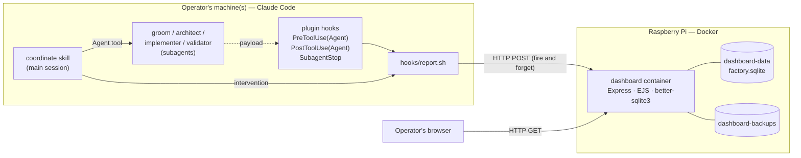

# Agent Factory Dashboard – architecture

## System context

The product has two halves. They live in the same repository and run as different things.

1. **The factory** — the Claude Code plugin in `plugins/factory/` (four agents, five skills). It
   runs natively inside Claude Code on the operator's machine, in this repository and in any other.
2. **The dashboard** — a small web application in `dashboard/`, one Docker container on the
   operator's Raspberry Pi. It stores what the factory reports and renders it as three tabs and a
   ticket detail page for a desktop browser.

The factory reports through **Claude Code hooks** that the plugin ships: a POSIX shell script posts
the raw hook payload to the dashboard with `curl`. Nothing connects the dashboard back to the
factory — it only shows.



There are no external services: no third-party API, no CDN, no font service, no telemetry. The
container makes no outbound connection at all.

## Hard constraints

| Constraint | Source | Budget / number | Verified by |
|---|---|---|---|
| Runs on a Raspberry Pi shared with the factory | 001 SC1, QE1 | Whole product ≤ 256 MB RAM and ≤ 1.0 CPU; assume Pi 4/5, arm64, ≥ 4 GB → ≥ 3.3 GB left for Claude Code and the OS | T-RES-1, T-PERF-1 |
| Dockerized, one compose file | 001 SC2 | 1 service, `docker compose up -d` | T-DEPLOY-1 |
| Images built for the target CPU | 001 SC1 | `linux/arm64` | T-ARCH-1 |
| Opening and switching tabs feels immediate | 001 QE2, QE5 | `GET /` p95 < 300 ms, `GET /ticket/...` p95 < 200 ms at 300 tickets / 3 000 runs on 1 CPU / 256 MB; tab switch < 50 ms with no network | T-PERF-1, T-PERF-2 |
| Reporting never breaks or slows the factory | 001 R9, QE6 | 0 tokens; ≤ 2 s (start) and ≤ 5 s (finish) worst case; the reporter exits 0 on every path | T-R9-1…3 |
| Reporting target configurable per installation | 001 R10, SC3, SC4 | Environment, then `~/.factory/dashboard.env`; no host, port or path hard-coded in the repository | T-CFG-1 |
| History kept forever | 001 R8, D9 | Nothing is ever deleted; ≈ 13 MB/year | T-DATA-1 |
| Dark appearance only, desktop browser | 001 QE3, QE4 | One stylesheet, no `prefers-color-scheme`, no media query below 1024 px | T-UI-1 |
| No login, no accounts, no roles | 001 D8, out of scope | No user table, no session, no auth on read routes | T-UI-1 |
| The dashboard never acts | 001 D1, out of scope | No write route reachable from the browser | T-INT-9 |

## Stack

| Layer | Technology and version | Why (ADR) |
|---|---|---|
| Runtime | Node.js 22 LTS on `node:22-bookworm-slim` | ADR-0001 |
| Language | TypeScript 5, compiled to ESM | ADR-0001 |
| HTTP | Express 5 | ADR-0001 |
| Templating | EJS 3, auto-escaping `<%= %>` | ADR-0001, ADR-0002 |
| Database | SQLite via `better-sqlite3` 11, file in a named volume | ADR-0001 |
| Client code | One hand-written `app.js` (~40 lines) plus native `<details>`; no framework, no bundler | ADR-0002 |
| Fonts | IBM Plex Sans + IBM Plex Mono, self-hosted `woff2` from pinned `@fontsource/*` dev dependencies | 001 design decision 7 |
| Tests | Vitest 3, supertest, cheerio, shellcheck | ADR-0001 |
| Reporting transport | Claude Code plugin hooks running POSIX `sh` + `curl` | ADR-0003, ADR-0004 |
| Container | One image, multi-stage, non-root `node` user | ADR-0001 |

Production dependencies are exactly three: `express`, `ejs`, `better-sqlite3`. Anything beyond that
needs a requirement.

## Components

| Component | Responsibility | Code |
|---|---|---|
| `dashboard/src/server.ts` | Express app, config, routes, error handler, request log, startup | `dashboard/src/` |
| `dashboard/src/db/` | Schema, forward-only migrations, every prepared statement | `dashboard/src/db/` |
| `dashboard/src/ingest/` | The three write endpoints, meta decoding, tolerant payload parsing, run matching, idempotency | `dashboard/src/ingest/` |
| `dashboard/src/domain/` | Attention rules, stage mapping, ticket metrics, weekly trends, the design's formatters — pure functions over plain data and an injected `now` | `dashboard/src/domain/` |
| `dashboard/src/views/` | EJS templates: layout, overview with its three tabs, detail, empty, error | `dashboard/src/views/` |
| `dashboard/src/public/` | `app.js`, `app.css`, `fonts/` | `dashboard/src/public/` |
| `dashboard/src/jobs/` | Abandoned-run sweeper, nightly backup with startup catch-up | `dashboard/src/jobs/` |
| `plugins/factory/hooks/hooks.json` | Registers `PreToolUse(Agent\|Task)`, `PostToolUse(Agent\|Task)`, `SubagentStop` | `plugins/factory/hooks/` |
| `plugins/factory/hooks/report.sh` | The reporter: `run-start`, `run-finish`, `intervention`; always exits 0 | `plugins/factory/hooks/` |

## Data model

Five tables in one SQLite file, all owned by the dashboard. Field-level detail is in
`docs/architecture/001-agent-factory-dashboard.md` §Data model.

- `ticket` — one row per `(repository, requirements number)`. Title, current requirements status,
  current agent status, first seen, last activity, validated at. Only the number and the title are
  ever displayed (ADR-0006).
- `run` — one agent run *or* one operator intervention on one ticket: actor, start, end, result,
  tokens, the agent's verbatim final message, the statuses before and after.
- `ticket_status_event` — the append-only status trail.
- `hook_cursor` — the last cumulative token counter per session and transcript, for the token
  delta (ADR-0004).
- `schema_migration` — applied migrations.

There is no user, session, role, permission or settings table: the two attention thresholds are
environment configuration (ADR-0005).

## Deployment and runtime

One compose stack with a single service. The database is a file in a named volume, so there is no
database container and nothing to wait for at startup.

| Service | Image or build | Ports | Volumes | Memory limit |
|---|---|---|---|---|
| `dashboard` | build `./dashboard` (multi-stage, `node:22-bookworm-slim`, non-root) | `${DASHBOARD_BIND:-0.0.0.0}:${DASHBOARD_PORT:-8787}:8787` | `dashboard-data:/data`, `dashboard-backups:/backups` | `mem_limit: 256m`, `cpus: "1.0"` |

- **Volumes.** `dashboard-data` holds `/data/factory.sqlite` and its WAL files — the whole history.
  `dashboard-backups` holds the last 14 nightly copies.
- **Configuration.** `.env` at the repository root (not committed; `*.env` is in `.gitignore`),
  with `.env.example` committed and complete: `DASHBOARD_PORT`, `DASHBOARD_BIND`, `TZ`,
  `LOOP_THRESHOLD`, `IDLE_HOURS`, `RUN_STALE_HOURS`, `FACTORY_INGEST_TOKEN`, `BACKUP_AT`,
  `BACKUP_KEEP`. Each reporting machine has `~/.factory/dashboard.env` with
  `FACTORY_DASHBOARD_URL`, `FACTORY_INGEST_TOKEN` and optionally `FACTORY_PROJECT_KEY`.
- **Access.** `http://<pi-host>:8787/` on the home network. No TLS, no reverse proxy, no login, no
  published database port. The only secret in the product is the optional ingest token.
- **Backups.** A nightly online SQLite backup at `BACKUP_AT`, caught up at startup when the newest
  is older than 24 h, `BACKUP_KEEP` copies retained. Restore: stop the stack, copy a backup over
  `factory.sqlite`, remove the `-wal`/`-shm` files, start it again.
- **Start.** One command, locally and on the Pi:

```bash
docker compose up -d
```

## Conventions

- **Code structure**: `src/<layer>/<file>.ts`, ESM, no default exports, no barrel files. Everything
  in `domain/` is a pure function over plain data plus `now` and the thresholds — it never reads
  the clock, the database or the environment.
- **Time**: epoch milliseconds (`INTEGER`) in the database, always UTC. Display zone from `TZ`
  (default `Europe/Berlin`), converted only in the formatting layer. ISO weeks start Monday.
- **HTTP**: read routes render HTML with `Cache-Control: no-store` and the product CSP. Ingest
  routes take the raw hook payload as the body and a base64 `X-Factory-Meta` header, answer `204`
  on success and never ask for a retry.
- **Errors**: one Express error handler; a dark error page for reads, a status code and a log line
  for ingest. No error ever reaches the factory.
- **Logging**: one JSON line per request on stdout, plus `report_drop`, `report_ignored`,
  `backup_done`, `sweep_done`. No log library. Docker's json-file driver capped at 3 × 10 MB.
- **Migrations**: numbered SQL files in `dashboard/migrations/NNN_<name>.sql`, applied in order at
  startup, one transaction each, recorded in `schema_migration`. Forward only; an applied file is
  never edited.
- **Templates**: `<%= %>` everywhere. `<%- %>` is allowed only for markup this codebase produced,
  never for anything an agent reported.
- **Styling**: the supplied design's inline styles stay inline in the templates, so the running UI
  can be diffed against the design file line by line. Only shared rules (`html`, `body`,
  scrollbars, the `af-pulse` keyframe, `@font-face`, `:hover`) live in `app.css`.
- **Tests**: `dashboard/test/<area>.test.ts`, Vitest. Unit tests for `domain/` and the payload
  parsers (against captured real payloads), integration tests through supertest against a temp-file
  database, DOM assertions with cheerio, stack tests behind `npm run test:stack`.
- **Shell**: the reporter is POSIX `sh` (shellcheck clean, no bashisms), uses only `cat`, `grep`,
  `sed`, `awk`, `date`, `base64`, `curl` and `git`, writes nothing to stdout, and always exits 0.

## Design index

| # | Title | Status |
|---|---|---|
| 001 | Agent Factory Dashboard | Designed |

## ADR index

| # | Decision |
|---|---|
| 0001 | The dashboard is one Node + SQLite container that renders HTML on the server |
| 0002 | The supplied design file becomes EJS templates with its inline styles kept verbatim |
| 0003 | The factory reports through Claude Code hooks, not through a skill the agents call |
| 0004 | The reporter ships raw payloads; the dashboard parses them, and tokens are a cumulative delta |
| 0005 | The two attention thresholds are installation configuration, not a screen |
| 0006 | A ticket is identified internally by (project, number) and shown as its number |
